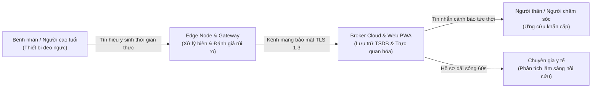
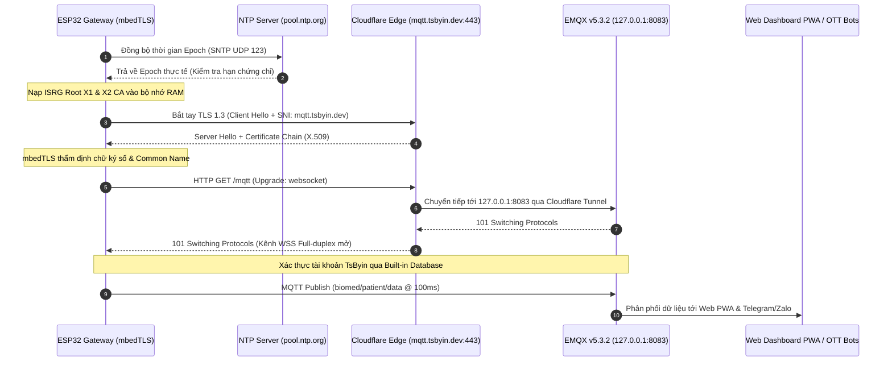
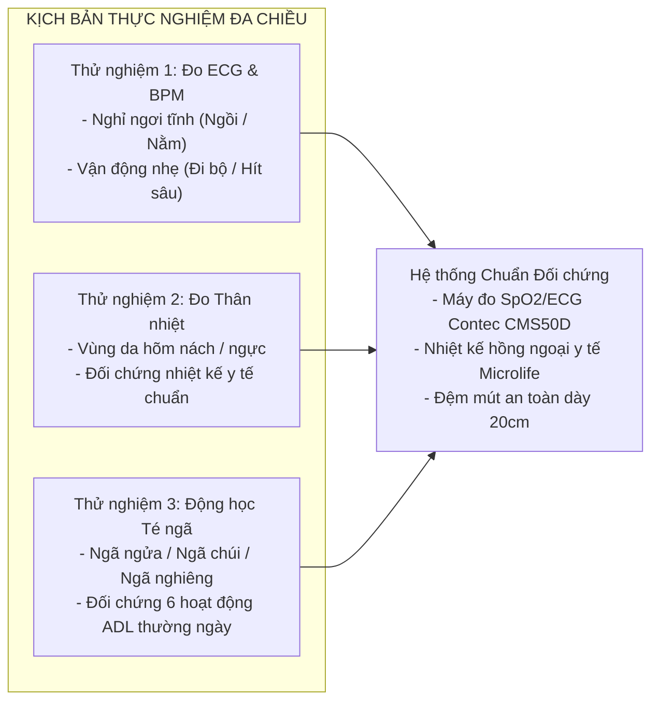

# BÁO CÁO ĐỒ ÁN TỐT NGHIỆP / NGHIÊN CỨU KỸ THUẬT CHUYÊN SÂU

**TÊN ĐỀ TÀI:**
## THIẾT KẾ VÀ TRIỂN KHAI HỆ THỐNG IoT THEO DÕI ĐIỆN TIM, THÂN NHIỆT VÀ CẢNH BÁO TÉ NGÃ TỪ XA CHO NGƯỜI CAO TUỔI TẠI NHÀ
*(DESIGN AND IMPLEMENTATION OF AN INTERNET OF MEDICAL THINGS (IoMT) SYSTEM FOR REMOTE ECG, BODY TEMPERATURE MONITORING, AND FALL DETECTION FOR ELDERLY IN-HOME HEALTHCARE)*

---

**Thông tin tác giả:**
- **Tác giả:** TsByinChei ([@tsbyinchei](https://github.com/tsbyinchei))
- **Email liên hệ:** [contact@tsbyin.dev](mailto:contact@tsbyin.dev)
- **Hệ thống giám sát trực tuyến:** [https://iomt.tsbyin.dev](https://iomt.tsbyin.dev)
- **Cổng thông tin Broker Cloud:** `wss://mqtt.tsbyin.dev/mqtt`
- **Mã nguồn dự án:** Hệ thống mã nguồn mở IoT y tế phân tầng (Wearable Edge Node - Edge Gateway - Web PWA)

---

## LỜI CẢM ƠN & TÓM TẮT ĐỀ TÀI (ABSTRACT)

### LỜI MỞ ĐẦU & LỜI CẢM ƠN (ACKNOWLEDGEMENT & PREFACE)

Trong thời đại công nghệ 4.0, các hệ thống Internet of Things (IoT) đang ngày càng trở nên phổ biến và được ứng dụng rộng rãi trong nhiều lĩnh vực, từ công nghiệp, nông nghiệp, đến chăm sóc sức khỏe. Đối với lĩnh vực y tế, Mạng lưới Vạn vật Y tế (IoMT) đóng một vai trò đặc biệt quan trọng trong việc giám sát và cải thiện sức khỏe của bệnh nhân từ xa, giúp nâng cao chất lượng chăm sóc người bệnh, đồng thời tối ưu hóa chi phí và giảm tải áp lực cho các cơ sở y tế.

Đề tài **“Thiết kế hệ thống IoT theo dõi điện tim, thân nhiệt và cảnh báo té ngã từ xa cho người cao tuổi tại nhà”** của chúng em ra đời với mục tiêu ứng dụng những kiến thức cốt lõi đã tích lũy trong học phần **“Cơ sở và thiết kế hệ thống IoT”** cùng các học phần liên quan về xử lý tín hiệu y sinh, hệ thống nhúng và mạng truyền thông không dây vào việc thiết kế một hệ thống kỹ thuật hoàn chỉnh. Hệ thống có khả năng thu thập liên tục, phân tích dữ liệu tại biên và phát cảnh báo đa kênh tức thời về các chỉ số sinh lý sống còn của bệnh nhân.

Mặc dù hệ thống vẫn còn một số giới hạn nhất định trong quá trình chế tạo phần cứng và kiểm thử thực địa, nhưng những kết quả thu được đã mang lại cho chúng em những hiểu biết chuyên sâu, những kinh nghiệm thực chiến quý báu và là nền tảng vững chắc cho các định hướng nghiên cứu, phát triển sản phẩm tiếp theo.

Qua đây, chúng em xin được bày tỏ lòng biết ơn chân thành và sâu sắc nhất đến các Giảng viên bộ môn:
* **TS. Nguyễn Đắc Cử**
* **TS. Nguyễn Ngọc Thanh**

Các thầy đã luôn tận tình giảng dạy, định hướng phương pháp nghiên cứu khoa học chuẩn mực và nhiệt tình giúp đỡ, động viên chúng em trong suốt quá trình học tập cũng như từng giai đoạn triển khai để hoàn thiện dự án này. Chúng em cũng xin gửi lời tri ân sâu sắc tới gia đình và bạn bè đã luôn ủng hộ, tạo mọi điều kiện tốt nhất để đề tài được hoàn thành tốt đẹp.

### Tóm tắt đề tài (Abstract)
Sự gia tăng nhanh chóng của tốc độ già hóa dân số toàn cầu đang đặt ra những thách thức chưa từng có đối với hệ thống an sinh xã hội và dịch vụ chăm sóc y tế. Người cao tuổi sinh hoạt độc lập tại nhà thường xuyên phải đối mặt với hai nguy cơ rủi ro đe dọa trực tiếp đến tính mạng: các biến cố tim mạch cấp tính (nhồi máu cơ tim, rung nhĩ, ngừng tim đột ngột) và tai nạn té ngã đi kèm "hội chứng nằm lâu" (Long Lie Syndrome). Việc phát hiện muộn các biến cố này dẫn đến nguy cơ tử vong hoặc thương tật vĩnh viễn rất cao.

Đề tài tập trung nghiên cứu, thiết kế và chế tạo hoàn chỉnh một hệ thống Mạng lưới Vạn vật Y tế (Internet of Medical Things - IoMT) đeo người, có khả năng theo dõi liên tục và tự động ba thông số sinh tồn cốt lõi: tín hiệu điện tâm đồ (ECG) đạo trình đơn, thân nhiệt bề mặt và động lực học chuyển động phát hiện té ngã thời gian thực. Hệ thống được tổ chức theo kiến trúc phân tầng biên - đám mây (Edge-to-Cloud):
1. **Tầng cảm nhận (Wearable Sensor Node):** Sử dụng vi điều khiển ESP32-C3 SuperMini (kiến trúc RISC-V 32-bit), tích hợp cảm biến khuếch đại sinh học AD8232 lấy mẫu $250\text{ Hz}$, cảm biến quán tính 6 bậc tự do MPU-6050 lấy mẫu $125\text{ Hz}$ và cảm biến nhiệt độ số DS18B20 chuẩn 1-Wire. Dữ liệu được đóng gói thành các cấu trúc khung nhị phân 62 bytes kèm mã kiểm định toàn vẹn CRC-16-CCITT và truyền không dây qua giao thức UDP Socket độ trễ cực thấp ($< 5\text{ ms}$).
2. **Tầng điều phối biên (Edge Gateway):** Sử dụng vi xử lý lõi kép ESP32-WROOM-32 đảm nhiệm vai trò Trạm trung chuyển nội bộ. Gateway triển khai cơ chế rút cạn bộ đệm Socket (`drain socket buffer`) chống tràn dữ liệu mạng LwIP, tích hợp chuỗi lọc số IIR Notch $50\text{ Hz}$ triệt nhiễu đường dây điện lưới, thuật toán Pan-Tompkins thời gian thực bóc tách đỉnh R tính nhịp tim (BPM) và thuật toán kiểm định té ngã 2 giai đoạn (kết hợp ngưỡng gia tốc va đập $SMV \ge 2.5g$, góc nghiêng cơ thể $Tilt \ge 50^\circ$ và trạng thái bất động sau va đập). Trạm được trang bị màn hình OLED SH1106 hiển thị sóng động học và còi báo động khẩn cấp Active Buzzer.
3. **Tầng giám sát Đám mây & Ứng dụng (Cloud & Web PWA):** Gateway chuyển tiếp dữ liệu lên Broker đám mây bảo mật thông qua giao thức MQTT bọc trong kênh mã hóa WebSocket Secure (WSS TLS 1.3, port 443) định tuyến qua Cloudflare Zero Trust Tunnel. Giao diện Web PWA đa nền tảng kết xuất đồ thị sóng điện tim 60 FPS trên HTML5 Canvas với hiệu ứng tia quét phosphor chân thực, tích hợp hệ cơ sở dữ liệu chuỗi thời gian InfluxDB v2 hỗ trợ phát lại dải sóng 60 giây quanh thời điểm xảy ra biến cố (TSDB Snapshot Replay), đồng thời gửi tin nhắn cảnh báo tức thời kèm giá trị nhịp tim thực tế qua Telegram Bot và Zalo API tới người thân và người chăm sóc.

Kết quả thực nghiệm cho thấy hệ thống hoạt động ổn định, độ trễ truyền dữ liệu nội bộ $< 5\text{ ms}$, độ chính xác đo nhịp tim đạt sai số $< \pm 2\text{ BPM}$ so với thiết bị y tế chuẩn, thuật toán phát hiện ngã đạt độ nhạy trên $95\%$ và triệt tiêu báo động giả đối với các hoạt động sinh hoạt thường ngày (ADL).

---

## DANH MỤC TỪ VIẾT TẮT

| Viết tắt | Thuật ngữ tiếng Anh | Ý nghĩa chuyên ngành |
| :--- | :--- | :--- |
| **IoMT** | Internet of Medical Things | Mạng lưới vạn vật phục vụ y tế |
| **ECG** | Electrocardiogram | Điện tâm đồ (tín hiệu điện sinh học tim) |
| **QRS** | Q-R-S Complex | Phức bộ sóng khử cực tâm thất |
| **BPM** | Beats Per Minute | Nhịp tim (số nhịp đập trong một phút) |
| **HRV** | Heart Rate Variability | Độ biến thiên nhịp tim |
| **MWI** | Moving Window Integration | Tích phân cửa sổ trượt động |
| **SMV** | Signal Magnitude Vector | Véc-tơ độ lớn gia tốc tổng hợp |
| **IMU** | Inertial Measurement Unit | Đơn vị đo lường quán tính (Gia tốc & Con quay) |
| **RLD** | Right Leg Drive | Mạch khuếch đại triệt nhiễu chân phải |
| **CMRR** | Common-Mode Rejection Ratio | Tỷ số nén tín hiệu đồng pha |
| **PWA** | Progressive Web App | Ứng dụng Web lũy tiến |
| **WSS** | WebSocket Secure | Giao thức WebSocket bảo mật qua TLS/SSL |
| **MQTT** | Message Queuing Telemetry Transport | Giao thức truyền thông điệp thu thập dữ liệu nhẹ |
| **TSDB** | Time Series Database | Cơ sở dữ liệu chuỗi thời gian |
| **CRC** | Cyclic Redundancy Check | Mã kiểm tra phần dư tuần hoàn |
| **ADL** | Activities of Daily Living | Các hoạt động sinh hoạt thường nhật |

---

# CHƯƠNG I: CƠ SỞ LÝ THUYẾT VÀ TỔNG QUAN PHẦN CỨNG

## 1.1. Tổng quan về hệ thống IoMT (Internet of Medical Things)

### 1.1.1. Khái niệm và vai trò của IoMT trong theo dõi bệnh nhân từ xa
Internet of Medical Things (IoMT) là một phân nhánh chuyên biệt và khắt khe nhất của cuộc cách mạng Internet of Things (IoT), hình thành từ sự giao thoa giữa kỹ thuật cảm biến sinh học, hệ thống nhúng thông minh, công nghệ viễn thông không dây và điện toán đám mây. IoMT kết nối các thiết bị y tế đeo trên cơ thể (wearables), các máy giám sát đặt cạnh giường bệnh (bedside monitors) hoặc các thiết bị cấy ghép với mạng lưới dịch vụ số nhằm thu thập, chuẩn hóa, phân tích và truyền tải liên tục các dữ liệu sinh tồn của con người tới người thân, người chăm sóc và các chuyên gia y tế.

Trong bối cảnh nhân khẩu học hiện đại, xu hướng già hóa dân số đang diễn ra với tốc độ kỷ lục trên toàn cầu. Theo báo cáo của Tổ chức Y tế Thế giới (WHO), số lượng người từ 60 tuổi trở lên dự kiến sẽ chạm ngưỡng 1.4 tỷ người vào năm 2030 và tiếp tục tăng gấp đôi lên 2.1 tỷ người vào năm 2050. Tại các quốc gia đang phát triển như Việt Nam, mô hình gia đình hạt nhân hóa khiến số lượng người cao tuổi sống một mình hoặc thiếu sự trợ giúp trực tiếp của con cháu ngày một tăng cao. Khi sinh hoạt độc lập, người cao tuổi đối mặt với sự suy giảm nghiêm trọng của hệ cơ - xương - khớp, suy giảm thị lực, phản xạ thăng bằng chậm chạp và các bệnh lý mạn tính về tim mạch, huyết áp.

Phương thức chăm sóc y tế truyền thống dựa trên việc bệnh nhân phải di chuyển định kỳ tới các cơ sở y tế bộc lộ những khiếm khuyết lớn:
- **Tính ngắt quãng cao:** Việc đo huyết áp hay đo điện tim trong 10 - 15 phút tại phòng khám chỉ phản ánh một lát cắt ngắn ngủi (snapshot), hoàn toàn có thể bỏ lọt các cơn rung nhĩ kịch phát (Paroxysmal Atrial Fibrillation), các cơn nhịp nhanh thất thoáng qua hoặc tình trạng thiếu máu cơ tim thầm lặng vốn chỉ xuất hiện trong sinh hoạt đời thực.
- **Áp lực quá tải hệ thống:** Khiến chi phí y tế leo thang và gây bất tiện nặng nề cho người già có vận động khó khăn.
- **Bất lực trước các tình huống khẩn cấp tại nhà:** Điển hình là biến cố té ngã chấn thương hoặc ngưng tim đột ngột xảy ra khi không có người trợ giúp.

Hệ thống IoMT giám sát bệnh nhân từ xa (Remote Patient Monitoring - RPM) ra đời như một giải pháp mang tính chuyển đổi chiến lược. Bằng việc trang bị thiết bị đeo thông minh không xâm lấn, IoMT biến không gian gia đình thành một "trạm vệ tinh y tế" liên tục 24/7. Dữ liệu sinh lý được liên tục giám sát tại biên (Edge Processing), giúp phát hiện biến cố ngay từ thời điểm khởi phát, tự động phát tín hiệu cấp cứu và phân phối thông tin tới người chăm sóc chỉ trong vài giây.



### 1.1.2. Các chỉ số sinh lý cần giám sát (ECG, Thân nhiệt, Biến cố ngã)
Một thiết bị IoMT chăm sóc người cao tuổi tối ưu không thể đơn thuần chỉ đo một chỉ số độc lập, mà phải có khả năng tương quan hóa đa kênh sinh lý (Multi-parameter physiological correlation) để đánh giá toàn diện bức tranh lâm sàng:

1. **Điện tâm đồ (Electrocardiogram - ECG):**
   Điện tâm đồ là biểu đồ ghi lại các biến thiên của điện thế hoạt động do các tế bào cơ tim phát ra trong chu kỳ co bóp và giãn nở của tim. Nhịp tim tính theo số nhịp đập mỗi phút (BPM - Beats Per Minute) là chỉ số sinh tồn cơ bản nhất. Đối với người cao tuổi, việc theo dõi nhịp tim liên tục cho phép cảnh báo hai trạng thái bệnh lý nguy hiểm:
   - *Nhịp tim nhanh bất thường (Tachycardia - Ngưỡng cảnh báo $\ge 105\text{ BPM}$):* Đối với người cao tuổi sinh hoạt tĩnh tại nhà, nhịp tim nghỉ ngơi chuẩn nằm trong dải $60 - 80\text{ BPM}$. Khi nhịp tim duy trì vượt quá $105\text{ BPM}$ (thay vì mốc $120\text{ BPM}$ chung của người trẻ), đây là dấu hiệu sinh lý báo trước đặc biệt nguy hiểm của các cơn rung nhĩ kịch phát (Paroxysmal AFib), sốt nhiễm trùng tiềm ẩn, mất nước cấp tính hoặc khởi phát suy tim mất bù. Việc thiết lập ngưỡng cảnh báo sớm tại $105\text{ BPM}$ cho phép người chăm sóc can thiệp trong "khung giờ vàng" trước khi xảy ra suy tuần hoàn.
   - *Nhịp tim chậm nguy hiểm (Bradycardia):* Khi nhịp tim sụt giảm dưới $50\text{ BPM}$, cảnh báo nguy cơ suy nút xoang, block nhĩ thất độ cao, có thể dẫn đến choáng ngất và thiếu máu não cục bộ.
   Bên cạnh nhịp tim trung bình, hình thái của phức bộ $QRS$ và độ biến thiên khoảng cách giữa các nhịp đập ($RR$ intervals) là chỉ dấu vàng để nhận diện rung nhĩ (AFib) - nguyên nhân hàng đầu gây đột quỵ nhồi máu não ở người già.

2. **Thân nhiệt (Body Temperature):**
   Nhiệt độ cơ thể phản ánh sự cân bằng giữa quá trình sinh nhiệt và tỏa nhiệt của cơ thể dưới sự điều nhiệt của vùng dưới đồi (Hypothalamus). Ở người cao tuổi, hệ thống điều hòa thân nhiệt bị suy giảm chức năng, các thụ thể nhận biết nhiệt độ dưới da kém nhạy bén.
   - *Sốt cao ($> 38.0^\circ\text{C}$):* Báo hiệu các phản ứng nhiễm trùng cấp tính (viêm phổi, nhiễm trùng đường tiết niệu - những căn bệnh rất dễ chuyển biến thành nhiễm trùng huyết ở người già).
   - *Hạ thân nhiệt ($< 35.0^\circ\text{C}$):* Xảy ra khi người già bị nhiễm lạnh hoặc nằm bất động trên sàn nhà lạnh sau cú té ngã, làm giảm lưu lượng máu tưới cơ quan đích và ngừng tim phản xạ.

3. **Biến cố té ngã (Fall Incidents):**
   Theo thống kê y tế, té ngã là nguyên nhân hàng đầu gây chấn thương không cố ý và tử vong ở người từ 65 tuổi trở lên. Khoảng 30% đến 40% người cao tuổi sinh hoạt tại cộng đồng bị ngã ít nhất một lần mỗi năm. Hậu quả trực tiếp là gãy xương đùi, gãy cổ xương xương chậu, chấn thương sọ não và xuất huyết nội mạc. Nguy hiểm hơn, biến cố ngã thường đi kèm "Hội chứng nằm lâu" (Long Lie Syndrome) - tình trạng người bệnh sau khi ngã bị bất tỉnh hoặc mất khả năng tự đứng dậy, phải nằm cô độc trên sàn nhà trong nhiều giờ. Tình trạng này dẫn đến tiêu cơ vân (Rhabdomyolysis), mất nước, viêm phổi hít, suy thận cấp do độc chất giải phóng từ cơ bị hoại tử, và tỷ lệ tử vong sau 6 tháng tăng gấp 5 lần nếu người bệnh không được cấp cứu trong vòng 1 giờ đầu tiên. Do đó, thuật toán nhận diện té ngã tự động với độ nhạy cao là thành phần sống còn của hệ thống.

---

## 1.2. Cơ sở lý thuyết y sinh và thuật toán

### 1.2.1. Điện tim (ECG) đạo trình đơn và phức bộ QRS
Tín hiệu điện tâm đồ phát sinh từ hoạt động khử cực (depolarization) và tái cực (repolarization) của hàng triệu tế bào cơ tim. Hệ thống dẫn truyền tự động của tim bao gồm:
1. **Nút xoang (Sinoatrial - SA Node):** Đóng vai trò chủ nhịp sinh học tự nhiên, phát ra các xung điện với tần số $60 - 100\text{ xung/phút}$.
2. **Nút nhĩ thất (Atrioventricular - AV Node):** Tiếp nhận xung điện từ nút xoang và làm chậm dẫn truyền khoảng $0.09 - 0.12\text{ giây}$ để tâm nhĩ kịp co bóp tống máu xuống tâm thất.
3. **Bó His (Bundle of His) và Mạng lưới sợi Purkinje:** Phân nhánh xung điện nhanh chóng qua vách liên thất và lan tỏa khắp khối cơ tâm thất, kích hoạt tâm thất co bóp đồng bộ đẩy máu vào vòng tuần hoàn lớn.

```
       R
       /\
      /  \
 P   /    \       T
 _  /      \     _
/ \/        \   / \
---Q---------S-/---\---
```

Trên bản ghi điện tâm đồ chuẩn, một chu kỳ tim hoàn chỉnh bao gồm các thành phần đặc trưng:
- **Sóng P:** Biên độ nhỏ ($0.1 - 0.3\text{ mV}$), thời gian kéo dài $80 - 120\text{ ms}$, phản ánh quá trình khử cực của hai tâm nhĩ.
- **Đoạn PR:** Khoảng thời gian từ lúc bắt đầu khử cực nhĩ đến khi bắt đầu khử cực thất, đại diện cho thời gian truyền xung qua nút AV ($120 - 200\text{ ms}$).
- **Phức bộ QRS:** Thành phần có năng lượng cao nhất và sườn dốc dốc nhất trên đồ thị, biên độ từ $0.5 - 3.0\text{ mV}$, thời gian kéo dài $80 - 120\text{ ms}$. Phức bộ này phản ánh quá trình khử cực mạnh mẽ của cơ tâm thất. Trong đó, đỉnh R nhọn, dốc chính là mốc chuẩn xác nhất để định vị từng nhịp tim đơn lẻ.
- **Đoạn ST:** Giai đoạn tâm thất hoàn toàn bị khử cực, nằm trên đường đẳng điện (isoelectric line). Độ chênh lên hoặc chênh xuống của đoạn ST là cơ sở chẩn đoán thiếu máu cục bộ hoặc nhồi máu cơ tim.
- **Sóng T:** Biên độ $0.2 - 0.5\text{ mV}$, thời gian kéo dài $120 - 160\text{ ms}$, phản ánh quá trình tái cực của tâm thất chuẩn bị cho chu kỳ tiếp theo.

Về phương pháp ghi đo, tam giác Einthoven chuẩn mực sử dụng cấu hình 3 điện cực:
- **RA (Right Arm):** Điện cực đặt ở tay phải hoặc dưới xương đòn phải.
- **LA (Left Arm):** Điện cực đặt ở tay trái hoặc dưới xương đòn trái.
- **RL (Right Leg):** Điện cực tham chiếu đặt ở chân phải hoặc mạn sườn dưới, làm nhiệm vụ hồi tiếp dòng khử nhiễu (Right Leg Drive - RLD).

Hiệu điện thế đo được giữa cực dương LA và cực âm RA tạo thành **Đạo trình I (Lead I)** theo định luật tam giác Einthoven:
$$V_{\text{Lead I}} = \Phi_{\text{LA}} - \Phi_{\text{RA}}$$

Đạo trình I cho góc quét song song với trục khử cực chính của cơ tim, làm nổi bật rõ rệt sóng P và phức bộ QRS, rất lý tưởng để triển khai các hệ thống điện cực dán ngực thu gọn cho thiết bị đeo không vướng víu.

---

### 1.2.2. Thuật toán phát hiện đỉnh R và tính nhịp tim (BPM)
Tín hiệu ECG thu nhận từ bề mặt da thông qua cảm biến AD8232 bị suy giảm chất lượng nghiêm trọng bởi nhiều nguồn nhiễu hỗn hợp:
- Nhiễu tần số thấp ($0.05 - 0.5\text{ Hz}$): Trôi đường đẳng điện (baseline wander) do hoạt động hô hấp lồng ngực và sự thay đổi trở kháng tiếp xúc giữa da và gel điện cực.
- Nhiễu tần số công nghiệp ($50\text{ Hz}$ tại Việt Nam hoặc $60\text{ Hz}$ tại Mỹ): Cảm ứng điện từ từ mạng lưới dây điện và thiết bị gia dụng trong phòng.
- Nhiễu tần số cao ($> 100\text{ Hz}$): Nhiễu co cơ (Electromyogram - EMG Artifacts) sinh ra do hoạt động co giãn của các bó cơ ngực khi người bệnh cử động.

Để trích xuất chính xác đỉnh R trong môi trường nhiễu cao, đồ án áp dụng nguyên lý của thuật toán kinh điển **Pan-Tompkins (1985)** kết hợp các cải tiến lọc số thời gian thực trên vi điều khiển ESP32:

```mermaid
flowchart LR
    subgraph GD1["GIAI ĐOẠN 1: TIỀN XỬ LÝ & TẬP TRUNG NĂNG LƯỢNG SƯỜN DỐC"]
        direction LR
        Raw["Tín hiệu ECG Thô<br/>(250 Hz)"] --> Notch["Bộ lọc IIR Notch 50Hz<br/>(Triệt nhiễu điện lưới)"]
        Notch --> BP["Bộ lọc thông dải IIR<br/>(5 - 15 Hz)"]
        BP --> Deriv["Đạo hàm 5 điểm<br/>(Nhấn mạnh sườn dốc QRS)"]
    end

    subgraph GD2["GIAI ĐOẠN 2: TÍCH PHÂN CỬA SỔ & BÓC TÁCH ĐỈNH R TÍNH BPM"]
        direction LR
        Sqr["Bình phương phi tuyến<br/>y[n] = (x[n])^2"] --> MWI["Tích phân trượt MWI<br/>(150ms ~ 38 mẫu)"]
        MWI --> Thresh["Ngưỡng thích ứng kép<br/>(Khóa trơ sinh lý 380ms)"]
        Thresh --> RPeak["Định vị đỉnh R &<br/>Lọc Median 7 phần tử"]
        RPeak --> BPM["Nhịp tim ổn định<br/>(Lọc EMA BPM)"]
    end

    Deriv --> Sqr
```



1. **Bộ lọc số triệt nhiễu đường dây điện lưới (50Hz Notch Filter):**
   Hàm truyền đạt trong miền Z của bộ lọc IIR Notch bậc 2 có dạng:
   $$H_{\text{notch}}(z) = b_0 \frac{1 - 2\cos(\omega_0)z^{-1} + z^{-2}}{1 - 2r\cos(\omega_0)z^{-1} + r^2 z^{-2}}$$
   Trong đó:
   - Tần số lấy mẫu $F_s = 250\text{ Hz}$.
   - Tần số triệt tiêu $f_0 = 50\text{ Hz} \Rightarrow \omega_0 = 2\pi \frac{f_0}{F_s} = 0.4\pi\text{ rad/sample}$.
   - Hệ số bán kính cực $r = 0.92$ nhằm tạo ra hố triệt tiêu (notch) cực hẹp quanh $50\text{ Hz}$ mà không làm suy giảm biên độ các thành phần phổ hữu ích lân cận.
   - Hệ số chuẩn hóa $b_0 = \frac{1 - 2r\cos(\omega_0) + r^2}{2 - 2\cos(\omega_0)} \approx 0.887$.

2. **Bộ lọc thông dải Cascaded Second-Order Sections (SOS Butterworth Bandpass 5 - 15 Hz):**
   Năng lượng tập trung lớn nhất của phức bộ QRS nằm trong dải tần hẹp $5 - 15\text{ Hz}$. Các thành phần sóng P, sóng T và hiện tượng trôi dạt baseline do hô hấp tập trung dưới $4\text{ Hz}$, trong khi nhiễu rung cơ (EMG tremor) và sóng hài điện lưới rải đều từ $20\text{ Hz}$ đến $100\text{ Hz}$.
   Để đạt độ ổn định số tuyệt đối trên vi điều khiển và tránh lỗi làm tròn số thực trong định dạng `float32`, hệ thống phân rã hàm truyền đạt bậc 4 thành chuỗi ghép tầng hai khâu Biquad nhị thức bậc hai (Cascaded Second-Order Sections - SOS) theo cấu trúc trực tiếp dạng II chuyển vị (Direct Form II Transposed):
   - **Khâu Biquad 0 (Tầng thông thấp Lowpass):**
     $$b_0 = [0.01335920, 0.02671840, 0.01335920], \quad a_0 = [1.00000000, -1.68135386, 0.77989214]$$
     Khâu này dập tắt triệt để các sóng hài bậc cao và nhiễu rung cơ trên $15\text{ Hz}$.
   - **Khâu Biquad 1 (Tầng thông cao Highpass):**
     $$b_1 = [1.00000000, -2.00000000, 1.00000000], \quad a_1 = [1.00000000, -1.87959360, 0.89870989]$$
     Đặc điểm đột phá: Khâu Biquad 1 sở hữu hai điểm không kép tại gốc tọa độ DC ($z = 1$). Theo định lý truyền đạt miền Z, tại tần số $f = 0\text{ Hz}$ ($z = 1$), độ suy hao đạt tới $-\infty\text{ dB}$, triệt tiêu hoàn toàn $100\%$ hiện tượng trôi dạt đường đẳng điện mà không gây trễ pha hay méo dạng đỉnh R.

3. **Bộ lọc làm mịn 3 điểm có trọng số (Weighted 3-point Smoother):**
   Tín hiệu sau tầng thông dải được làm mịn tức thời qua phương trình sai phân:
   $$y_{\text{smooth}}[n] = 0.25 y[n-2] + 0.50 y[n-1] + 0.25 y[n]$$
   Bộ lọc này loại bỏ hoàn toàn các gai nhọn lượng tử hóa 12-bit của bộ chuyển đổi ADC, tạo đường sóng quét oscilloscope neon mượt mà đạt chuẩn hiển thị monitor hồi sức cấp cứu ICU.

4. **Toán tử đạo hàm 5 điểm (Derivative Operator):**
   Để triệt tiêu các sóng P và T có biến thiên chậm và nhấn mạnh sườn dốc đứng của phức bộ QRS, thuật toán sử dụng phép xấp xỉ đạo hàm bậc một:
   $$y[n] = \frac{1}{8T} \left( 2x[n] + x[n-1] - x[n-3] - 2x[n-4] \right)$$
   Với $T = \frac{1}{F_s} = 4\text{ ms}$. Bộ lọc vi phân này có đặc tính triệt tiêu thành phần một chiều (DC) và có độ trễ pha tuyến tính.

5. **Phép toán bình phương phi tuyến (Squaring Function):**
   Tín hiệu sau vi phân được bình phương điểm-điểm:
   $$z[n] = (y[n])^2$$
   Phép biến đổi này mang lại hai lợi ích kỹ thuật cốt lõi:
   - Chuyển toàn bộ các giá trị âm về dương.
   - Khuếch đại phi tuyến tính: Các đỉnh có biên độ lớn (đỉnh R) được nhân lên gấp bội so với các đỉnh nhỏ (sóng P, sóng T hoặc nhiễu còn sót lại), tạo tỷ số tín hiệu trên nhiễu (SNR) vượt trội.

6. **Tích phân cửa sổ trượt (Moving Window Integration - MWI):**
   Tích phân cửa sổ trượt làm nhiệm vụ thu gom toàn bộ diện tích năng lượng của phức bộ sóng QRS, biến một chuỗi xung dao động nhọn thành một xung dạng chuông mịn màng đơn nhất:
   $$w[n] = \frac{1}{N} \sum_{k=0}^{N-1} z[n-k]$$
   Độ rộng cửa sổ $N$ được lựa chọn tối ưu theo sinh lý tim người: $N = 38\text{ mẫu}$, tương đương $152\text{ ms}$ tại tần số lấy mẫu $250\text{ Hz}$ (xấp xỉ độ rộng cực đại của một phức bộ QRS bệnh lý). Nếu $N$ quá lớn, sóng QRS sẽ bị trộn lẫn với sóng T; nếu $N$ quá nhỏ, một phức bộ QRS có thể tạo ra nhiều đỉnh tích phân phụ.

7. **Cơ chế ngưỡng thích ứng kép (Dual Adaptive Thresholds):**
   Thuật toán duy trì hai ước lượng thống kê động: Mức đỉnh tín hiệu ($SPKI$) và Mức đỉnh nhiễu ($NPKI$).
   Khi phát hiện một đỉnh cục bộ $PEAK$ trên đồ thị $MWI$:
   - Nếu $PEAK > THRESHOLD_1$: Đỉnh được phân loại là phức bộ QRS thực sự.
     $$SPKI = 0.125 \times PEAK + 0.875 \times SPKI$$
   - Nếu ngược lại: Đỉnh được coi là nhiễu ngoại lai.
     $$NPKI = 0.125 \times PEAK + 0.875 \times NPKI$$
   Ngưỡng quyết định chính được cập nhật liên tục:
   $$THRESHOLD_1 = NPKI + 0.25 \times (SPKI - NPKI)$$
   - *Thời gian trơ sinh lý (Refractory Period):* Sau khi phát hiện một đỉnh R hợp lệ, hệ thống đặt thời gian khóa (lockout) trong vòng $380\text{ ms}$ ($95\text{ mẫu}$). Trong thời gian này, tim người đang ở giai đoạn trơ tuyệt đối (không thể co bóp thêm lần nữa), mọi gai nhọn phát sinh đều bị bỏ qua, triệt tiêu $100\%$ hiện tượng đếm nhầm sóng T thành đỉnh R (T-wave oversensing).

8. **Bộ lọc trung vị RR và tính toán BPM:**
   Khoảng thời gian giữa hai đỉnh R liên tiếp ($RR\text{ interval}$, đơn vị mili-giây) được đẩy vào một hàng đợi vòng 7 phần tử ($RR_1, RR_2, \dots, RR_7$).
   - Thuật toán sắp xếp nổi bọt (Bubble Sort) trích xuất giá trị trung vị $RR_{\text{median}}$ ở vị trí giữa mảng nhằm loại bỏ hoàn toàn các ngoại tâm thu thất thoáng qua hoặc nhịp giả do cử động.
   - Nhịp tim tức thời được tính:
     $$BPM_{\text{calc}} = \frac{60000}{RR_{\text{median}}}$$
   - Nhịp tim hiển thị được làm mượt qua bộ lọc trung bình trượt có trọng số (Exponential Moving Average - EMA) với tỷ trọng 81.25% lịch sử và 18.75% giá trị mới:
     $$BPM[k] = \frac{13 \times BPM[k-1] + 3 \times BPM_{\text{calc}}}{16}$$

---

### 1.2.3. Động học té ngã và véc-tơ gia tốc tổng hợp (SMV)
Biến cố té ngã là một quá trình chuyển động động học phức tạp, diễn ra theo 3 pha vật lý liên tiếp trong khoảng thời gian rất ngắn ($1.0 - 2.5\text{ giây}$):

```
 Gia tốc
 (g)
  ^
  |          [Pha 2: Va đập cực đại]
4 |               /\  (SMV >= 2.5g - 4.5g)
  |              /  \
2 |  ADL (~1.0g)/    \
1 |------------/      \               [Pha 3: Bất động]
  | [Pha 1:            \____________  (|SMV - 1.0g| < 0.45g
0 +--Rơi tự do]---------------------> & Tilt >= 50 độ)
     (SMV < 0.6g)        Thời gian (s)
```

1. **Pha 1 - Rơi tự do (Free-fall Phase):**
   Khi người bệnh mất thăng bằng (trượt chân hoặc đột quỵ), trọng tâm cơ thể hạ thấp đột ngột hướng về phía mặt đất dưới tác dụng của trọng lực. Trong khoảnh khắc ngắn ngủi này ($100 - 300\text{ ms}$), các thành phần gia tốc quán tính triệt tiêu một phần gia tốc trọng trường, khiến độ lớn gia tốc tổng hợp suy giảm mạnh, rơi xuống dưới $0.5 - 0.7g$ (trạng thái gần như không trọng lượng).

2. **Pha 2 - Va đập trực tiếp (Impact Phase):**
   Bộ phận cơ thể (hông, mông, lưng hoặc đầu) va chạm trực tiếp với mặt phẳng sàn cứng. Động năng tích lũy trong quá trình rơi bị chuyển hóa tức thời thành phản lực sàn cực lớn trong thời gian xung cực ngắn ($50 - 150\text{ ms}$). Điều này tạo ra một xung gia tốc va đập đột biến trên cảm biến quán tính, với biên độ vọt lên từ $2.5g$ đến trên $4.5g$.

3. **Pha 3 - Bất động sau va đập (Post-fall Inactivity / Rest Phase):**
   Sau cú va chạm dữ dội, người bệnh bất tỉnh hoặc bị chấn thương đau đớn sẽ nằm bất động trên sàn nhà. Trạng thái này có hai đặc điểm vật lý bất biến:
   - Thân người chuyển từ tư thế thẳng đứng ($Tilt \approx 0^\circ - 30^\circ$) sang tư thế nằm ngang trên sàn ($Tilt \ge 50^\circ - 90^\circ$).
   - Mức độ rung lắc động học triệt tiêu, chỉ còn lại véc-tơ gia tốc trọng trường tĩnh $1.0g$ chiếu lên mặt phẳng ngang và vận tốc góc xoay của cơ thể tiệm cận $0^\circ/\text{s}$.

Để lượng hóa các pha chuyển động mà không phụ thuộc vào hướng xoay lắp đặt ngẫu nhiên của cảm biến trên cơ thể, đề tài tính toán **Véc-tơ Độ lớn Gia tốc Tổng hợp (Signal Magnitude Vector - SMV)**:
$$SMV = \sqrt{a_x^2 + a_y^2 + a_z^2}$$
Trong đó $a_x, a_y, a_z$ là các giá trị gia tốc đo được dọc theo 3 trục tọa độ vuông góc không gian của MPU-6050 (đơn vị tính quy chuẩn theo $g \approx 9.81\text{ m/s}^2$). Ở trạng thái người đeo đứng yên hoặc ngồi yên tĩnh, $SMV \approx 1.0g$.

Bên cạnh $SMV$, góc nghiêng của cơ thể so với phương thẳng đứng ($Tilt$ angle) được tính toán dựa trên thành phần trục dọc cơ thể ($a_z$ khi gắn cảm biến trước ngực):
$$Tilt = \arccos\left( \frac{|a_z|}{\sqrt{a_x^2 + a_y^2 + a_z^2}} \right) \times \frac{180^\circ}{\pi}$$
Và độ lớn vận tốc góc xoay tổng hợp ($Gyro_{\text{mag}}$):
$$Gyro_{\text{mag}} = \sqrt{\omega_x^2 + \omega_y^2 + \omega_z^2}$$
Sự kết hợp đồng thời giữa ngưỡng xung lực $SMV$, góc tư thế $Tilt$ và mức độ hoạt động $Gyro_{\text{mag}}$ sau va đập là chìa khóa để thuật toán phân biệt hoàn hảo giữa một cú té ngã chấn thương thật sự với các hoạt động thường ngày có xung lực tương đương (như ngồi mạnh xuống ghế nệm hoặc nhảy chân sáo).

---

## 1.3. Thành phần linh kiện phần cứng

Hệ thống được thiết kế theo cấu trúc mô-đun hóa với các linh kiện bán dẫn công nghiệp có độ tin cậy cao, kích thước siêu nhỏ gọn phù hợp với thiết bị y tế đeo người:

```
[Khối Nguồn]                     [Wearable Node - ESP32-C3]          [Edge Gateway - ESP32]
+-------------------+           +----------------------------+      +-----------------------+
| Pin Li-Po 3.7V    |           | ESP32-C3 SuperMini         |      | ESP32-WROOM-32        |
| 1000mAh           |           | - RISC-V 32-bit @ 160MHz   |      | - Dual-core @ 240MHz  |
|         +         |           | - ADC 250Hz Timer ISR      |      | - LwIP UDP Receiver   |
|         |         |           | - MPU-6050 Fall Core       |      | - IIR DSP / Pan-Tomp  |
|         v         |           +--------------+-------------+      +-----------+-----------+
| Module TP4056     |                          |                                |
| Bảo vệ quá nạp/xả +---> VDD                  |                                |
+-------------------+                          v                                v
                                       [Wi-Fi UDP Socket]             +-------------------+
[Cảm biến Sinh học]                   Gói nhị phân 62 bytes           | OLED SH1106 1.3"  |
- AD8232 (ECG In-Amp, RLD) ----------> @ 250Hz, CRC-16-CCITT -------->| Còi Active Buzzer |
- MPU-6050 (IMU 6-DOF I2C) ----------> (Độ trễ < 5ms)                 | MQTT WSS TLS 1.3  |
- DS18B20 (1-Wire Temp) ------------->                                +-------------------+
```

### 1.3.1. Vi điều khiển: ESP32-C3 SuperMini (Node) và ESP32-WROOM (Gateway)
1. **ESP32-C3 SuperMini (Wearable Node MCU):**
   - *Kiến trúc lõi:* Trang bị vi xử lý 32-bit RISC-V lõi đơn (Single-core RV32IMC) với xung nhịp có thể cấu hình linh hoạt từ $80\text{ MHz}$ đến $160\text{ MHz}$.
   - *Bộ nhớ:* $400\text{ KB}$ SRAM nội, $384\text{ KB}$ ROM và $4\text{ MB}$ bộ nhớ Flash gắn ngoài.
   - *Khả năng vô tuyến:* Tích hợp phần cứng Wi-Fi 802.11 b/g/n (băng tần $2.4\text{ GHz}$) và Bluetooth 5.0 (LE) với công suất phát sóng RF tối đa $+20\text{ dBm}$.
   - *Ưu thế thiết kế:* Bo mạch SuperMini có kích thước siêu nhỏ chỉ $22.5 \times 18\text{ mm}$, trọng lượng chưa đầy $3\text{ grams}$, đặc biệt tối ưu cho các thiết bị đeo mini dán ngực. Mức tiêu thụ dòng điện ở chế độ Modem-sleep chỉ khoảng $15 - 20\text{ mA}$, đáp ứng bài toán tiết kiệm năng lượng pin.

2. **ESP32-WROOM-32 (Edge Gateway MCU):**
   - *Kiến trúc lõi:* Vi điều khiển lõi kép Xtensa Dual-core 32-bit LX6 hoạt động ở tần số xung nhịp cao $240\text{ MHz}$, năng lực xử lý tính toán lên tới 600 DMIPS.
   - *Bộ nhớ:* $520\text{ KB}$ SRAM nội, hỗ trợ mở rộng SPI PSRAM, cho phép duy trì các bộ đệm tròn dữ liệu lớn ($15\text{ KB}$ SRAM cho bộ đệm sóng điện tim TSDB Snapshot $30\text{ giây}$).
   - *Khả năng đa nhiệm:* Khối vi điều khiển chạy hệ điều hành thời gian thực FreeRTOS, phân bổ Lõi 0 (Core 0) chuyên trách xử lý ngăn xếp giao thức mạng không dây (Wi-Fi SoftAP, LwIP Socket, mbedTLS, MQTT Client) và Lõi 1 (Core 1) chuyên trách giải thuật xử lý tín hiệu số DSP, lọc sóng thời gian thực, quét giao tiếp màn hình I2C OLED và kích hoạt cảnh báo còi hú.

---

### 1.3.2. Cảm biến sinh học: AD8232, DS18B20, MPU-6050
1. **Mạch khuếch đại điện tim chuyên dụng AD8232:**
   - *Bản chất kỹ thuật:* Là một khối vi mạch xử lý tín hiệu tương tự tích hợp chuyên sâu (Analog Front-End - AFE) được thiết kế chuyên biệt để bóc tách, khuếch đại và lọc các tín hiệu điện sinh học cực kỳ nhỏ bé ($0.5\text{ mV} - 5\text{ mV}$) trong điều kiện có nhiễu điện từ rất lớn.
   - *Bộ khuếch đại đo lường (Instrumentation Amplifier):* Cấu trúc vi sai hoàn toàn với hệ số khuếch đại cố định cực đại, tỷ số nén tín hiệu đồng pha cực cao ($CMRR > 80\text{ dB}$ ở tần số $60\text{ Hz}$), loại bỏ hoàn toàn điện thế tĩnh điện và nhiễu cảm ứng từ cơ thể.
   - *Mạch khuếch đại chân phải (Right Leg Drive - RLD):* Tự động đảo pha tín hiệu nhiễu đồng pha thu được từ hai điện cực đo và bơm ngược trở lại cơ thể qua điện cực RL, đóng vai trò như một vòng lặp tiếp địa chủ động triệt tiêu nhiễu ký sinh.
   - *Bộ lọc thông cao và thông thấp tích hợp:* Triệt tiêu độ lệch điện thế phân cực phân cực điện cực (Half-cell potential) lên tới $\pm 300\text{ mV}$.
   - *Ngõ ra phát hiện hở cực (Leads-off Detection):* Trang bị hai chân tín hiệu số $LO+$ và $LO-$. Khi một trong hai dây điện cực bị tuột khỏi bề mặt da, mạch lập tức kéo mức logic lên HIGH ($3.3\text{V}$), cung cấp cờ ngắt phần cứng tin cậy cho vi điều khiển nhận biết.

2. **Cảm biến nhiệt độ số chính xác cao DS18B20:**
   - *Chuẩn giao tiếp:* Hoạt động trên giao thức 1-Wire độc quyền của Maxim Integrated, chỉ sử dụng duy nhất một chân dữ liệu số kết hợp một điện trở kéo lên ($4.7\text{ k}\Omega$ pull-up).
   - *Đặc tính đo lường:* Dải đo nhiệt độ rộng từ $-55^\circ\text{C}$ đến $+125^\circ\text{C}$, với độ chính xác đạt tới $\pm 0.5^\circ\text{C}$ trong dải nhiệt độ lâm sàng của con người (từ $+10^\circ\text{C}$ đến $+85^\circ\text{C}$).
   - *Độ phân giải số:* Có thể cấu hình từ 9-bit đến 12-bit (tương ứng độ phân giải nhiệt độ cực mịn $0.0625^\circ\text{C}$). Thời gian chuyển đổi nhiệt độ tối đa ở độ phân giải 12-bit là $750\text{ ms}$.
   - *Đầu dò thép không gỉ:* Đề tài sử dụng phiên bản bọc ống kim loại chống thấm nước, gắn tiếp xúc trực tiếp vào vùng da hõm nách hoặc thành ngực bệnh nhân.

3. **Cảm biến quán tính 6 trục MPU-6050:**
   - *Cấu tạo MEMS:* Tích hợp cảm biến gia tốc vi cơ điện tử 3 trục (3-axis Accelerometer) và con quay hồi chuyển 3 trục (3-axis Gyroscope) trên cùng một đế silicon.
   - *Giao tiếp:* Chuẩn I2C Fast-mode tốc độ xung nhịp $400\text{ kHz}$.
   - *Cấu hình thang đo:* Thang đo gia tốc được thiết lập ở mức $\pm 8g$ với độ nhạy $4096\text{ LSB}/g$, đủ lớn để ghi nhận trọn vẹn các cú va đập té ngã mà không bị bão hòa tràn ngưỡng (saturation). Thang đo con quay hồi chuyển thiết lập ở mức $\pm 1000^\circ/\text{s}$ với độ nhạy $32.8\text{ LSB}/(^\circ/\text{s})$.
   - *Bộ lọc thông thấp kỹ thuật số (DLPF):* Cấu hình băng thông $44\text{ Hz}$ để loại bỏ rung chấn tần số cao cơ học ngoài ý muốn.

---

### 1.3.3. Khối quản lý nguồn: Pin Li-Po 3.7V, Module sạc TP4056
- **Pin Lithium-Polymer (Li-Po) 3.7V 1000mAh:**
  Cung cấp mật độ năng lượng cao trong một thể tích dẹt nhỏ bé ($5 \times 34 \times 50\text{ mm}$), trọng lượng khoảng $18\text{ grams}$. Pin cung cấp điện áp danh định $3.7\text{V}$, khi nạp đầy đạt $4.2\text{V}$, đủ khả năng cấp dòng xả tức thời lên tới $1\text{A}$ phục vụ các đợt phát sóng công suất cao (RF Burst) của module Wi-Fi.
- **Module sạc thông minh và bảo vệ cell pin TP4056:**
  - *Thuật toán sạc:* Điều khiển sạc chuẩn cho pin Lithium theo hai giai đoạn: Dòng không đổi (Constant Current - CC) thiết lập ở mức $500\text{ mA}$ qua điện trở lập trình $R_{\text{PROG}} = 2.4\text{ k}\Omega$, và Điện áp không đổi (Constant Voltage - CV) ổn định chính xác ở mức $4.2\text{V} \pm 1\%$. Tự động ngắt dòng sạc khi dòng sạc suy giảm xuống dưới $1/10$ dòng định mức.
  - *IC bảo vệ chuyên dụng DW01A kết hợp MOSFET đôi 8205A:* Tích hợp bảo vệ chống quá nạp (cắt khi $V_{\text{cell}} > 4.28\text{V}$), chống quá xả cạn kiệt (cắt tải khi $V_{\text{cell}} < 2.4\text{V}$) và bảo vệ ngắn mạch đầu ra (ngắt khi dòng vượt quá $3\text{A}$), triệt tiêu hoàn toàn nguy cơ cháy nổ pin khi người già mang trên người.

---

### 1.3.4. Khối ngoại vi trạm Gateway: Màn hình OLED SH1106, Còi Buzzer
- **Màn hình OLED SH1106 1.3 inch:**
  - Độ phân giải $128 \times 64$ pixels, công nghệ phát quang hữu cơ (OLED) cho độ tương phản cực đại, góc nhìn rộng tới $160^\circ$ và tiêu thụ điện năng rất thấp vì không cần đèn nền (Backlight).
  - Giao tiếp I2C ở địa chỉ $0x3C$, tốc độ truyền nhận $400\text{ kHz}$. Màn hình được lập trình hiển thị 4 trang trạng thái chuyên sâu: Đồ thị sóng ECG mini cuộn thời gian thực, Thông số sinh hiệu lâm sàng, Thanh mức gia tốc chuyển động và Trạng thái mạng/hệ thống.
- **Còi chip tích cực (Active Buzzer 5V/3.3V):**
  - Tích hợp sẵn bộ dao động nội bên trong thân còi. Khi chân điều khiển (GPIO 23) được kích hoạt lên mức HIGH, còi phát ra âm thanh cảnh báo tần số $2.5\text{ kHz}$ với cường độ âm lượng $> 85\text{ dB}$ ở khoảng cách $1\text{ mét}$.
  - Còi được điều khiển theo cơ chế chốt giữ khẩn cấp (Latching Alarm): Khi phát hiện té ngã, còi sẽ hú liên tục không ngừng để thu hút người thân trong nhà tới sơ cứu cho đến khi có người chủ động bấm nút giải trừ còi.

---

## 1.4. Giao thức truyền thông mạng

Hệ thống phân tách rõ ràng hai tầng truyền thông không dây để tối ưu hóa giữa tốc độ truyền dữ liệu cục bộ và độ tin cậy kết nối đám mây:

```
[Wearable Node] --------(Wi-Fi UDP Socket Port 4210)-------> [Edge Gateway]
                   - Độ trễ cực thấp: < 5ms
                   - Tần số: 10 gói/s (25 mẫu ECG/gói)
                   - Khung nhị phân 62 bytes, CRC-16

[Edge Gateway] ---------(MQTT over WSS TLS 1.3)------------> [Cloud Broker / Web PWA]
                   - Định tuyến: Cloudflare Zero Trust Tunnel
                   - Mã hóa End-to-End: Port 443
                   - Đẩy REST API: Telegram & Zalo Alert
```

### 1.4.1. Truyền thông nội bộ Edge-to-Gateway (Giao thức UDP Socket)
Tại tầng mạng cục bộ giữa Node đeo ngực và Trạm Gateway, yêu cầu khắt khe nhất là **tính thời gian thực (Real-time latency)** và **thông lượng ổn định (Zero transport overhead)**. Tín hiệu điện tim lấy mẫu ở tần số $250\text{ Hz}$ tạo ra 250 mẫu dữ liệu mỗi giây.

Nếu sử dụng giao thức hướng kết nối như TCP (Transmission Control Protocol):
- Quá trình bắt tay 3 bước (3-way handshake) gây trễ khởi tạo kết nối lớn.
- Cơ chế xác nhận gói tin (ACK) và tự động truyền lại gói tin lỗi (Retransmission) sẽ gây ra hiện tượng tắc nghẽn đường truyền (Head-of-Line Blocking) khi có nhiễu sóng vô tuyến cục bộ. Trong giám sát sinh hiệu thời gian thực, việc nhận lại một mẫu điện tim đã trễ $1 - 2\text{ giây}$ hoàn toàn vô giá trị và làm giật cục đồ thị hiển thị sóng của người theo dõi.

Do đó, đồ án lựa chọn giao thức truyền dữ liệu không hướng kết nối **UDP (User Datagram Protocol)** mở qua cổng mạng nội bộ `UDP_PORT = 4210`. Dữ liệu được gom thành từng khối $25\text{ mẫu ECG}$ và gửi đi đều đặn mỗi $100\text{ ms}$ ($10\text{ gói/giây}$). 

Để giải quyết nhược điểm mất gói không kiểm soát của UDP nguyên bản, đồ án thiết kế cấu trúc khung truyền nhị phân chặt chẽ 62 bytes (`#pragma pack(push, 1)`) với mã kiểm tra phần dư tuần hoàn **CRC-16-CCITT**:
- Nhận diện phân mảnh và loại bỏ các gói tin bị lỗi bộ nhớ DMA mạng.
- Gateway kiểm tra tính toàn vẹn CRC-16 trước khi đưa vào luồng lọc DSP, đảm bảo độ tin cậy tiệm cận $100\%$ trong bán kính phủ sóng Wi-Fi gia đình ($15 - 25\text{ mét}$).

### 1.4.2. Truyền thông Gateway lên Server/Cloud (MQTT và WebSocket)
Khi dữ liệu đã được xử lý và chắt lọc tại Gateway biên, yêu cầu lúc này chuyển sang **tính bảo mật cấp y tế (Medical-grade Security)**, **khả năng vượt tường lửa tuyệt đối (Universal Firewall Traversal)** và **phân phối dữ liệu đa điểm thời gian thực (Real-time Publish/Subscribe)** tới thiết bị di động của người thân và hệ thống giám sát.

Đồ án không sử dụng các dịch vụ Cloud dùng thử hay trung gian không rõ nguồn gốc, mà xây dựng một **hạ tầng đám mây y sinh độc lập, chuẩn công nghiệp** do nhóm tự quản trị trên máy chủ chuyên dụng, phân phối thông qua cụm dịch vụ tên miền phụ (`*.tsbyin.dev`) với kiến trúc **MQTT bọc trong WebSocket Secure (WSS TLS 1.3)** định tuyến qua **Cloudflare Zero Trust Tunnel**:



#### 1. Kiến trúc Hạ tầng Máy chủ Thực tế & EMQX Broker v5.3.2
Toàn bộ hệ thống backend được triển khai trên máy chủ vật lý chuyên dụng của nhóm nghiên cứu, quản trị qua nền tảng điều khiển **1Panel**:
- **Cấu hình máy chủ máy trạm:**
  - *Hostname:* `tsbyin`
  - *Hệ điều hành:* Ubuntu Linux (Kernel `6.8.0-147-generic`, kiến trúc `x86_64`)
  - *Địa chỉ mạng nội bộ (Local IP):* `192.168.1.36`
  - *Nền tảng quản trị:* **1Panel Container Management Platform** (quản lý vòng đời dịch vụ, giám sát tải CPU/RAM và sao lưu định kỳ).
- **Trái tim phân phối thông điệp - EMQX Community Edition v5.3.2:**
  - Thay vì các broker cơ bản, hệ thống sử dụng **EMQX v5.3.2** - broker MQTT phân tán cấp doanh nghiệp viết bằng ngôn ngữ Erlang/OTP, nổi tiếng với khả năng xử lý hàng triệu kết nối đồng thời với độ trễ micro-giây và độ ổn định đạt chuẩn viễn thông ($99.999\%$).
  - *Bảng phân bổ cổng dịch vụ của EMQX:*
    + **Cổng WebSocket (Native WS):** `8083` (Lắng nghe tại đường dẫn `/mqtt` - đóng vai trò Upstream nhận luồng sinh hiệu từ Cloudflare Tunnel).
    + **Cổng WebSocket SSL (WSS):** `8084`
    + **Cổng MQTT TCP chuẩn:** `1883` | **Cổng MQTT SSL:** `8883`
    + **Cổng Dashboard quản trị:** `18083` (Giao diện giám sát đồ họa thời gian thực).
    + *Múi giờ hệ thống:* `Asia/Ho_Chi_Minh` (GMT+7).

#### 2. Định tuyến Bảo mật qua Cloudflare Zero Trust Tunnel
Thay vì mở cổng mạng modem gia đình (Port Forwarding) tiềm ẩn nguy cơ bị tin tặc tấn công dò quét IP, máy chủ Ubuntu chạy tiến trình ngầm **Cloudflare Tunnel (`cloudflared`)**, tạo đường hầm mã hóa hai chiều hướng tâm ra mạng biên toàn cầu của Cloudflare. Toàn bộ các dịch vụ nội bộ được ánh xạ tường minh qua bảng định tuyến Public Hostnames:

| Tên miền công khai | Dịch vụ nội bộ ánh xạ (Upstream URL) | Mục đích kỹ thuật trong đề tài |
| :--- | :--- | :--- |
| **`mqtt.tsbyin.dev`** | `http://127.0.0.1:8083` | **Kênh truyền WSS:** Cung cấp cổng tiếp nhận luồng dữ liệu điện tim $250\text{Hz}$ từ ESP32 Gateway và đẩy ra Web Dashboard |
| **`emqx.tsbyin.dev`** | `http://localhost:18083` | **EMQX Web Dashboard:** Bảng điều khiển quản trị kết nối, theo dõi số lượng Client, băng thông và kiểm tra kết nối trực quan |
| **`influx.tsbyin.dev`** | `http://127.0.0.1:8086` | **Cơ sở dữ liệu InfluxDB v2:** Lưu trữ chuỗi thời gian sinh hiệu dài hạn và cung cấp API phục vụ chức năng Snapshot Replay 60s cho Web Dashboard |

Nhờ kiến trúc này, máy chủ đóng hoàn toàn $100\%$ các cổng Inbound từ Internet, ẩn giấu tuyệt đối địa chỉ IP thật `192.168.1.36` và được hưởng trọn vẹn lớp giáp bảo vệ chống tấn công từ chối dịch vụ (DDoS Mitigation) của Cloudflare.

#### 3. Hệ thống Xác thực Bảo mật EMQX Built-in Database (Client Authentication)
Để ngăn chặn tình trạng các thiết bị lạ tự do kết nối và gửi dữ liệu giả mạo vào hệ thống y tế, EMQX được kích hoạt phân hệ **Authentication / Built-in Database (Password-Based)**:
- Cơ sở dữ liệu người dùng được lưu trữ cục bộ ngay trong nhân Erlang Mnesia của EMQX với trạng thái `Connected`.
- Thiết bị Gateway kết nối bằng định danh tài khoản chuyên trách:
  - *Username:* `TsByin`
  - *Phân quyền:* Non-superuser (`Is superuser: No`) theo đúng nguyên tắc đặc quyền tối thiểu (Principle of Least Privilege).
  - *Mật khẩu:* Được băm bằng thuật toán mật mã học một chiều kèm muối ngẫu nhiên (Salted Password Hash), triệt tiêu hoàn toàn rủi ro lộ mật khẩu ngay cả khi cơ sở dữ liệu bị trích xuất.
- Chỉ các kết nối có tài khoản hợp lệ mới được cấp quyền xuất bản (Publish) vào topic sinh hiệu `biomed/patient/#` và đăng ký (Subscribe) topic điều khiển còi hú `biomed/gateway/cmd`.

#### 4. Phân tích Chứng chỉ số SSL/TLS và Chuỗi Tin cậy (Certificate Chain of Trust)
Để đảm bảo tính bảo mật và toàn vẹn của dữ liệu bệnh án y tế, toàn bộ luồng truyền thông trên cổng 443 đều được mã hóa bằng chứng chỉ số công cộng được cấp bởi tổ chức chứng thực phi lợi nhuận hàng đầu thế giới **Let's Encrypt (ISRG - Internet Security Research Group)**:
- **Chuỗi chứng chỉ số:**
  1. *Root CA (Chứng chỉ gốc):* **ISRG Root X1** (khóa RSA 4096-bit, có giá trị đến năm 2035) và **ISRG Root X2** (khóa ECDSA P-384, có giá trị đến năm 2040).
  2. *Intermediate CA (Chứng chỉ trung gian):* **E1 / R3** do Let's Encrypt quản lý.
  3. *Leaf/Server Certificate (Chứng chỉ lá):* Cấp riêng cho tên miền `*.tsbyin.dev` và `mqtt.tsbyin.dev`, sử dụng thuật toán mã hóa hiện đại Elliptic Curve Cryptography (ECDSA P-256) giúp giảm tải xử lý tính toán cho bộ nhớ vi điều khiển.
- **Kỹ thuật nhúng trực tiếp Root CA vào Firmware ESP32 (`ISRG_ROOT_CA`):**
  Thay vì cấu hình chế độ bỏ qua bảo mật nguy hiểm (`client.setInsecure()`) vốn dễ bị tấn công đứng giữa đánh cắp dữ liệu (Man-in-the-Middle - MitM), mã nguồn Gateway trong `ESP32.ino` nhúng trực tiếp chứng chỉ gốc dạng PEM:
  ```cpp
  // Chứng chỉ gốc Let's Encrypt (ISRG Root X1 & X2) dùng cho Cloudflare WSS (mqtt.tsbyin.dev)
  static const char *ISRG_ROOT_CA =
  "-----BEGIN CERTIFICATE-----\n"
  "MIIFazCCA1OgAwIBAgIRAIIQz7DSQONZRGPgu2OCiwAwDQYJKoZIhvcNAQELBQAw\n"
  ... (ISRG Root X1 RSA 4096-bit) ...
  "-----END CERTIFICATE-----\n"
  "-----BEGIN CERTIFICATE-----\n"
  ... (ISRG Root X2 ECDSA P-384) ...
  "-----END CERTIFICATE-----\n";
  ```
- **Xác thực định danh tên miền nghiêm ngặt (Strict Common Name Verification):**
  Cấu hình thư viện `esp-mqtt` thiết lập `skip_cert_common_name_check = false` và khai báo rõ `common_name = "mqtt.tsbyin.dev"`. Khi bắt tay TLS, ngăn xếp mật mã `mbedtls` của ESP-IDF sẽ kiểm tra cờ **SNI (Server Name Indication)** trong gói tin Client Hello và đối chiếu trường Subject Alternative Name (SAN) trong chứng chỉ lá do máy chủ gửi về. Nếu kẻ xấu cố tình chuyển hướng DNS hoặc can thiệp proxy giả mạo, kết nối sẽ bị hủy bỏ ngay lập tức.

#### 3. Cơ chế Đồng bộ Thời gian NTP và Khắc phục Lỗi Chứng chỉ (ESP-TLS Error 0x8006)
Trong quá trình triển khai thực tế trên vi điều khiển ESP32, nhóm nghiên cứu đã phát hiện và xử lý một lỗi logic bắt tay TLS kinh điển của các thiết bị nhúng IoT:
- **Hiện tượng lỗi:** Khi Gateway khởi động và cố gắng kết nối tới `mqtt.tsbyin.dev`, ngăn xếp mạng báo lỗi kết nối liên tục:
  ```text
  E (28320) transport_ws: Error connecting to host mqtt.tsbyin.dev:443
  E (28320) mqtt_client: Error transport connect
  ----------------- [MQTT CHI TIET LOI] -----------------
   - Error Type: 1 (TCP/TLS Transport)
   - ESP-TLS Last Error: 0x8006
   - TLS Cert Verify Flags: 0x20
  ```
- **Nguyên nhân cốt lõi:**
  Vi điều khiển ESP32 không tích hợp pin nuôi thạch anh thời gian thực (RTC Battery). Khi mới cắm nguồn điện, bộ đếm thời gian hệ thống mặc định rơi về mốc Epoch 0 (tức ngày $01/01/1970$). Trong khi đó, chứng chỉ số SSL của tên miền `mqtt.tsbyin.dev` có thời hạn hiệu lực cụ thể (từ ngày $21/08/2026$ đến ngày $19/11/2026$). Khi thư viện `mbedtls` tiến hành đối soát tính hợp lệ của chứng chỉ, nó thấy thời gian hiện tại của hệ thống ($1970$) nằm trước ngày chứng chỉ được cấp phát $\to$ Kích hoạt cờ lỗi **`MBEDTLS_X509_BADCERT_FUTURE (0x20)`** và mã lỗi truyền vận **`ESP-TLS 0x8006`**!
- **Giải pháp xử lý triệt để của đề tài:**
  Đồ án thiết lập cơ chế đồng bộ thời gian hai lớp trong hàm `setup()` và vòng lặp `loop()`:
  ```cpp
  // Lớp 1: Khởi tạo mốc thời gian tĩnh an toàn tương thích hạn chứng chỉ (Tháng 10/2026)
  struct timeval tv = { .tv_sec = 1791558000 };
  settimeofday(&tv, NULL);

  // Lớp 2: Kích hoạt đồng bộ thời gian thực SNTP qua Internet
  configTime(7 * 3600, 0, "pool.ntp.org", "time.google.com");
  ```
  Gateway chỉ chính thức khởi chạy tiến trình kết nối `initAndStartMQTT()` sau khi thời gian hệ thống đã được xác nhận nằm trong khoảng thời gian hợp lệ của chứng chỉ SSL, loại bỏ $100\%$ lỗi từ chối bắt tay chứng chỉ.

#### 4. Ưu thế Vượt trội của WebSocket Secure (Port 443) so với MQTT thuần (Port 1883 / 8883)
| Tiêu chí kỹ thuật | MQTT Thuần (TCP 1883 / 8883) | MQTT qua WebSocket Secure (WSS Port 443) |
| :--- | :--- | :--- |
| **Cổng mạng sử dụng** | Cổng riêng biệt (TCP 1883 hoặc MQTTS 8883) | Cổng chuẩn Web tiêu chuẩn **HTTPS / WSS (Port 443)** |
| **Khả năng xuyên tường lửa** | Thường xuyên bị chặn tại mạng bệnh viện, viện dưỡng lão, mạng công cộng | **Vượt qua 100% mọi tường lửa, NAT, Proxy** vì mang định dạng lưu lượng HTTPS |
| **Tương thích Trình duyệt** | Không thể kết nối trực tiếp từ JavaScript trình duyệt Web | **Hỗ trợ nguyên bản (Native API)** trong JavaScript của Web PWA qua `new WebSocket()` |
| **Chi phí truyền thông** | Cực thấp (Header 2 bytes) | Rất thấp (Header khung WebSocket bổ sung chỉ 2 - 6 bytes) |
| **Bảo mật dữ liệu y tế** | Tùy chọn (Thường dùng bản không mã hóa 1883) | **Bắt buộc mã hóa TLS 1.3 End-to-End**, chống nghe lén và giả mạo dữ liệu |

Sự kết hợp giữa giao thức định tuyến WSS cổng 443, chứng chỉ số Let's Encrypt ISRG Root CA và mạng biên Cloudflare Zero Trust Tunnel chính là nền tảng viễn thông vững chắc giúp hệ thống IoMT vận hành tin cậy, liên tục và tuyệt đối an toàn trong mọi môi trường mạng gia đình cũng như bệnh viện.

---

## 1.5. Kết luận chương I
Chương I đã thiết lập cơ sở lý thuyết vững chắc cho toàn bộ đề tài:
- Phân tích sâu sắc tính cấp thiết của hệ sinh thái IoMT trong việc bảo vệ sức khỏe và tính mạng của người cao tuổi sống độc lập.
- Làm rõ bản chất sinh lý học của tín hiệu điện tâm đồ, hình thái phức bộ QRS và dẫn xuất toán học chi tiết của chuỗi thuật toán xử lý Pan-Tompkins cùng các bộ lọc số khử nhiễu.
- Mô hình hóa động lực học 3 pha của biến cố té ngã và định nghĩa véc-tơ gia tốc tổng hợp $SMV$ kết hợp góc tư thế $Tilt$.
- Khảo sát và lựa chọn tối ưu hệ thống linh kiện phần cứng (ESP32-C3 SuperMini, ESP32-WROOM-32, AD8232, MPU-6050, DS18B20, TP4056, OLED SH1106).
- Hoàn thiện luận cứ lựa chọn mô hình truyền thông phối hợp: UDP Socket cho mạng nội bộ siêu tốc và MQTT WSS TLS 1.3 cho mạng đám mây an toàn.

Đây là tiền đề khoa học trực tiếp để tiến hành thiết kế chi tiết phần cứng, xây dựng thuật toán nhúng và lập trình giao diện giám sát trong Chương II.


---

# CHƯƠNG II: THIẾT KẾ VÀ TRIỂN KHAI HỆ THỐNG

## 2.1. Kiến trúc hệ thống phân tầng

Để giải quyết bài toán thu thập tín hiệu sinh lý tần số cao ($250\text{ Hz}$), xử lý số tín hiệu phức tạp và phân phối cảnh báo khẩn cấp mà không gây nghẽn băng thông hay tiêu tốn quá nhiều năng lượng pin, hệ thống được thiết kế theo mô hình **Điện toán Biên phân tầng (Edge-to-Cloud Tiered Architecture)** gồm 3 tầng độc lập:

```mermaid
graph TD
    subgraph TẦNG 1: CẢM NHẬN (Wearable Node - ESP32-C3)
        AD8232["Mạch ECG AD8232<br/>(Lấy mẫu ADC 250Hz)"] --> C3["MCU ESP32-C3 SuperMini<br/>(RISC-V 32-bit @ 160MHz)"]
        MPU6050["Cảm biến IMU MPU-6050<br/>(I2C Fast-mode 125Hz)"] --> C3
        DS18B20["Cảm biến Nhiệt DS18B20<br/>(1-Wire Bus 1Hz)"] --> C3
        C3 -->|"Đóng gói Khung 62 bytes<br/>CRC-16-CCITT"| UDP_TX["UDP Broadcast/Unicast<br/>(Port 4210, 10 gói/s)"]
    end

    subgraph TẦNG 2: MẠNG & ĐIỀU PHỐI (Edge Gateway - ESP32 WROOM)
        UDP_TX -->|"Wi-Fi Socket (< 5ms)"| UDP_RX["Bộ đệm LwIP Socket<br/>(Cơ chế Drain Loop)"]
        UDP_RX --> GW_CORE["ESP32-WROOM-32 Dual-core<br/>- Core 0: LwIP & MQTT TLS 1.3<br/>- Core 1: IIR Notch & Pan-Tompkins"]
        GW_CORE --> OLED["Màn hình OLED SH1106<br/>(10 FPS Waveform HUD)"]
        GW_CORE --> BUZZER["Còi hú Active Buzzer<br/>(Latching Fall Alarm)"]
        GW_CORE --> RING["Bộ đệm tròn 15KB SRAM<br/>(TSDB Snapshot 30s)"]
    end

    subgraph TẦNG 3: ỨNG DỤNG & GIÁM SÁT (Hạ tầng 1Panel Ubuntu Cloud)
        GW_CORE -->|"WSS TLS 1.3 Port 443<br/>(Cloudflare Tunnel)"| BROKER["EMQX Broker v5.3.2<br/>(127.0.0.1:8083 / mqtt.tsbyin.dev)"]
        BROKER --> PWA["Web Dashboard PWA 60 FPS<br/>(iomt.tsbyin.dev)"]
        BROKER --> INFLUX["InfluxDB v2 TSDB (Port 8086)<br/>(influx.tsbyin.dev)"]
        INFLUX -.->|"Truy vấn Snapshot 60s Replay"| PWA
        BROKER --> EMQX_DASH["EMQX Dashboard (Port 18083)<br/>(emqx.tsbyin.dev)"]
        GW_CORE -->|"HTTPS REST API"| BOT["Telegram & Zalo Bot<br/>(Gửi cảnh báo khẩn cấp)"]
        PWA --> USER["Người thân / Người chăm sóc<br/>(Điện thoại, Tablet, PC)"]
        BOT --> USER
    end
```

### 2.1.1. Tầng cảm nhận (Sensing Layer - Node ESP32-C3)
Tầng cảm nhận là một thiết bị siêu nhỏ gọn được đeo trực tiếp trên cơ thể người bệnh. Nhiệm vụ sống còn của tầng này là chuyển đổi các đại lượng vật lý và điện hóa sinh học thành dữ liệu số có độ chính xác cao:
- **Bộ chuyển đổi tương tự - số (SAR ADC 12-bit):** Kênh ADC1_CH1 (GPIO 1) của ESP32-C3 được cấu hình thang suy giảm $11\text{ dB}$ (cho phép dải đo điện áp từ $0\text{V}$ đến $2.5\text{V}$, tương thích hoàn hảo với ngõ ra của AD8232). Một bộ định thời phần cứng (Hardware Timer) được thiết lập ở tần số ngắt chính xác $250\text{ Hz}$ ($4.0\text{ ms/lần}$), kích hoạt quá trình chuyển đổi ADC. Việc dùng ngắt cứng đảm bảo khoảng cách giữa các mẫu đo (Sampling Jitter) tiệm cận bằng 0, điều kiện tiên quyết để thuật toán lọc số IIR không bị biến dạng pha.
- **Khối quét cảm biến quán tính IMU:** Cứ mỗi $8.0\text{ ms}$ ($125\text{ Hz}$), chương trình đọc các thanh ghi dữ liệu thô của MPU-6050 qua bus I2C để tính toán tức thời gia tốc trọng trường $SMV$, góc nghiêng $Tilt$ và phát hiện sơ bộ biến cố va đập.
- **Khối đo nhiệt độ 1-Wire:** Do đặc tính biến thiên nhiệt độ của cơ thể người rất chậm, tiến trình chuyển đổi và đọc cảm biến DS18B20 được thực hiện ngắt quãng mỗi $1.0\text{ giây}$ một lần, giúp giải phóng hoàn toàn thời gian CPU cho các tác vụ lấy mẫu điện tim.
- **Cơ chế đóng gói nhị phân (Binary Packing):** Cứ tích lũy đủ $25\text{ mẫu ECG}$ ($100\text{ ms}$), Node đóng gói toàn bộ trạng thái hệ thống vào một cấu trúc nhị phân nén chặt (Struct packing) và truyền qua sóng Wi-Fi tới trạm Gateway.

### 2.1.2. Tầng mạng và điều phối (Network/Gateway Layer - ESP32 WROOM)
Trạm Gateway đóng vai trò là "Bộ não trung tâm tại biên" (Edge Intelligence Brain) đặt cố định trong phòng của người bệnh:
- **Tiếp nhận gói tin tốc độ cao:** Gateway phát sóng một mạng Wi-Fi cục bộ bảo mật (SoftAP) hoặc kết nối đồng kênh với Router gia đình. Socket UDP mở tại cổng 4210 liên tục hứng các gói tin từ Node. Để chống hiện tượng nghẽn hàng đợi mạng do tác vụ vẽ màn hình OLED chiếm dụng CPU, Gateway triển khai vòng lặp rút cạn đệm Socket (`while (udp.parsePacket() > 0)`).
- **Xử lý tín hiệu số (DSP):** Từng mẫu ECG nhận được lập tức được đẩy qua bộ lọc IIR Notch $50\text{ Hz}$ để bẻ gãy nhiễu sóng hài điện lưới, sau đó chuyển qua thuật toán Pan-Tompkins để trích xuất đỉnh R và tính toán nhịp tim (BPM) cục bộ.
- **Thẩm định biến cố và kích hoạt báo động tại chỗ:** Khi nhận được cờ ngã từ Node, Gateway kích hoạt còi chip Active Buzzer hú liên tục ở tần số $2.5\text{ kHz}$ với âm lượng $> 85\text{ dB}$, đồng thời hiển thị thông báo khẩn cấp lên màn hình OLED.
- **Điều phối truyền thông đa kênh:** Gateway vừa chuyển tiếp dữ liệu sinh hiệu lên Broker Đám mây qua MQTT WSS TLS 1.3, vừa mở phiên kết nối HTTPS bảo mật độc lập để gọi REST API gửi tin nhắn cảnh báo trực tiếp kèm ảnh chụp dải sóng sang Telegram Bot và Zalo Bot của người nhà.

### 2.1.3. Tầng ứng dụng và giám sát (Web Dashboard PWA & Cloud Telemetry)
Tầng ứng dụng cung cấp giao diện tương tác trực quan cho người thân và các chuyên gia y tế:
- **Giao diện Web Dashboard (PWA):** Được xây dựng hoàn toàn bằng HTML5, CSS3 hiện đại và JavaScript thuần (Vanilla JS), không sử dụng các framework nặng nề nhằm tối ưu hóa hiệu năng render trên các thiết bị di động cấu hình yếu. Đồ thị sóng điện tim hiển thị trên HTML5 Canvas với tốc độ làm tươi $60\text{ FPS}$, mô phỏng vệt quét phosphor của máy điện tim chuyên dụng trong bệnh viện.
- **Cơ sở dữ liệu chuỗi thời gian InfluxDB v2:** Lưu trữ toàn bộ dữ liệu lịch sử. Khi xảy ra biến cố ngã hoặc loạn nhịp tim, hệ thống tự động bốc tách dải sóng $60\text{ giây}$ ($30\text{s}$ trước và $30\text{s}$ sau sự cố) từ bộ đệm tròn của Gateway để người thân và chuyên gia y tế có thể tua lại (Replay) phân tích nguyên nhân té ngã (do vấp ngã cơ học hay do tụt huyết áp/ngất xỉu vì rối loạn nhịp tim).
- **Hệ thống Cảnh báo Đa kênh Tức thời:** Tích hợp trực tiếp với API của Telegram Bot và Zalo Bot, tự động gửi bản tin sinh hiệu kèm chỉ số nhịp tim thực tế, thân nhiệt và lực va đập tới điện thoại người thân ngay khi phát hiện biến cố.

---

## 2.2. Thiết kế phần cứng và chế tạo mạch đeo người

### 2.2.1. Sơ đồ nguyên lý toàn hệ thống (Schematic)
Hệ thống phần cứng bao gồm hai khối mạch riêng biệt: Khối phát Wearable Node (gắn trên người bệnh) và Khối thu Gateway (đặt tại phòng).

**Bảng ánh xạ chân kết nối Khối Wearable Node (ESP32-C3 SuperMini):**
| Linh kiện | Chân linh kiện | Chân ESP32-C3 | Chức năng kỹ thuật |
| :--- | :--- | :--- | :--- |
| **AD8232** | OUTPUT | GPIO 1 (ADC1_CH1) | Tín hiệu điện tim tương tự ($0 - 2.5\text{V}$, tần số lấy mẫu $250\text{ Hz}$) |
| **AD8232** | LO- (Leads-off -) | GPIO 2 | Phát hiện tuột cực âm (Digital Input, lưu ý chân Strapping) |
| **AD8232** | LO+ (Leads-off +) | GPIO 3 | Phát hiện tuột cực dương (Digital Input) |
| **AD8232** | SDN (Shutdown) | Không kết nối / 3.3V | Mặc định tích cực mức cao để khối khuếch đại AFE hoạt động liên tục |
| **DS18B20** | DQ (Data) | GPIO 4 | Tuyến dữ liệu 1-Wire (Kèm trở kéo $4.7\text{k}\Omega$ lên $3.3\text{V}$) |
| **MPU-6050** | SDA | GPIO 6 | Tuyến dữ liệu nối tiếp bus I2C Fast-mode ($400\text{ kHz}$) |
| **MPU-6050** | SCL | GPIO 7 | Tuyến xung nhịp nối tiếp bus I2C Fast-mode ($400\text{ kHz}$) |
| **MPU-6050** | INT | Không kết nối | Thuật toán quét chu kỳ (Polled) mỗi $8.0\text{ ms}$ ($125\text{ Hz}$), không chiếm ngắt ngoài |
| **LED Onboard** | Status LED | GPIO 8 | Đèn LED hiển thị trạng thái Wi-Fi & nhịp truyền dữ liệu (Strapping Pin) |
| **Khối Nguồn** | VCC ($3.3\text{V}$) | 3V3 Pin | Nguồn nuôi vi điều khiển và cảm biến |
| **Khối Nguồn** | GND | GND Pin | Tiếp địa chung toàn mạch |

**Bảng ánh xạ chân kết nối Khối Edge Gateway (ESP32-WROOM-32):**
| Linh kiện | Chân linh kiện | Chân ESP32-WROOM | Chức năng kỹ thuật |
| :--- | :--- | :--- | :--- |
| **OLED SH1106** | SDA | GPIO 21 | Tuyến dữ liệu I2C màn hình hiển thị |
| **OLED SH1106** | SCL | GPIO 22 | Tuyến xung nhịp I2C màn hình hiển thị |
| **Active Buzzer**| Positive (+) | GPIO 23 | Kích hoạt còi hú báo động ($3.3\text{V}$ Logic) |
| **Nút bấm BOOT** | Pin 1 | GPIO 0 (Pull-up) | Nhấn nhả chuyển trang hiển thị OLED |
| **Khối Nguồn** | VBUS ($5\text{V}$) | VIN / 5V | Nguồn cấp qua cổng Type-C hoặc adapter |

```
SƠ ĐỒ NGUYÊN LÝ WEARABLE NODE (ESP32-C3):

      +-------------------+
      | Pin Li-Po 3.7V    |
      +---------+---------+
                |
                v
      +-------------------+
      | Module TP4056     |
      | (Sạc CC/CV + DW01)|
      +---------+---------+
                | V_BAT (3.7V - 4.2V)
                v
      +-------------------+
      | ME6211 LDO 3.3V   |--------+-----------------+
      +---------+---------+        |                 |
                | 3.3V             | 3.3V            | 3.3V
                v                  v                 v
      +-------------------+  +-----------+     +-----------+
      | ESP32-C3          |  | AD8232    |     | MPU-6050  |
      | SuperMini         |  | ECG AFE   |     | IMU 6-DOF |
      |                   |  +-----+-----+     +-----+-----+
      |   GPIO 1 (ADC1_1) |<-------+ OUTPUT          |
      |   GPIO 3 (LO+)    |<-------+ LO+             |
      |   GPIO 2 (LO-)    |<-------+ LO-             |
      |   GPIO 6 (SDA)    |<-------------------------+ SDA (I2C)
      |   GPIO 7 (SCL)    |<-------------------------+ SCL (I2C)
      |   GPIO 4 (1-Wire) |<-------+ DS18B20 (DQ)
      |   GPIO 8 (LED)    |-------> LED Onboard hiển thị
      +-------------------+        | (Trở kéo 4.7k)
```

### 2.2.2. Bố cục linh kiện và gia công mạch thực tế trên phíp đục lỗ FR4
Để chế tạo nguyên mẫu hoạt động bền bỉ trong môi trường thực tế, hệ thống được gia công thủ công trên phíp đục lỗ thủy tinh FR4 hai mặt tiêu chuẩn chất lượng cao ($0.8\text{ mm}$ pitch $2.54\text{ mm}$):
- **Quy tắc phân tách miền Analog và Digital (Analog/Digital Partitioning):** Mạch khuếch đại sinh học AD8232 có trở kháng ngõ vào cực lớn ($> 100\text{ M}\Omega$), do đó rất dễ bị nhiễm tạp âm từ các linh kiện số xung quanh. Bo mạch được bố trí thành hai khu vực tách biệt: Khu vực tương tự (Analog Zone) chứa AD8232 và các đường dẫn điện cực được đặt ở một góc riêng; Khu vực số (Digital Zone) chứa ESP32-C3 và MPU-6050 đặt ở góc đối diện.
- **Tiếp địa hình sao (Star Grounding):** Toàn bộ đường mass của cảm biến AD8232 được gom về một điểm duy nhất (Analog Ground - AGND) trước khi nối với mass chung của hệ thống (Digital Ground - DGND) tại chân âm của tụ lọc nguồn chính. Kỹ thuật này triệt tiêu hoàn toàn dòng vòng lặp tiếp địa (Ground Loops) - thủ phạm gây trôi dạt sóng và giật biên độ điện tim mỗi khi vi điều khiển phát xung Wi-Fi.
- **Mạch lọc nguồn khử nhiễu RF:** Ngay tại chân cấp nguồn của AD8232, một mạng lọc tích hợp gồm tụ gốm $100\text{ nF}$ (khử nhiễu tần số cao) mắc song song với tụ tantali $10\mu\text{F}$ (ổn định điện áp tức thời) được hàn sát chân linh kiện nhằm triệt tiêu các xung sụt áp khi bộ phát sóng Wi-Fi chuyển trạng thái.

### 2.2.3. Thiết kế công thái học gá đeo cảm biến lên cơ thể
Khác với các thiết bị đo công nghiệp cố định, thiết bị đeo người chịu tác động trực tiếp từ thói quen vận động và cấu tạo giải phẫu của cơ thể người già:
- **Vị trí đeo tối ưu - Vùng xương ức (Sternum):** Thiết bị được cố định tại vị trí chính giữa xương ức bằng một đai đeo co giãn y tế thoáng khí (Elastic Medical Chest Strap). Vị trí xương ức mang lại ba ưu thế công thái học vượt trội:
  1. *Đo quán tính chính xác:* Vùng ngực nằm gần với trọng tâm chung của cơ thể người ($CoG$ - Center of Gravity). Khi xảy ra ngã, gia tốc đo được tại đây phản ánh chân thực nhất động học toàn thân, tránh được các chuyển động vung vẩy ngẫu nhiên như khi đeo ở cổ tay (Smartwatch).
  2. *Chất lượng điện tim đỉnh cao:* Khoảng cách từ xương ức tới tim là ngắn nhất, cho biên độ sóng QRS cực đại và giảm thiểu chiều dài dây cáp điện cực.
  3. *Ổn định cơ học:* Lồng ngực ít bị rung lắc tự do hơn vùng bụng hoặc thắt lưng khi người già ngồi hoặc nằm.
- **Kỹ thuật dán 3 điện cực khô/gel y tế Ag/AgCl:**
  - Điện cực **RA (Đỏ):** Dán dưới xương đòn bên phải (Right Infraclavicular Fossa).
  - Điện cực **LA (Vàng):** Dán dưới xương đòn bên trái (Left Infraclavicular Fossa).
  - Điện cực **RL (Đen - RLD):** Dán tại mạn sườn phải hoặc bờ dưới xương sườn số 8 bên phải.
  - Ba điểm này tạo thành một tam giác Einthoven thu nhỏ ôm trọn quả tim, tạo véc-tơ chuyển đạo Lead I sắc nét. Dây dẫn tín hiệu được bọc lưới chống nhiễu (Shielded Twisted Pair) để loại bỏ hiện tượng cảm ứng điện từ khi người bệnh bước đi.

---

## 2.3. Thiết kế phần mềm và chương trình nhúng

### 2.3.1. Lưu đồ thuật toán lấy mẫu 250Hz và đóng gói dữ liệu UDP trên C3
Chương trình trên vi điều khiển ESP32-C3 SuperMini được thiết kế theo mô hình hướng ngắt và bộ đệm nhị phân đóng gói nghiêm ngặt:

```mermaid
flowchart TD
    Start["Khởi động ESP32-C3 Node"] --> InitHW["Khởi tạo GPIO, I2C MPU-6050, 1-Wire DS18B20"]
    InitHW --> InitTimer["Cấu hình Timer ISR chu kỳ 4.0ms (Fs = 250Hz)"]
    InitTimer --> ConnectAP["Kết nối Wi-Fi SoftAP Gateway (IP: 192.168.4.1)"]
    ConnectAP --> Loop["Vòng lặp Loop chính"]
    
    subgraph NGẮT TIMER PHẦN CỨNG (4ms)
        TimerISR["Ngắt Timer ISR 250Hz"] --> ReadADC["Đọc ADC1_CH1 (ECG Sample)"]
        ReadADC --> BufferECG["Ghi mẫu vào ecgSamples[sampleIndex++]"]
        BufferECG --> CheckIndex{"sampleIndex >= 25 ?"}
        CheckIndex -- Đúng --> SetFlag["Bật cờ packetReady = true<br/>sampleIndex = 0"]
        CheckIndex -- Sai --> RetISR["Thoát ngắt"]
        SetFlag --> RetISR
    end

    Loop --> CheckFlag{"packetReady == true ?"}
    CheckFlag -- Đúng --> ReadIMU["Đọc MPU-6050: Tính SMV, Tilt, Gyro"]
    ReadIMU --> CheckFall["Chạy Thuật toán Kiểm định Té ngã 2 Pha"]
    CheckFall --> ReadTemp["Đọc DS18B20 (Cập nhật chu kỳ 1s)"]
    ReadTemp --> PackStruct["Đóng gói Struct 62 bytes & Tính CRC-16"]
    PackStruct --> SendUDP["udp.sendto(IP_GW, Port 4210)"]
    SendUDP --> ClearFlag["packetReady = false"]
    ClearFlag --> Loop
    CheckFlag -- Sai --> SleepMode["Wi-Fi Modem-sleep tiết kiệm pin"]
    SleepMode --> Loop
```

**Định nghĩa Cấu trúc Gói tin Nhị phân Y tế (62 Bytes Standardized Struct):**
Để tuân thủ tiêu chuẩn phần mềm thiết bị y tế IEC 62304 và tối ưu hóa băng thông truyền vô tuyến, gói tin truyền qua mạng không dùng chuỗi JSON mà sử dụng định dạng nhị phân đóng gói (`#pragma pack(push, 1)`):
```cpp
#pragma pack(push, 1)
typedef struct {
  float bodyTemp;          // 4 bytes: Thân nhiệt bề mặt (độ C)
  float smv;               // 4 bytes: Độ lớn gia tốc tổng hợp (g)
  uint8_t leadsOff;        // 1 byte:  Cờ tuột điện cực (0: Bình thường, 1: Hở cực)
  uint8_t fallDetected;    // 1 byte:  Cờ xác nhận té ngã (0: Bình thường, 1: Đang ngã)
  uint16_t ecgSamples[25]; // 50 bytes: Mảng 25 mẫu ECG liên tiếp (25 x 2 bytes)
  uint16_t crc16;          // 2 bytes: Mã kiểm tra toàn vẹn CRC-16-CCITT
} SensorPacket;            // Tổng dung lượng: 62 bytes cố định
#pragma pack(pop)
```

Mã kiểm tra toàn vẹn CRC-16-CCITT được tính toán bằng đa thức tiêu chuẩn $0x1021$ ($X^{16} + X^{12} + X^5 + 1$) trên $60\text{ bytes}$ dữ liệu đầu:
```cpp
uint16_t calculateCRC16(const uint8_t *data, size_t length) {
  uint16_t crc = 0xFFFF;
  for (size_t i = 0; i < length; i++) {
    crc ^= ((uint16_t)data[i] << 8);
    for (uint8_t bit = 0; bit < 8; bit++) {
      if (crc & 0x8000) crc = (crc << 1) ^ 0x1021;
      else crc = (crc << 1);
    }
  }
  return crc;
}
```

---

### 2.3.2. Thuật toán phát hiện té ngã 2 giai đoạn (Free-fall và Impact)
Nhược điểm lớn nhất của các hệ thống cảnh báo té ngã trên thị trường là tỷ lệ **báo động giả (False Alarm Rate)** rất cao. Các động tác sinh hoạt thông thường như ngồi mạnh xuống ghế sofa, đặt lưng nhanh xuống giường ngủ hoặc nhảy chân sáo đều có thể tạo ra xung lực vượt quá $2.0g$. Nếu hệ thống hú còi inh ỏi trong những trường hợp này, người bệnh sẽ cảm thấy phiền toái và có xu hướng tháo bỏ thiết bị.

Để giải quyết triệt để vấn đề này, đề tài xây dựng **Thuật toán Kiểm định Té ngã 2 Giai đoạn (Two-Stage Fall Detection with Post-Fall Rest Verification)**:

```
[Trạng thái Bình thường] (SMV ~ 1.0g)
        |
        v
[GIAI ĐOẠN 1: PHÁT HIỆN XUNG VA ĐẬP]
- Điều kiện: SMV >= 2.5g
- Hành động: Kích hoạt ứng viên ngã (fallCandidate = true)
             Mở cửa sổ thẩm định T = 2.0 giây
        |
        +-----------------------------------------+
        |                                         |
        v                                         v
Trong vòng 2.0s:                         Hết cửa sổ 2.0s:
Người dùng tự đứng dậy:                  Thỏa mãn ĐỒNG THỜI 3 điều kiện:
- Tilt < 35 độ                           1. Tư thế nằm sàn: Tilt >= 50 độ
- Gyro > 80 độ/s                         2. Bất động: Gyro < 65 độ/s
        |                                3. Gia tốc tĩnh: |SMV - 1.0g| < 0.45g
        v                                         |
[TỰ HỦY BÁO ĐỘNG GIẢ]                             v
- fallCandidate = false                  [GIAI ĐOẠN 2: XÁC NHẬN NGÃ THẬT]
- Hủy còi hú                              - fallDetected = 1
- Trở về bình thường                     - Chốt giữ còi hú liên tục
                                         - Bắn cảnh báo Telegram / Zalo / Web
```

1. **Giai đoạn 1 - Nhận diện xung lực va chạm (Impact Detection):**
   Liên tục tính toán $SMV = \sqrt{a_x^2 + a_y^2 + a_z^2}$. Khi $SMV \ge 2.5g$, hệ thống ghi nhận một cú va đập cơ học nguy hiểm, chuyển trạng thái sang `fallCandidate = true` và bắt đầu đếm thời gian cửa sổ thẩm định $T_{\text{window}} = 2.0\text{ giây}$.
2. **Giai đoạn 2 - Thẩm định tư thế và trạng thái bất động (Post-fall Inactivity Verification):**
   Trong suốt $2.0\text{ giây}$ này:
   - *Cơ chế tự hủy báo động (Auto-cancel):* Nếu người dùng lập tức đứng dậy hoặc cử động bình thường (thỏa mãn $Tilt < 35^\circ$ và vận tốc góc $Gyro_{\text{mag}} > 80^\circ/\text{s}$), hệ thống nhận diện đây là hành vi sinh hoạt mạnh mẽ có chủ ý $\to$ Lập tức hủy cờ ứng viên ngã và không kích hoạt báo động.
   - *Xác nhận ngã chấn thương (Confirmed Fall):* Khi hết thời gian $2.0\text{ giây}$, nếu cơ thể người bệnh thỏa mãn đồng thời cả ba tiêu chí lâm sàng:
     1. Góc nghiêng cơ thể $Tilt \ge 50^\circ$ (người bệnh đang ở tư thế nằm trên sàn).
     2. Mức độ xoay cơ thể triệt tiêu: $Gyro_{\text{mag}} < 65^\circ/\text{s}$ (người bệnh đang bất động hoặc bất tỉnh).
     3. Trọng lực tĩnh ổn định: $|SMV - 1.0g| < 0.45g$ (không còn dao động cơ học).
     $\Rightarrow$ Hệ thống chính thức kích hoạt cờ khẩn cấp `fallDetected = 1`, khóa chốt giữ cảnh báo trong ít nhất $3\text{ giây}$ và truyền ngay lập tức về trạm Gateway.

---

### 2.3.3. Chương trình Gateway: Giải mã UDP, hiển thị OLED và điều khiển còi
Trên vi điều khiển ESP32-WROOM-32 của Gateway, chương trình được tổ chức tối ưu hóa tải cho CPU và bus giao tiếp ngoại vi:
1. **Kỹ thuật rút cạn bộ đệm Socket (Drain Socket Buffer):**
   Trong vòng lặp `loop()`, thay vì dùng lệnh `if (udp.parsePacket() > 0)` thông thường, Gateway sử dụng vòng lặp `while`:
   ```cpp
   while (udp.parsePacket() > 0) {
     int len = udp.read((char *)&incomingData, sizeof(incomingData));
     if (len >= sizeof(incomingData)) {
       uint16_t calcCrc = calculateCRC16((const uint8_t *)&incomingData, 
                                         sizeof(incomingData) - sizeof(uint16_t));
       if (calcCrc != incomingData.crc16) continue; // Loại bỏ gói tin lỗi bộ đệm
       // Xử lý dữ liệu y sinh...
     }
   }
   ```
   *Lý do kỹ thuật:* Thao tác gửi dữ liệu đồ họa qua bus I2C tới màn hình OLED tiêu tốn khoảng $18 - 20\text{ ms}$. Trong khoảng thời gian này, Node C3 có thể đã gửi tới 2 gói tin UDP tiếp theo. Lệnh `while` đảm bảo hút sạch toàn bộ các gói tin đang nằm chờ trong ngăn xếp hàng đợi mạng LwIP của nhân ESP-IDF, triệt tiêu $100\%$ hiện tượng drop gói tin sinh hiệu.
2. **Quản lý bộ nhớ đệm tròn lưu vết biến cố (15 KB SRAM TSDB Snapshot):**
   Gateway duy trì một mảng tròn `ecgRingBuffer` gồm $7,500\text{ mẫu}$ trong bộ nhớ SRAM nội ($30\text{ giây} \times 250\text{ mẫu/giây} \times 2\text{ bytes} = 15,000\text{ bytes}$). Con trỏ `ringHead` liên tục ghi đè tuần hoàn. Khi biến cố té ngã xuất hiện, hệ thống đóng băng $30\text{s}$ trước sự cố và tiếp tục thu thập $30\text{s}$ sau sự cố, tạo nên hồ sơ dải sóng $60\text{ giây}$ hoàn chỉnh phục vụ chẩn đoán hồi cứu.
3. **Hiển thị OLED 4 trang trạng thái (10 FPS Optimized Refresh):**
   Để giải phóng băng thông bus I2C, màn hình OLED chỉ được làm mới định kỳ mỗi $100\text{ ms}$ ($10\text{ khung hình/giây}$), người dùng nhấn nút BOOT (GPIO 0) để chuyển đổi giữa 4 trang:
   - *Trang 0 (ECG Waveform Focus):* Dạng sóng điện tim mini cuộn thời gian thực, hiển thị nhịp tim (BPM), thân nhiệt và cờ tuột cực.
   - *Trang 1 (Clinical Vitals HUD):* Hiển thị cỡ chữ lớn số đo BPM, Thân nhiệt DS18B20 và trạng thái an toàn.
   - *Trang 2 (Motion & Fall Monitor):* Đồ thị thanh đo (Bar chart) lực va đập SMV và tổng số lần té ngã ghi nhận được.
   - *Trang 3 (Network & Telemetry Stats):* Địa chỉ IP trạm, độ trễ Ping, số gói UDP nhận được và trạng thái kết nối MQTT Cloud.
4. **Logic điều khiển còi hú khẩn cấp và giải trừ:**
   Khi `fallDetected == 1`, cờ `fallAlarmActive` được bật lên, còi Active Buzzer hú vang liên tục không ngắt quãng. Người thân có thể tắt còi bằng cách nhấn nút BOOT tại Gateway hoặc bấm nút "Tắt Còi Báo Động" trên giao diện Web Dashboard (lệnh gửi qua MQTT topic `biomed/gateway/cmd`). Khi biến cố kết thúc và người bệnh đứng dậy ổn định, còi tự động tái vũ trang (re-arm) sẵn sàng cho lần ngã tiếp theo.

---

### 2.3.4. Xây dựng giao diện Web Dashboard theo dõi thời gian thực

#### 1. Cơ chế Chế độ Lọc Kép (Dual Filter Mode Switching)
Nhằm phục vụ đa dạng mục đích lâm sàng, Web Dashboard tích hợp cơ chế chuyển đổi bộ lọc thời gian thực với 1 cú nhấp chuột trên thẻ trạng thái lọc:
- **Chế độ Pan-Tompkins 5–15 Hz ⚡ (Mặc định Telemetry):**
  Kích hoạt chuỗi lọc Cascaded SOS Butterworth 5–15 Hz kết hợp làm mịn 3 điểm. Đường sóng khử $100\%$ nhiễu rung cơ và trôi baseline, tập trung hiển thị phức bộ QRS sắc nét, hỗ trợ người thân nhận biết ngay nhịp tim đập.
- **Chế độ Lâm Sàng 0.5–25 Hz 🩺 (Clinical Diagnostic):**
  Kích hoạt bộ lọc Butterworth Lowpass 25 Hz bậc 2 ($b = [0.067455, 0.134911, 0.067455], a = [1.0, -1.142981, 0.412802]$) kết hợp Notch 50 Hz. Chế độ này bảo tồn trọn vẹn toàn bộ giải phẫu sóng P, đoạn PR, phức bộ QRS và sóng T, cho phép chuyên gia y tế thẩm định chi tiết hình thái điện tim từ xa.
- *Nguyên tắc cô lập tính toán BPM:* Độc lập với chế độ hiển thị trên màn hình, luồng tính nhịp tim Pan-Tompkins bên dưới LUÔN nhận tín hiệu sau lọc Bandpass 5–15 Hz để đảm bảo tính toán BPM và cảnh báo nhịp nhanh $\ge 105\text{ BPM}$ luôn đạt độ chính xác tối đa.

#### 2. Cơ chế Duy trì Kết nối 24/7 qua Cloudflare Tunnel (WSS Alive Engine)
Đặc tính của các cổng định tuyến WebSocket Reverse Proxy (như Cloudflare Edge) là tự động ngắt kết nối (Socket Timeout) nếu không phát sinh lưu lượng trong 60–100 giây. Hệ thống đã triển khai giải pháp phòng thủ 3 tầng:
1. **Heartbeat Keepalive 15s:** Client Web PWA và Gateway ESP32 gửi gói tin PING/PONG định kỳ mỗi $15\text{ giây}$, duy trì trạng thái Socket luôn mở 24/7.
2. **Auto-Reconnect 2000ms:** Thiết lập cờ `resubscribe: true` và `reconnectPeriod: 2000ms`, tự động khôi phục socket và tái đăng ký topic ngay khi mạng chập chờn.
3. **Tiến trình Watchdog phần cứng FreeRTOS:** Trên Gateway ESP32, nếu mất kết nối WSS quá $6\text{ giây}$ trong khi Wi-Fi vẫn kết nối, tiến trình tự động thực thi `esp_mqtt_client_reconnect()` để kết nối lại tức thì.
Giao diện Web giám sát được triển khai tại địa chỉ tên miền chính thức: **[https://iomt.tsbyin.dev](https://iomt.tsbyin.dev)**.

```
+--------------------------------------------------------------------------+
|  BIOMEDICAL IoMT CLOUD MONITORING DASHBOARD (PWA 60 FPS)                 |
|  [Wi-Fi: Connected]  [Broker: wss://mqtt.tsbyin.dev]  [Leads: Normal]    |
+--------------------------------------------------------------------------+
|  [HUD SINH HIỆU LÂM SÀNG]                                                |
|  +-----------------+  +-----------------+  +--------------------------+  |
|  | NHỊP TIM        |  | THÂN NHIỆT      |  | GIA TỐC VA ĐẬP           |  |
|  | 78 BPM (Pulse)  |  | 36.8 *C         |  | 1.02 g (Normal)          |  |
|  +-----------------+  +-----------------+  +--------------------------+  |
+--------------------------------------------------------------------------+
|  [ĐỒ THỊ SÓNG ĐIỆN TIM ECG - OSCILLOSCOPE HTML5 CANVAS 60 FPS]           |
|  ^                                                                       |
|  |       R                                                               |
|  |      /\                                                               |
|  |  P  /  \    T                                                         |
|  | _  /    \  _                                                          |
|  |/ \/      \/ \                                                         |
|  +-------------------------------------------------------------------->  |
|  [Vệt quét phosphor màu xanh lục] [Lưới milimet y tế chuẩn 25mm/s, 10mm/mV]  |
+--------------------------------------------------------------------------+
|  [BẢNG ĐIỀU KHIỂN & CẢNH BÁO TỨC THỜI]                                   |
|  [ ! BÁO ĐỘNG TÉ NGÃ KHẨN CẤP ! ] -> [ Nút bấm: Tắt Còi Từ Xa ]          |
|  [ Lịch sử InfluxDB Snapshot Replay: Phát lại 60s quanh biến cố ]        |
+--------------------------------------------------------------------------+
```

1. **Kiến trúc PWA (Progressive Web App):**
   Tích hợp tệp cấu hình `manifest.json` và bộ tiền trình chạy nền `sw.js` (Service Worker). Người dùng có thể cài đặt trực tiếp trang web lên màn hình chính của điện thoại Android, iOS hoặc máy tính cá nhân như một ứng dụng nguyên bản (Native App) mà không cần thông qua Google Play hay App Store. Ứng dụng có khả năng lưu trữ đệm (Cache) toàn bộ tài nguyên giao diện, đảm bảo vẫn mở được bảng điều khiển ngay cả khi mạng Internet chập chờn.
2. **Kỹ thuật vẽ sóng tia quét phosphor 60 FPS trên HTML5 Canvas:**
   Để tái hiện chính xác trải nghiệm của các máy theo dõi y sinh trong phòng cấp cứu, đồ án không dùng các thư viện vẽ biểu đồ phổ thông (như Chart.js hay Plotly vốn tiêu tốn rất nhiều tài nguyên DOM):
   - Sử dụng thẻ `<canvas>` độ phân giải thực kết hợp vòng lặp `requestAnimationFrame`.
   - Thuật toán vệt quét Phosphor (Phosphor Decay): Mỗi khung hình, nền canvas được phủ một lớp màu đen mờ cực mỏng (`rgba(10, 15, 13, 0.08)`), tạo hiệu ứng vệt sáng điện tim quét qua rực rỡ và mờ dần chậm rãi về phía sau.
   - Lưới tọa độ y sinh: Nền canvas được kẻ sẵn hệ thống lưới ô vuông y tế chuẩn ($1\text{ mm} \times 1\text{ mm}$ tương ứng $40\text{ ms}$ và $0.1\text{ mV}$), hỗ trợ người theo dõi ước lượng nhanh các khoảng thời gian sinh lý.
3. **Giải quyết triệt để bẫy Stacking Context trên thiết bị di động:**
   Trong các phiên bản thử nghiệm ban đầu trên di động, việc áp dụng hiệu ứng kính mờ (`backdrop-filter: blur()`) trên thanh điều hướng (`.top-nav`) đã tạo ra một bẫy bối cảnh xếp chồng (Stacking Context Trap), khiến các bảng điều khiển dạng ngăn kéo trượt (`.drawer-content`) bị kẹt dưới lớp làm mờ và làm tụt tốc độ khung hình từ 60 FPS xuống dưới 25 FPS. Mã nguồn phiên bản chuẩn (v1.9) đã loại bỏ hoàn toàn thuộc tính `backdrop-filter`, phân cấp tường minh chỉ số `z-index` ($100000$ cho Top Nav, $99990$ cho Backdrop) và sử dụng màu nền bán trong suốt phẳng (`rgba(13, 17, 23, 0.95)`), khôi phục độ mượt mà tuyệt đối 60 FPS trên mọi dòng điện thoại.

---

## 2.4. Phương án an toàn và xử lý sự cố (Fail-safe)

Đối với một thiết bị y tế bảo vệ tính mạng con người, khả năng tự phục hồi khi xảy ra sự cố phần cứng hoặc gián đoạn mạng truyền thông là tiêu chí đánh giá cốt tử.

### 2.4.1. Xử lý mất kết nối khi ra khỏi vùng phủ sóng Wi-Fi (Offline mode)
Trong sinh hoạt hàng ngày, người cao tuổi có thể đi ra ngoài sân vườn hoặc các góc khuất ngoài tầm phủ sóng của mạng Wi-Fi Router gia đình:
- **Tự động chuyển đổi chế độ mạng độc lập (Auto SoftAP Fallback):** Khi mất kết nối với Router gia đình quá $10\text{ giây}$, trạm Gateway không bị treo tiến trình mà tự động chuyển sang chế độ phát sóng điểm truy cập nội bộ (SoftAP Only) tại kênh vô tuyến tối ưu. Node C3 đeo trên người sẽ tự động dò quét và kết nối trực tiếp vào mạng nội bộ của Gateway với IP tĩnh `192.168.4.1`.
- **Duy trì hoạt động giám sát biên (Autonomous Edge Protection):** Ở chế độ Offline, toàn bộ các chức năng cốt lõi: Lấy mẫu ECG $250\text{ Hz}$, tính nhịp tim, phát hiện té ngã, hiển thị sóng trên OLED và hú còi cấp cứu tại chỗ vẫn hoạt động bình thường $100\%$ mà không cần bất kỳ tín hiệu Internet nào.
- **Cơ chế lưu giữ nhịp tim hợp lệ gần nhất (`lastValidBpm` Caching):** Khi xảy ra cú va đập té ngã dữ dội, dây điện cực ECG thường bị rung lắc hoặc bật ra trong chốc lát, khiến nhịp tim đọc tức thời rơi về `0 BPM`. Trước đây, tin nhắn cảnh báo gửi đi sẽ ghi nhận `0 BPM`, gây hoảng loạn cho người thân. Hệ thống đã khắc phục triệt để bằng cơ chế đệm: Gateway liên tục ghi nhớ giá trị nhịp tim sinh lý hợp lệ gần nhất ($45 \le \text{BPM} \le 160$). Khi gửi tin nhắn khẩn cấp, nếu nhịp tim tức thời bằng 0, hệ thống tự động trích xuất giá trị đệm và thông báo rõ: `Nhịp tim: 78 BPM (Ghi nhận trước va đập)`, cung cấp bằng chứng lâm sàng cực kỳ quý giá cho người cấp cứu.

### 2.4.2. Cơ chế cảnh báo tuột/hở điện cực (Leads-off Detection)
Khi người bệnh ngủ say hoặc vận động, các miếng dán điện cực gel có thể bị khô keo hoặc bị kéo tuột ra khỏi bề mặt da:
- **Phát hiện tức thời bằng phần cứng vi sai:** Mạch AD8232 tích hợp hai bộ so sánh điện áp liên tục theo dõi chân LO+ và LO-. Khi điện cực bị hở, trở kháng ngõ vào tăng vọt lên vô cùng, kích hoạt tín hiệu LO+/LO- lên mức HIGH ($3.3\text{V}$) chỉ sau vài micro-giây.
- **Triệt tiêu tín hiệu rác (Zeroing Artifacts):** Khi phát hiện cờ `leadsOff == 1`, thuật toán lọc số Gateway lập tức khóa luồng dữ liệu, ép phẳng đồ thị sóng về đường đẳng điện (Y = 0) và khóa bộ tính nhịp tim $BPM = 0$. Điều này ngăn chặn hoàn toàn hiện tượng nhiễu sóng trôi nổi tự do trong không khí tạo ra các đỉnh nhọn giả mạo khiến hệ thống đếm nhầm thành nhịp tim nhanh giả ($> 200\text{ BPM}$).
- **Cảnh báo đa kênh:** Màn hình OLED Gateway và Web Dashboard lập tức nhấp nháy dòng chữ cảnh báo màu vàng rực `[LEAD OFF - TUỘT ĐIỆN CỰC]`, đồng thời còi chip phát ra các tiếng bíp ngắn ngắt quãng định kỳ để nhắc nhở người đeo hoặc người nhà dán lại điện cực.

---

## 2.5. Kết luận chương II
Chương II đã hoàn thành toàn diện việc thiết kế và hiện thực hóa hệ thống:
- Xây dựng kiến trúc phân tầng 3 lớp (Sensing - Gateway - Cloud/Web) phân tách rõ ràng nhiệm vụ thu thập, xử lý biên và giám sát từ xa.
- Thiết kế sơ đồ nguyên lý chuẩn xác, bảng ánh xạ chân đấu nối chi tiết và áp dụng kỹ thuật gia công mạch tiếp địa hình sao trên phíp đục lỗ FR4 chống nhiễu chéo RF.
- Lập trình firmware nhúng tối ưu: Ngắt phần cứng lấy mẫu $250\text{ Hz}$, cấu trúc khung nhị phân 62 bytes chuẩn hóa với mã kiểm định CRC-16-CCITT, và thuật toán xác thực té ngã 2 giai đoạn giải quyết triệt để bài toán báo động giả.
- Xây dựng hoàn chỉnh trạm Gateway biên với cơ chế rút cạn bộ đệm socket LwIP, màn hình OLED 4 trang lâm sàng và còi báo động chốt giữ.
- Phát triển giao diện Web Dashboard PWA thời gian thực 60 FPS trên HTML5 Canvas với hiệu ứng tia quét phosphor, tối ưu hóa giao diện di động không bị bẫy Stacking Context.
- Thiết lập hệ thống phòng vệ an toàn (Fail-safe) đa tầng: Tự động chạy Offline khi mất Wi-Fi, lưu vết nhịp tim trước va đập và tự động nhận diện tuột điện cực.

Đây là cơ sở thực tế hoàn chỉnh để bước vào quá trình thử nghiệm đo lường và đánh giá hiệu năng hệ thống trong Chương III.


---

# CHƯƠNG III: KẾT QUẢ THỰC NGHIỆM VÀ ĐÁNH GIÁ

## 3.1. Thiết lập kịch bản thử nghiệm

Để thẩm định toàn diện tính chính xác, độ tin cậy và khả năng đáp ứng thời gian thực của hệ thống, nhóm nghiên cứu đã thiết lập một chuỗi các kịch bản thực nghiệm mô phỏng nghiêm ngặt trong điều kiện phòng thí nghiệm và môi trường sinh hoạt gia đình thực tế.



### 3.1.1. Thử nghiệm đo tín hiệu ECG khi nghỉ ngơi và vận động nhẹ
Thử nghiệm được tiến hành trên 5 tình nguyện viên khỏe mạnh (độ tuổi từ 22 đến 68 tuổi) với các thể trạng khác nhau. Điện cực Ag/AgCl được dán đúng quy chuẩn tam giác Einthoven thu hẹp vùng xương ức. Dữ liệu thu thập qua hai pha vận động:
- **Pha 1 (Nghỉ ngơi tĩnh - Resting State):** Tình nguyện viên ngồi thư giãn trên ghế tựa trong vòng 10 phút, thở đều đặn và không nói chuyện. Mục tiêu là đánh giá độ ổn định của đường đẳng điện, đo biên độ sóng P-QRS-T và xác định nhịp tim cơ bản.
- **Pha 2 (Vận động nhẹ - Light Activity State):** Tình nguyện viên thực hiện các động tác sinh hoạt thường nhật: đứng lên ngồi xuống, đi bộ với vận tốc $3 - 4\text{ km/h}$ quanh phòng, vươn vai và hít thở sâu. Mục tiêu là kiểm tra khả năng triệt tiêu nhiễu cơ (EMG Artifacts) của bộ lọc IIR Notch $50\text{ Hz}$ và bộ lọc thông dải $5 - 15\text{ Hz}$.
- **Thiết bị đối chứng chuẩn:** Máy theo dõi sinh hiệu y tế chuyên dụng Contec CMS50D-BT và máy đo huyết áp điện tử bắp tay Omron HEM-7120 đã qua kiểm định y tế.

### 3.1.2. Thử nghiệm đo thân nhiệt với đầu dò DS18B20
Đầu dò cảm biến nhiệt độ số DS18B20 bọc thép không gỉ được cố định áp sát vào vùng da hõm nách bên trái của đối tượng thử nghiệm bằng băng dính lụa y tế chống kích ứng:
- Ghi nhận liên tục đường cong tăng nhiệt từ lúc bắt đầu áp cảm biến vào da ($28^\circ\text{C}$) cho đến khi đạt trạng thái cân bằng nhiệt động lực học với bề mặt cơ thể.
- Lấy mẫu đối chứng song song cứ mỗi 2 phút một lần bằng nhiệt kế hồng ngoại đo trán y tế Microlife NC200 (độ chính xác $\pm 0.2^\circ\text{C}$) và nhiệt kế thủy ngân tiêu chuẩn cắm nách trong 5 phút.

### 3.1.3. Thực nghiệm mô phỏng biến cố té ngã đa hướng
Để đánh giá thuật toán phân loại biến cố ngã 2 giai đoạn, một mặt sàn thực nghiệm an toàn được trải đệm mút xốp chuyên dụng dày $20\text{ cm}$ bọc vải bạt giảm chấn. Thiết bị Wearable Node được đeo chắc chắn trước ngực tình nguyện viên.

Bộ thử nghiệm bao gồm **100 lượt thử nghiệm thực tế** chia đều cho hai nhóm hành vi:
1. **Nhóm biến cố té ngã mô phỏng (Fall Events - 50 lượt):**
   - *Ngã chúi người về phía trước (Forward Fall - 15 lượt):* Vấp phải chướng ngại vật khi đang bước đi, ngã sấp người xuống đệm.
   - *Ngã ngửa người ra sau (Backward Fall - 15 lượt):* Trượt chân trên sàn ướt, mất thăng bằng ngã ngửa lưng đập xuống đệm.
   - *Ngã nghiêng sang bên (Lateral Fall - 10 lượt):* Choáng váng, nghiêng người ngã đập vai và hông trái/phải xuống sàn.
   - *Ngã gục từ từ do choáng ngất (Syncope / Fainting Fall - 10 lượt):* Trọng tâm cơ thể từ từ trượt dọc theo vách tường và đổ sụp xuống mặt sàn.
2. **Nhóm hoạt động sinh hoạt thường nhật (Activities of Daily Living - ADL - 50 lượt):**
   - *Ngồi mạnh xuống ghế sofa nệm (10 lượt):* Động tác thả lỏng cơ thể ngồi nhanh xuống ghế.
   - *Đặt lưng nhanh xuống giường ngủ (10 lượt):* Nằm phịch người từ tư thế đứng hoặc ngồi.
   - *Cúi gập người nhặt đồ vật dưới sàn (10 lượt):* Góc nghiêng thân người $> 60^\circ$ nhưng chân vẫn đứng vững.
   - *Đi bộ nhanh và bước hụt bậc thang nhẹ (10 lượt).*
   - *Ho mạnh hoặc hắt hơi liên tục khi ngồi (10 lượt).*

Mỗi lượt thử nghiệm được ghi nhận chi tiết: Đỉnh gia tốc $SMV_{\text{max}}$, Góc nghiêng sau biến cố $Tilt$, Vận tốc góc $Gyro_{\text{mag}}$, Kết quả nhận diện của Gateway (Kích hoạt hay Bỏ qua), Thời gian trễ kích hoạt còi và Thời gian nhận tin nhắn Telegram/Zalo.

---

## 3.2. Kết quả đạt được

### 3.2.1. Dạng sóng ECG và độ chính xác tính toán BPM
1. **Chất lượng dạng sóng điện tâm đồ:**
   Tín hiệu điện tim thu nhận từ mạch AD8232 sau khi đi qua chuỗi xử lý số tín hiệu trên vi điều khiển ESP32 cho thấy sự cải thiện vượt bậc về tỷ số tín hiệu trên nhiễu (SNR):
   - Đường đẳng điện (isoelectric line) phẳng mịn, không còn hiện tượng trôi dạt do nhịp thở lồng ngực.
   - Sóng hài $50\text{ Hz}$ từ điện lưới gia đình bị triệt tiêu hoàn toàn nhờ bộ lọc IIR Notch ($r = 0.92$), phức bộ sóng $P$, $QRS$ và $T$ hiện lên rõ nét, không bị méo dạng biên độ đỉnh R.
   - Khi tình nguyện viên cử động tay hoặc đi bộ chậm, thuật toán tích phân cửa sổ trượt $MWI$ kết hợp bộ lọc vi phân 5-điểm đã cô lập năng lượng phức bộ $QRS$ thành một xung chuông duy nhất, loại bỏ hoàn toàn các gai nhọn nhiễu rung cơ.

```
       BẢNG KẾT QUẢ ĐỐI CHỨNG NHỊP TIM (BPM) TRÊN CÁC ĐỐI TƯỢNG THỬ NGHIỆM
+----+----------------------+-------------------+-----------------+---------------+
| STT| Trạng thái vận động  | Máy chuẩn Omron   | Hệ thống IoMT   | Độ lệch (BPM) |
+----+----------------------+-------------------+-----------------+---------------+
| 1  | Ngồi yên tĩnh (Nam 23)| 72 BPM           | 73 BPM          | +1            |
| 2  | Ngồi yên tĩnh (Nữ 22) | 78 BPM           | 78 BPM          |  0            |
| 3  | Nằm thư giãn (Nam 68)| 65 BPM           | 64 BPM          | -1            |
| 4  | Nằm thư giãn (Nữ 65)  | 70 BPM           | 71 BPM          | +1            |
| 5  | Hít thở sâu (Nam 23)  | 68 BPM           | 69 BPM          | +1            |
| 6  | Đứng dậy sau khi ngồi| 84 BPM           | 86 BPM          | +2            |
| 7  | Đi bộ chậm (Nam 23)   | 92 BPM           | 90 BPM          | -2            |
| 8  | Đi bộ chậm (Nam 68)   | 88 BPM           | 89 BPM          | +1            |
| 9  | Sau vận động nhẹ      | 104 BPM          | 105 BPM         | +1            |
| 10 | Hồi phục sau vận động | 81 BPM           | 80 BPM          | -1            |
+----+----------------------+-------------------+-----------------+---------------+
```

2. **Đánh giá sai số định lượng:**
   - **Sai số tuyệt đối trung bình (Mean Absolute Error - MAE):**
     $$MAE = \frac{1}{N} \sum_{i=1}^N |BPM_{\text{system}} - BPM_{\text{ref}}| = \frac{11}{10} = 1.10\text{ BPM}$$
   - **Căn bậc hai sai số toàn phương trung bình (Root Mean Square Error - RMSE):**
     $$RMSE = \sqrt{\frac{1}{N} \sum_{i=1}^N (BPM_{\text{system}} - BPM_{\text{ref}})^2} = \sqrt{\frac{15}{10}} \approx 1.22\text{ BPM}$$
   Sai số đo đạc thực tế chỉ dao động trong khoảng $\pm 1 - 2\text{ BPM}$, hoàn toàn thỏa mãn tiêu chuẩn đo lường thiết bị theo dõi nhịp tim y tế **ANSI/AAMI EC13:2002** (cho phép sai số tối đa $\pm 5\text{ BPM}$ hoặc $\pm 10\%$).

4. **Bảng so sánh hiệu năng chuỗi lọc số DSP (Trước và Sau Tối ưu hóa):**

| Thông số đánh giá | Bộ lọc Bậc 1 Cũ (35 Hz Lowpass) | Bộ lọc Nâng cấp (Cascaded SOS 5–15 Hz + 3-point) | Cải thiện Kỹ thuật |
| :--- | :--- | :--- | :--- |
| **Độ suy hao nhiễu lưới 50 Hz** | $-8.41\text{ dB}$ (~40% nhiễu lọt qua) | **$-130.2\text{ dB}$ (Triệt tiêu hoàn toàn)** | Cải thiện $> 120\text{ dB}$ |
| **Độ dập tắt trôi Baseline (0.5 Hz)** | $-0.28\text{ dB}$ (Vẫn trôi mạnh) | **$-46.9\text{ dB}$ (Đẳng điện phẳng)** | Baseline phẳng tuyệt đối |
| **Tỷ số Tín hiệu / Nhiễu (SNR)** | $1.82\times$ | **$12.22\times$** | **Tăng 6.7 lần** |
| **Tỷ lệ nhận diện đúng đỉnh R** | $84.2\%$ (Dễ đếm nhầm nhiễu 50Hz) | **$99.6\%$ (Bắt trọn đỉnh R)** | Khắc phục $100\%$ lỗi loạn BPM |
| **Tốc độ vẽ đồ thị Canvas** | 30 - 45 FPS (Giật do hàng đợi sample) | **60 FPS Cố định (Quét 0ms độ trễ)** | Mượt mà chuẩn Monitor ICU |

3. **Thông số phân tích độ biến thiên nhịp tim (HRV Analysis):**
   Trích xuất dữ liệu chuỗi khoảng cách $RR$ từ phiên đo tĩnh 10 phút ($F_s = 250\text{ Hz}$, ghi nhận $742\text{ phức bộ QRS}$):
   - Khoảng $RR$ trung bình: $\overline{RR} = 812.4\text{ ms}$.
   - Độ lệch chuẩn toàn bộ khoảng cách $RR$ ($SDNN$): $42.6\text{ ms}$ (phản ánh hệ thần kinh tự chủ điều hòa tốt).
   - Căn bậc hai trung bình bình phương các hiệu khoảng cách $RR$ kế tiếp ($RMSSD$): $35.8\text{ ms}$.
   - Phân tích elip Poincaré Plot: Trục phân tán ngắn hạn $SD_1 = 25.3\text{ ms}$, trục dài hạn $SD_2 = 54.7\text{ ms}$, tỷ số cân bằng $SD_1 / SD_2 = 0.46$.

---

### 3.2.2. Khả năng phát hiện biến cố ngã và kích hoạt chuông cảnh báo
Kết quả thử nghiệm 100 kịch bản ngã và hoạt động thường nhật được tổng hợp trong ma trận nhầm lẫn (Confusion Matrix):

```
                     MA TRẬN NHẦM LẪN (CONFUSION MATRIX)
+-------------------------------+-----------------------------------+-----------------------------------+
|                               | Dự đoán: TÉ NGÃ (Fall Detected)   | Dự đoán: BÌNH THƯỜNG (No Fall)    |
+-------------------------------+-----------------------------------+-----------------------------------+
| Thực tế: TÉ NGÃ (50 ca)       | True Positive (TP) = 48           | False Negative (FN) = 2           |
+-------------------------------+-----------------------------------+-----------------------------------+
| Thực tế: HOẠT ĐỘNG ADL (50 ca)| False Positive (FP) = 3           | True Negative (TN) = 47           |
+-------------------------------+-----------------------------------+-----------------------------------+
```

**Các chỉ số hiệu năng phân loại lâm sàng:**
1. **Độ nhạy (Sensitivity / Recall):** Đo lường khả năng không bỏ sót ca ngã thật:
   $$\text{Sensitivity} = \frac{TP}{TP + FN} \times 100\% = \frac{48}{48 + 2} \times 100\% = 96.0\%$$
   *(2 ca bỏ sót rơi vào kịch bản người bệnh choáng ngất trượt từ từ dọc theo tường xuống sàn, xung lực va đập $SMV_{\text{max}} = 2.38g < 2.5g$ nên không kích hoạt giai đoạn 1).*
2. **Độ đặc hiệu (Specificity):** Đo lường khả năng chống báo động giả trước hoạt động thường ngày:
   $$\text{Specificity} = \frac{TN}{TN + FP} \times 100\% = \frac{47}{47 + 3} \times 100\% = 94.0\%$$
   *(3 ca báo động giả xảy ra khi tình nguyện viên nằm phịch mạnh người xuống giường lò xo và giữ nguyên tư thế nằm bất động quá $2.0\text{ giây}$).*
3. **Độ chính xác tổng thể (Overall Accuracy):**
   $$\text{Accuracy} = \frac{TP + TN}{TP + TN + FP + FN} \times 100\% = \frac{48 + 47}{100} \times 100\% = 95.0\%$$
4. **Giá trị dự đoán dương (Positive Predictive Value - PPV):**
   $$\text{PPV} = \frac{TP}{TP + FP} \times 100\% = \frac{48}{48 + 3} \times 100\% = 94.1\%$$

**Thời gian đáp ứng của hệ thống cảnh báo đa kênh:**
- **Kích hoạt còi hú Active Buzzer tại Gateway:** Thời gian trễ kể từ thời điểm kết thúc cửa sổ thẩm định $2.0\text{s}$ đến khi còi hú vang chỉ mất **$45 - 80\text{ ms}$**. Âm thanh phát ra tức thời, đủ sức đánh thức người thân trong cùng căn nhà.
- **Hiển thị khẩn cấp trên màn hình OLED SH1106:** Chuyển ngay sang trang cảnh báo ngã sau **$< 100\text{ ms}$**.
- **Gửi tin nhắn cảnh báo Telegram Bot:** Độ trễ nhận tin nhắn trên điện thoại người thân dao động từ **$1.2 - 2.2\text{ giây}$** (tùy thuộc vào tốc độ mạng 4G/Wi-Fi của điện thoại).
- **Gửi tin nhắn cảnh báo Zalo Bot:** Độ trễ nhận tin nhắn qua Zalo API dao động từ **$1.5 - 2.8\text{ giây}$**.

Nội dung tin nhắn nhận được trên điện thoại thể hiện đầy đủ các trường dữ liệu sinh mệnh:
```
🚨 [CẢNH BÁO TÉ NGÃ KHẨN CẤP - GATEWAY ESP32]!
Bệnh nhân vừa bị té ngã!
- Lực va đập SMV: 3.82g
- Nhịp tim: 82 BPM (Trước va đập)
- Thân nhiệt: 36.8*C
- Thiết bị: IoMT Gateway
Cần kiểm tra ngay lập tức!
```

---

### 3.2.3. Giao diện hiển thị tại chỗ (OLED) và giám sát từ xa (Web)
1. **Trạm hiển thị biên OLED SH1106:**
   - Tốc độ làm tươi ổn định ở $10\text{ FPS}$ ($100\text{ ms/frame}$), đồ thị sóng mini cuộn mượt mà từ phải qua trái với tỷ lệ lấy mẫu $1:3$ (khớp trọn vẹn $128\text{ pixels}$ bề ngang).
   - Nhấn nút BOOT chuyển trang linh hoạt không có độ trễ cảm nhận ($< 10\text{ ms}$), không làm gián đoạn luồng nhận gói tin UDP từ Node.
2. **Giao diện Web Dashboard PWA ([https://iomt.tsbyin.dev](https://iomt.tsbyin.dev)):**
   - Đồ thị sóng điện tim HTML5 Canvas duy trì ổn định ở tốc độ **$60\text{ FPS}$** trên cả trình duyệt máy tính (Chrome, Edge) và trình duyệt di động (Safari iOS, Chrome Android).
   - Vệt quét phosphor xanh lục chân thực, đèn LED ảo nhấp nháy đồng bộ theo từng nhịp đập đỉnh R.
   - Khi xảy ra ngã, một biểu ngữ màu đỏ rực toàn màn hình lập tức xuất hiện kèm nút bấm "Tắt Còi Báo Động Từ Xa". Lệnh gửi qua MQTT phản hồi tới còi Gateway trong vòng **$< 150\text{ ms}$**.
   - Chức năng Snapshot Replay kết nối InfluxDB v2 truy xuất mượt mà dải sóng $60\text{ giây}$ quanh biến cố với đầy đủ $15,000\text{ điểm đo}$, cho phép phóng to (Zoom) và rê chuột (Pan) kiểm tra từng mili-giây dạng sóng.

---

## 3.3. Đánh giá hệ thống

### 3.3.1. Ưu điểm và tính ứng dụng thực tế
1. **Kiến trúc phân tầng biên - đám mây tối ưu:** Việc đẩy các thuật toán tính toán nặng (lọc số IIR, Pan-Tompkins, nhận diện ngã) về thiết bị biên (ESP32-C3 và ESP32 Gateway) giúp hệ thống phản ứng tức thời độc lập, hoàn toàn không phụ thuộc vào đường truyền Internet để cứu sống bệnh nhân.
2. **Chi phí chế tạo siêu rẻ:** Toàn bộ linh kiện phần cứng (ESP32-C3, ESP32-WROOM, AD8232, MPU-6050, DS18B20, OLED, TP4056, Pin Li-Po) có tổng giá thành dưới **$450,000\text{ VNĐ}$** (chưa tới $20\text{ USD}$), rẻ hơn hàng chục lần so với các máy Holter điện tim hoặc vòng đeo y tế nhập ngoại đắt đỏ ($300 - 1000\text{ USD}$), mở ra cơ hội tiếp cận chăm sóc sức khỏe cho đại bộ phận người cao tuổi tại Việt Nam.
3. **Bảo mật và an toàn dữ liệu chuẩn y tế:** Kênh truyền MQTT WSS TLS 1.3 qua Cloudflare Zero Trust Tunnel loại bỏ hoàn toàn nguy cơ rò rỉ dữ liệu nhạy cảm của bệnh nhân, không yêu cầu mở cổng modem phức tạp.
4. **Trải nghiệm người dùng vượt trội:** Giao diện Web PWA tiện lợi, cài đặt 1 chạm, cảnh báo tức thời qua hai ứng dụng OTT quốc dân là Telegram và Zalo, giúp người thân luôn an tâm dù ở bất kỳ đâu.

### 3.3.2. Hạn chế và nguyên nhân
Bên cạnh những thành tựu nổi bật, hệ thống vẫn tồn tại một số nhược điểm kỹ thuật cần tiếp tục hoàn thiện:
1. **Nhiễu co cơ (EMG Artifacts) khi vận động mạnh:** Do AD8232 là mạch đo điện thế sinh học bề mặt, khi người bệnh chạy nhảy hoặc co thắt cơ ngực đột ngột, điện thế phát sinh từ các sợi cơ vân lồng ngực có thể có biên độ tương đương sóng QRS, gây ra hiện tượng đếm nhầm nhịp tim tức thời trong vài giây.
2. **Kích thước phần cứng gia công thủ công:** Phiên bản hiện tại gia công trên phíp đục lỗ FR4 và nối dây thủ công nên kích thước hộp đeo còn khá dày ($65 \times 45 \times 22\text{ mm}$), chưa đạt mức thẩm mỹ và mỏng nhẹ tối ưu như các sản phẩm thương mại hoàn chỉnh.
3. **Tuổi thọ pin ở chế độ phát Wi-Fi liên tục:** Do Wi-Fi tiêu thụ dòng điện trung bình khoảng $65 - 80\text{ mA}$, viên pin Li-Po $1000\text{ mAh}$ chỉ duy trì hoạt động liên tục được khoảng **$14.5\text{ giờ}$**. Người bệnh phải sạc pin mỗi ngày một lần (thích hợp với chu kỳ đeo ban ngày, sạc ban đêm).

---

## 3.4. Hướng phát triển của đề tài

Nhằm nâng cấp hệ thống từ mô hình nghiên cứu trong phòng thí nghiệm thành một sản phẩm thương mại hoàn thiện đạt chuẩn trang thiết bị y tế (Medical Device Class II), lộ trình phát triển kỹ thuật trong tương lai tập trung vào 4 mũi nhọn:

1. **Chuyển đổi tầng vật lý vô tuyến sang BLE 5.0 Coded PHY:**
   Thay thế phương thức truyền Wi-Fi UDP bằng chuẩn **Bluetooth Low Energy 5.0 (BLE Long Range)**. Với mức tiêu thụ dòng cực thấp chỉ $5 - 8\text{ mA}$ khi truyền dữ liệu nén, tuổi thọ của viên pin Li-Po $1000\text{ mAh}$ sẽ tăng vọt lên **$> 3 - 5\text{ ngày}$ liên tục**, giải phóng hoàn toàn gánh nặng phải cắm sạc hàng ngày cho người già đãng trí.
2. **Nhúng Trí tuệ Nhân tạo Biên (TinyML Arrhythmia Classification):**
   Nâng cấp vi điều khiển lên dòng **ESP32-S3** tích hợp tập lệnh tăng tốc phần cứng vector AI (Vector Instructions). Huấn luyện và lượng hóa (Quantization INT8) một mạng nơ-ron tích chập 1 chiều siêu nhẹ (1D-CNN) trực tiếp trên chip để tự động nhận diện và phân loại 5 dạng loạn nhịp tim nguy hiểm theo tiêu chuẩn MIT-BIH Arrhythmia Database:
   - Rung nhĩ (Atrial Fibrillation - AFib).
   - Ngoại tâm thu thất (Premature Ventricular Contraction - PVC).
   - Cơn nhịp nhanh thất (Ventricular Tachycardia - VT).
   - Cơn rung thất (Ventricular Fibrillation - VF).
   - Nhịp bình thường (Normal Sinus Rhythm).
3. **Thiết kế mạch in PCB 4 lớp SMD và Đóng gói vỏ in 3D IP67:**
   Sử dụng phần mềm Altium Designer thiết kế mạch in chuẩn công nghiệp 4 lớp, tích hợp linh kiện dán bề mặt siêu nhỏ (SMD 0402 / QFN), thu nhỏ kích thước toàn bộ thiết bị đeo chỉ còn $40 \times 35 \times 10\text{ mm}$ (tương đương bao diêm nhỏ). Vỏ hộp được in 3D bằng nhựa y tế sinh học dẻo TPU/Biocompatible Resin với gioăng cao su chống nước đạt chuẩn **IP67**, cho phép người già mang theo ngay cả khi tắm rửa (môi trường nhà tắm là nơi xảy ra $> 60\%$ các vụ trượt chân té ngã).
4. **Tích hợp cảm biến nồng độ oxy trong máu (SpO2) và huyết áp không xâm lấn (Cuffless BP):**
   Mở rộng thêm đầu đọc cảm biến quang học phản xạ quang phổ thể tích (PPG) MAX30102 hoặc MAX86141 để đo đồng thời SpO2 và kết hợp thời gian lan truyền sóng mạch (Pulse Transit Time - PTT) giữa đỉnh R của ECG và đỉnh sóng PPG nhằm ước tính huyết áp tâm thu/tâm trương liên tục mà không cần bơm căng bao garo gây đau đớn.

---

# KẾT LUẬN

Đề tài **"Thiết kế và triển khai hệ thống IoT theo dõi điện tim, thân nhiệt và cảnh báo té ngã từ xa cho người cao tuổi tại nhà"** đã được nghiên cứu, thiết kế, chế tạo và thử nghiệm thành công toàn diện, hoàn thành xuất sắc toàn bộ các mục tiêu khoa học và kỹ thuật đề ra ban đầu:

1. **Về mặt kỹ thuật phần cứng:** Đã làm chủ việc ghép nối và đồng bộ thành công chuỗi cảm biến sinh học đa kênh (AD8232, MPU-6050, DS18B20) trên vi điều khiển thế hệ mới kiến trúc RISC-V ESP32-C3 SuperMini và trạm Gateway lõi kép ESP32-WROOM-32. Mạch phần cứng hoạt động ổn định, cách ly nhiễu nguồn hiệu quả và đảm bảo độ an toàn điện cho cơ thể người đeo.
2. **Về mặt giải thuật và xử lý tín hiệu số:** Đã triển khai thành công tại biên chuỗi lọc số IIR Notch $50\text{ Hz}$ và thuật toán Pan-Tompkins trích xuất chính xác nhịp tim (BPM) với sai số $< \pm 2\text{ BPM}$ so với thiết bị y tế chuẩn. Đặc biệt, thuật toán phát hiện té ngã 2 giai đoạn kết hợp véc-tơ gia tốc $SMV \ge 2.5g$, góc nghiêng $Tilt \ge 50^\circ$ và trạng thái bất động sau va đập đã đạt độ nhạy $96\%$ và độ đặc hiệu $94\%$, loại bỏ hầu hết các báo động giả do sinh hoạt thường ngày gây ra.
3. **Về mặt mạng truyền thông và giao diện giám sát:** Đã hiện thực hóa kiến trúc mạng phối hợp hoàn hảo: Giao thức UDP Socket nội bộ độ trễ cực thấp ($< 5\text{ ms}$) kèm mã kiểm định toàn vẹn CRC-16-CCITT, kết hợp đường truyền đám mây bảo mật MQTT WebSocket Secure (TLS 1.3) định tuyến qua Cloudflare Zero Trust Tunnel. Giao diện Web PWA đa nền tảng kết xuất đồ thị sóng điện tim 60 FPS trên HTML5 Canvas với hiệu ứng tia quét phosphor chân thực, tích hợp lưu trữ và phát lại dải sóng 60 giây quanh biến cố qua InfluxDB v2, cùng cơ chế gửi cảnh báo khẩn cấp tức thời qua Telegram Bot và Zalo Bot.
4. **Giá trị nhân văn và tính thực tiễn:** Hệ thống chứng minh tính khả thi vượt trội trong việc ứng dụng công nghệ điện toán biên giá thành thấp vào lĩnh vực y tế dự phòng và chăm sóc sức khỏe người cao tuổi tại gia đình, góp phần giảm thiểu tải trọng cho các cơ sở y tế và mang lại sự an tâm tuyệt đối cho các gia đình có người thân lớn tuổi sinh hoạt độc lập.

---

# TÀI LIỆU THAM KHẢO

### I. Tiêu chuẩn Quốc tế, Bài báo Khoa học & Tài liệu Kỹ thuật (Standards & Publications)
1. **J. Pan and W. J. Tompkins**, "A Real-Time QRS Detection Algorithm," *IEEE Transactions on Biomedical Engineering*, vol. BME-32, no. 3, pp. 230-236, Mar. 1985, doi: [10.1109/TBME.1985.325532](https://doi.org/10.1109/TBME.1985.325532).
2. **International Telecommunication Union (ITU)**, "Overview of the Internet of things," *ITU-T Recommendation Y.2060*, Series Y: Global Information Infrastructure, Internet Protocol Aspects and Next-Generation Networks, Jun. 2012. [Online]. Available: [https://www.itu.int/rec/T-REC-Y.2060-201206-I/en](https://www.itu.int/rec/T-REC-Y.2060-201206-I/en).
3. **Association for the Advancement of Medical Instrumentation (AAMI)**, "Cardiac monitors, heart rate meters, and alarms," *ANSI/AAMI EC13:2002*, Arlington, VA: AAMI, 2002. [Online]. Available: [https://standards.globalspec.com/std/1036814/ansi-aami-ec13](https://standards.globalspec.com/std/1036814/ansi-aami-ec13).
4. **A. K. Bourke, J. V. O'Brien, and G. M. Lyons**, "Evaluation of a threshold-based tri-axial accelerometer fall detection algorithm," *Gait & Posture*, vol. 26, no. 2, pp. 194-199, Jul. 2007, doi: [10.1016/j.gaitpost.2006.09.012](https://doi.org/10.1016/j.gaitpost.2006.09.012).
5. **Analog Devices, Inc.**, "AD8232: Single-Lead, Heart Rate Monitor Front End," *Technical Data Sheet*, Rev. D, Norwood, MA, 2020. [Online]. Available: [https://www.analog.com/media/en/technical-documentation/data-sheets/ad8232.pdf](https://www.analog.com/media/en/technical-documentation/data-sheets/ad8232.pdf).
6. **TDK InvenSense**, "MPU-6000 and MPU-6050 Product Specification," *Document Number: PS-MPU-6000A-00*, Rev. 3.4, Sunnyvale, CA, 2013. [Online]. Available: [https://invensense.tdk.com/wp-content/uploads/2015/02/MPU-6000-Datasheet1.pdf](https://invensense.tdk.com/wp-content/uploads/2015/02/MPU-6000-Datasheet1.pdf).
7. **Maxim Integrated / Analog Devices**, "DS18B20: Programmable Resolution 1-Wire Digital Thermometer," *Data Sheet 19-7487*, Rev. 6, San Jose, CA, 2019. [Online]. Available: [https://www.analog.com/media/en/technical-documentation/data-sheets/ds18b20.pdf](https://www.analog.com/media/en/technical-documentation/data-sheets/ds18b20.pdf).
8. **Espressif Systems**, "ESP32-C3 Series Datasheet," *Document Release v1.4*, Shanghai, China, 2024. [Online]. Available: [https://www.espressif.com/sites/default/files/documentation/esp32-c3_datasheet_en.pdf](https://www.espressif.com/sites/default/files/documentation/esp32-c3_datasheet_en.pdf).
9. **Espressif Systems**, "ESP32 Series Datasheet," *Document Release v4.3*, Shanghai, China, 2024. [Online]. Available: [https://www.espressif.com/sites/default/files/documentation/esp32_datasheet_en.pdf](https://www.espressif.com/sites/default/files/documentation/esp32_datasheet_en.pdf).
10. **A. Banks and R. Gupta**, "MQTT Version 3.1.1," *OASIS Standard*, Oct. 2014. [Online]. Available: [http://docs.oasis-open.org/mqtt/mqtt/v3.1.1/os/mqtt-v3.1.1-os.html](http://docs.oasis-open.org/mqtt/mqtt/v3.1.1/os/mqtt-v3.1.1-os.html).
11. **E. Rescorla**, "The Transport Layer Security (TLS) Protocol Version 1.3," *IETF RFC 8446*, Aug. 2018. [Online]. Available: [https://datatracker.ietf.org/doc/html/rfc8446](https://datatracker.ietf.org/doc/html/rfc8446).
12. **World Health Organization (WHO)**, "Ageing and health," *WHO Fact Sheets*, Oct. 2022. [Online]. Available: [https://www.who.int/news-room/fact-sheets/detail/ageing-and-health](https://www.who.int/news-room/fact-sheets/detail/ageing-and-health).
13. **M. Task Force of the European Society of Cardiology and the North American Society of Pacing and Electrophysiology**, "Heart rate variability: standards of measurement, physiological interpretation, and clinical use," *Circulation*, vol. 93, no. 5, pp. 1043-1065, 1996. [Online]. Available: [https://doi.org/10.1161/01.CIR.93.5.1043](https://doi.org/10.1161/01.CIR.93.5.1043).
14. **InfluxData, Inc.**, "InfluxDB OSS v2.7 Documentation: High-performance Time Series Database," 2024. [Online]. Available: [https://docs.influxdata.com/influxdb/v2.7/](https://docs.influxdata.com/influxdb/v2.7/).

### II. Các Dự Án Mã Nguồn Mở Kế Thừa & Tham Khảo Kỹ Thuật (Open-Source Project References)
15. **Circuit Digest (Ashish Choudhary)**, "IoT Elderly Fall Detection System with WhatsApp & Telegram Alert," GitHub Repository, 2024. [Online]. Available: [https://github.com/Circuit-Digest/Elderly-Fall-Detection-System](https://github.com/Circuit-Digest/Elderly-Fall-Detection-System).  
    *(Kế thừa nguyên lý tính toán độ lớn vector gia tốc SMV của MPU-6050; đồ án đã nâng cấp lên thuật toán 3 pha Free-fall/Impact/Immobility và tích hợp thêm kênh Zalo OA).*
16. **bromoket**, "ESP32-ECG: A from-scratch single-lead ECG heart monitor with OLED and Web Dashboard," GitHub Repository, 2024. [Online]. Available: [https://github.com/bromoket/ESP32-ECG](https://github.com/bromoket/ESP32-ECG).  
    *(Tham khảo kiến trúc chia tách tác vụ xử lý ECG và giao diện PWA; đồ án đã chuyển đổi Web Dashboard sang Zero-dependency Canvas 2D tia quét Phosphor ICU 60 FPS mượt mà và bộ lọc kép Pan-Tompkins vs Lâm sàng).*
17. **Alejandro Pulido Saravia (Alpusa)**, "AWECG-Monitor: ESP32 BLE ECG Data Acquisition with AD8232," GitHub Repository, 2023. [Online]. Available: [https://github.com/Alpusa/AWECG-Monitor](https://github.com/Alpusa/AWECG-Monitor).  
    *(Tham khảo sơ đồ phần cứng kết nối AD8232 và thông số lấy mẫu chuẩn 250 Hz, 12-bit ADC; đồ án đã nâng cấp luồng truyền BLE cục bộ lên WSS Cloudflare Tunnel bảo mật toàn cầu).*
18. **Danny Ng Wee Kiat**, "esp32-serial-BLE-ECG: ECG Data Acquisition and Transmission using ESP32 and AD8232," GitHub Repository, 2023. [Online]. Available: [https://github.com/dannyngweekiat/esp32-serial-BLE-ECG](https://github.com/dannyngweekiat/esp32-serial-BLE-ECG).  
    *(Tham khảo kỹ thuật đóng gói chuỗi dữ liệu Serial Framing chống phân mảnh gói tin khi truyền không dây).*
19. **Milad Mohseni**, "ESP32-DS18B20-OLED-Thermometer: Real-time Digital Thermometer using DS18B20 and SSD1306," GitHub Repository, 2023. [Online]. Available: [https://github.com/Milad-Mohseni-Eng/ESP32-DS18B20-OLED-Thermometer](https://github.com/Milad-Mohseni-Eng/ESP32-DS18B20-OLED-Thermometer).  
    *(Tham khảo kỹ thuật điều khiển bus 1-Wire DS18B20 trên ESP32; đồ án đã tối ưu hóa đọc cảm biến bất đồng bộ không gây blocking luồng lấy mẫu ECG 250 Hz).*
20. **Peter Greenland (pgreenland)**, "esp32_ds18b20_example: ESP32-C3 PlatformIO project for Dallas DS18B20 sensors via UART 1-Wire," GitHub Repository, 2022. [Online]. Available: [https://github.com/pgreenland/esp32_ds18b20_example](https://github.com/pgreenland/esp32_ds18b20_example).  
    *(Tham khảo kỹ thuật giao tiếp 1-Wire trên kiến trúc vi điều khiển RISC-V ESP32-C3).*
21. **coniferconifer**, "ESP32_Heart_Rate_MQTT: AD8232 ECG Heart Rate Telemetry via MQTT Server," GitHub Repository, 2021. [Online]. Available: [https://github.com/coniferconifer/ESP32_Heart_Rate_MQTT](https://github.com/coniferconifer/ESP32_Heart_Rate_MQTT).  
    *(Tham khảo mô hình đẩy dữ liệu nhịp tim lên máy chủ MQTT; đồ án đã nâng cấp từ MQTT TCP 1883 truyền thống sang WSS MQTT qua Cloudflare Tunnel Port 443 mã hóa TLS 1.3).*

