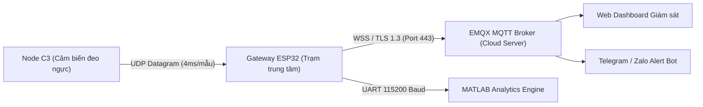
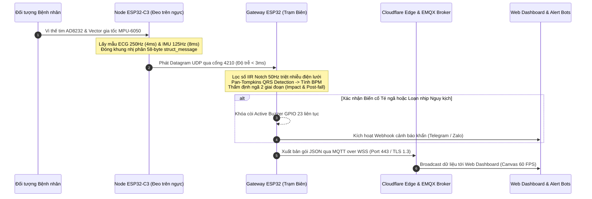
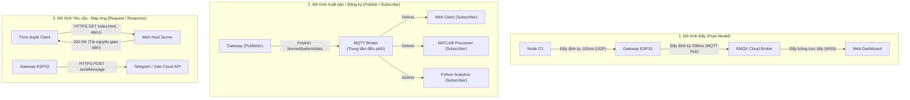
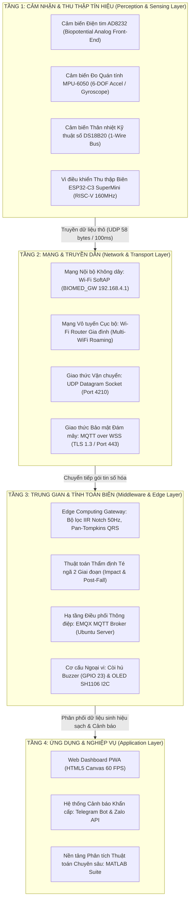

# 🏗️ TÀI LIỆU ĐẶC TẢ KIẾN TRÚC KỸ THUẬT HỆ THỐNG IoT
## THIẾT KẾ HỆ THỐNG IoT THEO DÕI ĐIỆN TIM, THÂN NHIỆT VÀ CẢNH BÁO TÉ NGÃ TỪ XA CHO NGƯỜI CAO TUỔI TẠI NHÀ

> **Đề tài:** Thiết kế hệ thống IoT theo dõi điện tim, thân nhiệt và cảnh báo té ngã từ xa cho người cao tuổi tại nhà  
> **Tên tiếng Anh:** Design of an IoT System for Remote Monitoring of ECG, Body Temperature and Fall Detection for the Elderly at Home  
> **Tác giả:** [TsByinChei](https://github.com/tsbyinchei)  
> **Kho mã nguồn:** [IoMT-ECG-FallDetection](https://github.com/tsbyinchei/IoMT-ECG-FallDetection)  
> **Phiên bản:** 2.0 (Engineering Architecture Release)

---

## 📑 MỤC LỤC
1. [Tổng quan Kiến trúc & Bối cảnh Ứng dụng](#1-tổng-quan-kiến-trúc--bối-cảnh-ứng-dụng)
2. [Phân hệ Phần cứng: Cảm biến, Cơ cấu Chấp hành & Vi điều khiển](#2-phân-hệ-phần-cứng-cảm-biến-cơ-cấu-chấp-hành--vi-điều-khiển)
3. [Mô hình Luồng Dữ liệu & Chu trình Xử lý Tín hiệu Y sinh](#3-mô-hình-luồng-dữ-liệu--chu-trình-xử-lý-tín-hiệu-y-sinh)
4. [Các Mô hình Truyền Dữ liệu trong Hệ thống IoT](#4-các-mô-hình-truyền-dữ-liệu-trong-hệ-thống-iot)
5. [Kiến trúc Giao thức Truyền thông & Cơ chế Bảo mật SSL/TLS Let's Encrypt](#5-kiến-trúc-giao-thức-truyền-thông--cơ-chế-bảo-mật-ssltls-lets-encrypt)
6. [Mô hình Kiến trúc Phân tầng Chức năng IoT (Functional Layers)](#6-mô-hình-kiến-trúc-phân-tầng-chức-năng-iot-functional-layers)
7. [Mô hình Truyền thông 4 Lớp IoT Đối sánh với OSI & TCP/IP](#7-mô-hình-truyền-thông-4-lớp-iot-đối-sánh-với-osi--tcpip)
8. [Các Cơ chế Kỹ thuật Tối ưu Hóa & Khả năng Chịu lỗi Hệ thống](#8-các-cơ-chế-kỹ-thuật-tối-ưu-hóa--khả-năng-chịu-lỗi-hệ-thống)
9. [Phụ lục Danh mục Mã nguồn & Tài liệu Tham chiếu](#9-phụ-lục-danh-mục-mã-nguồn--tài-liệu-tham-chiếu)

---

## 1. TỔNG QUAN KIẾN TRÚC & BỐI CẢNH ỨNG DỤNG

### 1.1. Bối cảnh Kỹ thuật & Thực tiễn Đề tài
Đối với người cao tuổi sinh sống tại gia đình, viện dưỡng lão hoặc sống một mình, ba rủi ro sức khỏe nguy hiểm và phổ biến nhất cần giám sát liên tục gồm:
- **Biến cố Loạn nhịp tim (Cardiac Arrhythmias):** Các cơn rung nhĩ, nhịp nhanh kịch phát hoặc ngoại tâm thu nguy hiểm thường xuất hiện thoáng qua trong sinh hoạt hàng ngày, đòi hỏi thu nhận sóng điện tim (ECG) liên tục thời gian thực với tần số lấy mẫu cao ($\ge 200\text{ Hz}$).
- **Bất thường Thân nhiệt (Body Temperature):** Người cao tuổi có khả năng điều hòa thân nhiệt suy giảm, dễ bị sốt cao nhiễm trùng hoặc hạ thân nhiệt đột ngột vào ban đêm, cần được theo dõi định kỳ liên tục để người nhà kịp thời xử lý.
- **Tai nạn Té ngã (Fall Incidents):** Người già bị ngã thường mất ý thức, chấn thương hoặc gãy xương, dẫn đến hội chứng "Nằm bất động kéo dài" (Long Lie) mà không thể với tới điện thoại để gọi người thân. Việc phát hiện cú va đập và gửi cảnh báo khẩn cấp từ xa tức thì đóng vai trò quyết định "thời gian vàng" cứu hộ.

### 1.2. Giải pháp Kiến trúc IoT Toàn diện của Đề tài
Hệ thống được thiết kế theo mô hình **Điện toán Biên kết hợp Đám mây (Edge-Cloud Hybrid Architecture)**, phục vụ theo dõi trọn vẹn 3 thông số sinh hiệu và biến cố cho người cao tuổi tại nhà:
- **Nút cảm biến đeo người (Wearable Node - ESP32-C3):** Thiết bị nhỏ gọn đeo trên ngực người cao tuổi, đo liên tục điện thế tim (AD8232 @ 250Hz), gia tốc chuyển động 3 chiều (MPU-6050 @ 125Hz) và thân nhiệt biểu mô (DS18B20 1-Wire).
- **Trạm trung tâm xử lý biên (Edge Gateway - ESP32):** Đặt tại phòng ngủ hoặc phòng khách, thu nhận dữ liệu nội bộ qua Wi-Fi, chạy thuật toán lọc số IIR Notch 50Hz, Pan-Tompkins tính nhịp tim BPM, hiển thị màn hình OLED 60 FPS, kích hoạt còi hú báo động lớn khi phát hiện ngã và chuyển tiếp dữ liệu lên Cloud.
- **Hạ tầng Đám mây & Giám sát Từ xa cho Người thân:** Định tuyến thông điệp qua MQTT Broker mã hóa TLS 1.3, cập nhật Web Dashboard trực quan và kích hoạt tin nhắn cấp cứu tức thời qua Telegram Bot & Zalo API đến điện thoại của người nhà.



---

## 2. PHÂN HỆ PHẦN CỨNG: CẢM BIẾN, CƠ CẤU CHẤP HÀNH & VI ĐIỀU KHIỂN

Kiến trúc phần cứng của hệ thống phân định rõ ràng giữa các phần tử **Cảm biến (Input/Sensors)**, **Khối Xử lý Trung tâm (Processing/MCUs)** và **Cơ cấu Chấp hành (Output/Actuators)**:

| Phân loại Phân hệ | Linh kiện / Thiết bị | Chuẩn Giao tiếp | Tần số / Thông số Hoạt động | Vai trò Kỹ thuật trong Hệ thống |
| :--- | :--- | :--- | :--- | :--- |
| **Cảm biến** | **AD8232** (Analog Front-End) | Analog Voltage + GPIO | $250\text{ Hz}$ (Chu kỳ $4\text{ ms}$) | Thu nhận vi điện thế tim $\mu\text{V}$, khuếch đại, xuất tín hiệu $0\text{--}3.3\text{V}$ và cờ hở điện cực `LO+`/`LO-`. |
| **Cảm biến** | **MPU-6050** (6-DOF IMU) | I2C Fast-Mode ($400\text{ kHz}$) | $125\text{ Hz}$ (Chu kỳ $8\text{ ms}$) | Đo gia tốc 3 trục ($\pm 8g$) và vận tốc góc xoay 3 trục ($\pm 2000^\circ/\text{s}$) phục vụ nhận diện va đập và tư thế. |
| **Cảm biến** | **DS18B20** (Cảm biến Nhiệt) | Dallas 1-Wire Bus | $1\text{ Hz}$ (Chuyển đổi 12-bit) | Đo nhiệt độ biểu mô cơ thể, dải $-55^\circ\text{C} \text{ đến } +125^\circ\text{C}$, độ phân giải $0.0625^\circ\text{C}$, kiểm tra mã CRC-8. |
| **Vi điều khiển** | **ESP32-C3 SuperMini** | On-chip RF, I2C, ADC, 1-Wire | CPU RISC-V 32-bit @ $160\text{ MHz}$ | Thu thập dữ liệu sensor tại biên, quản lý máy trạng thái lấy mẫu, đóng gói UDP nhị phân 58 bytes. |
| **Vi điều khiển** | **ESP32 Gateway Dev Module** | Dual-Core, I2C, UART, Wi-Fi | CPU Xtensa LX6 @ $240\text{ MHz}$ | Tiếp nhận UDP, lọc số IIR Notch 50Hz, thuật toán Pan-Tompkins, điều khiển OLED, mã hóa MQTT TLS 1.3. |
| **Cơ cấu Chấp hành** | **Active Buzzer** | Digital Output (GPIO 23) | Tần số âm học $\approx 2.3\text{ kHz}$ | Phát tín hiệu âm thanh cảnh báo decibel cao ($\ge 85\text{ dB}$), chế độ chốt giữ khẩn cấp (Latching Siren). |
| **Cơ cấu Chấp hành** | **Màn hình OLED SH1106** | I2C Hardware ($400\text{ kHz}$) | Độ phân giải $128 \times 64\text{ px}$ | Kết xuất đồ thị sóng điện tim cuộn 60 FPS, chỉ số sinh hiệu (HR, Temp, SMV) và chẩn đoán kết nối mạng. |
| **Cơ cấu Chấp hành** | **Đèn LED Báo trạng thái** | Digital Output (GPIO 8 trên C3) | Tần số nhấp nháy $2\text{--}10\text{ Hz}$ | Phản hồi trực quan trạng thái liên kết vô tuyến và trạng thái chuyển vùng mạng (Network Roaming). |

---

### 2.1. Đặc tả Chi tiết Các Vi điều khiển (Microcontrollers)

#### A. Vi điều khiển Node Cảm biến Đeo: [ESP32-C3 SuperMini](ESP32C3%20Example/ESP32C3%20Example.ino)
- **Kiến trúc Vi xử lý:** Lõi đơn 32-bit RISC-V RV32IMC, xung nhịp tối đa $160\text{ MHz}$, tích hợp $400\text{ KB}$ SRAM và $384\text{ KB}$ ROM.
- **Kích thước & Trọng lượng:** Form-factor siêu thu nhỏ ($22.5 \times 18\text{ mm}$), phù hợp tuyệt đối cho thiết bị y sinh đeo ngực (Wearable Holter/Patch).
- **Hệ thống Thu thập Tín hiệu:**
  - Kênh ADC nội vi 12-bit (chân GPIO 1 / ADC1_CH1) với bộ điều chỉnh điện áp tham chiếu nội suy đa thức, triệt tiêu sai số phi tuyến ở hai đầu biên $0\text{V}$ và $3.3\text{V}$.
  - Giao diện I2C phần cứng tốc độ $400\text{ kHz}$ kết nối MPU-6050 (SDA: GPIO 2, SCL: GPIO 3).
  - Giao diện 1-Wire phần mềm xung nhịp vi giây kết nối cảm biến thân nhiệt DS18B20 (GPIO 4).
- **Trách nhiệm Hệ thống:**
  1. Duy trì bộ định thời chính xác bằng hàm vi giây nội tại (`micros()`) để lấy mẫu ECG cố định tại $250\text{ Hz}$ (sai số $< 5\mu\text{s}$).
  2. Vận hành máy trạng thái bất đồng bộ (Non-blocking State Machine) đọc DS18B20 nhằm loại bỏ hoàn toàn hiện tượng nghẽn CPU $750\text{ ms}$ khi cảm biến chuyển đổi nhiệt độ.
  3. Gom bộ đệm nhị phân 25 mẫu ECG thành khung truyền dữ liệu cố định **58 bytes** và truyền phát qua giao thức UDP Datagram Socket.

#### B. Vi điều khiển Trạm Biên Xử lý: [ESP32 Gateway (Xtensa Dual-Core LX6)](ESP32%20Example/ESP32%20Example.ino)
- **Kiến trúc Vi xử lý:** 2 nhân xử lý độc lập (Core 0 và Core 1) kiến trúc Tensilica Xtensa LX6 32-bit, xung nhịp $240\text{ MHz}$, tích hợp $520\text{ KB}$ SRAM.
- **Mô hình Đa luồng Thực thi (SMP Concurrency):**
  - **Core 0:** Phụ trách toàn bộ ngăn xếp giao thức mạng (TCP/IP, Wi-Fi Driver, mã hóa SSL/TLS 1.3 mbedTLS, SNTP Synchronization và tiến trình MQTT Client daemon).
  - **Core 1:** Chuyên biệt xử lý luồng tính toán số thực (Digital Signal Processing): Bộ lọc số IIR Notch 50Hz, giải thuật đỉnh sóng Pan-Tompkins QRS, render màn hình OLED SH1106 và giám sát ngắt GPIO nút nhấn.
- **Trách nhiệm Hệ thống:**
  1. Khởi tạo đồng thời hai giao diện mạng vô tuyến (Dual Wi-Fi Mode: SoftAP + Station).
  2. Tiếp nhận luồng gói tin UDP từ Node C3 qua cổng cục bộ 4210.
  3. Tính toán nhịp tim tức thời (BPM) và giải thuật thẩm định té ngã 2 giai đoạn.
  4. Duy trì phiên kết nối bảo mật WSS với Cloudflare Edge và kích hoạt chuỗi cảnh báo khẩn cấp.

---

### 2.2. Đặc tả Kỹ thuật Các Cảm biến Y sinh (Biomedical Sensors)

#### A. Cảm biến Điện tim AD8232 (Biopotential Analog Front-End)
- **Nguyên lý Hoạt động:** Hoạt động điện của cơ tim tạo ra các gradient điện thế lan truyền ra bề mặt biểu bì ở biên độ cực nhỏ ($\approx 0.5\text{--}4\text{ mV}$). Module AD8232 tích hợp mạch khuếch đại đo lường (Instrumentation Amplifier), bộ lọc thông cao 2 cực ($0.5\text{ Hz}$) để chặn điện thế trôi phân cực tiếp xúc điện cực-da (Half-cell potential), và bộ lọc thông thấp 3 cực ($40\text{ Hz}$) để triệt tiêu can nhiễu co cơ (EMG noise).
- **Cấu hình Đạo trình (Lead Placement):**
  - Điện cực Đỏ (RA - Right Arm): Đặt dưới xương đòn ngực phải.
  - Điện cực Vàng (LA - Left Arm): Đặt dưới xương đòn ngực trái.
  - Điện cực Xanh lá (RL - Right Leg): Đặt tại hông dưới xương sườn hoặc vùng bụng làm điện cực tham chiếu triệt nhiễu đồng pha (Right Leg Drive - RLD).
- **Cơ chế Phát hiện Hở Điện cực (Leads-Off Detection):**
  - AD8232 tích hợp mạch so sánh dòng rò siêu nhỏ ($100\text{ nA}$) qua hai chân logic số `LO+` (GPIO 6) và `LO-` (GPIO 7).
  - Khi một trong các miếng điện cực bị bong tróc khỏi da bệnh nhân, mạch so sánh lập tức kéo chân logic lên mức HIGH. Node C3 lập tức thiết lập cờ `leadsOff = 1`, Gateway chuyển trạng thái hiển thị OLED sang `"HO DIEN CUC!"` và tạm dừng thuật toán tính BPM để tránh cảnh báo nhịp tim sai lệch.

#### B. Cảm biến Đo Quán tính MPU-6050 (6-DOF IMU)
- **Đặc tính Đo đạc:** Tích hợp cảm biến gia tốc MEMS 3 trục ($A_x, A_y, A_z$) và con quay hồi chuyển MEMS 3 trục ($G_x, G_y, G_z$).
- **Cấu hình Thanh ghi Phần cứng:**
  - Dải đo gia tốc: $\pm 8g$ (Độ nhạy $4096\text{ LSB}/g$) nhằm thu nhận trọn vẹn đỉnh gia tốc va chạm cao tần mà không gây bão hòa bộ chuyển đổi ADC 16-bit nội vi.
  - Dải đo vận tốc góc: $\pm 2000^\circ/\text{s}$ (Độ nhạy $16.4\text{ LSB}/(^\circ/\text{s})$).
  - Bộ lọc thông thấp kỹ thuật số tích hợp (DLPF - Digital Low-Pass Filter): Băng thông $260\text{ Hz}$ để bảo toàn dạng sóng phản chấn va đập.
- **Giải thuật Nhận diện Tư thế & Động học:**
  - **Vector Gia tốc Tổng hợp (Signal Magnitude Vector - SMV):**
    $$\text{SMV} = \sqrt{A_x^2 + A_y^2 + A_z^2}$$
  - Trạng thái tĩnh (Người đứng/ngồi yên): $\text{SMV} \approx 1.0g$ (Gia tốc trọng trường).
  - Trạng thái rơi tự do (Free Fall): $\text{SMV} \le 0.6g$.
  - Trạng thái va đập sàn (Impact Shock): $\text{SMV} \ge 2.8g$.
  - **Góc nghiêng Thân người (Tilt Angle $\theta$):**
    $$\theta = \arccos\left(\frac{A_z}{\text{SMV}}\right) \times \frac{180}{\pi}$$
  - Khi $\theta \ge 40^\circ$ và vận tốc góc xoay tổng hợp $\omega = \sqrt{G_x^2 + G_y^2 + G_z^2} < 45^\circ/\text{s}$, hệ thống xác nhận đối tượng đang nằm bất động trên mặt phẳng sàn.

#### C. Cảm biến Thân nhiệt Số DS18B20 (1-Wire Temperature Sensor)
- **Đặc tính Kỹ thuật:** Cảm biến nhiệt bán dẫn kỹ thuật số giao tiếp chuẩn 1-Wire độc quyền của Dallas Semiconductor.
- **Độ phân giải & Thời gian Chuyển đổi:** Cấu hình 12-bit (bước nhảy nhiệt độ $0.0625^\circ\text{C}$), thời gian trễ chuyển đổi nội bộ $t_{\text{conv}} \approx 750\text{ ms}$.
- **Cơ chế Máy trạng thái Bất đồng bộ (Asynchronous State Machine):**
  - Chu kỳ $1\text{s}$, máy trạng thái phát lệnh `0x44` (Convert T) rồi thoát ngay trong $2\text{ ms}$.
  - CPU tiếp tục thực thi chu kỳ đọc ADC $4\text{ ms}$ của ECG mà không bị block.
  - Sau $1000\text{ ms}$, máy trạng thái chuyển sang bước đọc thanh ghi cào (Scratchpad `0xBE`), thu nhận 9 byte dữ liệu và xác thực toàn vẹn bằng đa thức mã sửa sai **CRC-8**:
    $$P(x) = x^8 + x^5 + x^4 + 1$$
  - Chỉ khi byte CRC nhận được trùng khớp hoàn toàn với phép tính CRC-8 trên 8 byte dữ liệu, giá trị nhiệt độ mới được cập nhật vào cấu trúc truyền tin.

---

### 2.3. Đặc tả Kỹ thuật Cơ cấu Chấp hành & Hiển thị (Actuators & Displays)

#### A. Còi Chíp Tích cực (Active Buzzer - GPIO 23)
- Hoạt động ở mức điện áp logic $3.3\text{V}$, dòng định mức $\approx 30\text{ mA}$, tạo áp suất âm thanh $\ge 85\text{ dB}$ ở khoảng cách $10\text{ cm}$.
- Hoạt động theo chế độ **Chốt giữ Khẩn cấp (Latching Alarm State)**: Khi có biến cố té ngã được xác nhận, còi duy trì kích hoạt liên tục cho đến khi người chăm sóc bấm nút vật lý BOOT trên Gateway hoặc gửi lệnh giải tỏa `{"cmd":"mute"}` từ Web Dashboard qua MQTT topic `biomed/gateway/cmd`.

#### B. Màn hình Đồ họa OLED SH1106 $1.3\text{ inch}$ (I2C)
- Độ phân giải $128 \times 64$ điểm ảnh, điều khiển qua bus I2C địa chỉ `0x3C`.
- Thiết kế phân trang giao diện người dùng (4 Trang Chức năng):
  - **Trang 0 (ECG Waveform Focus):** Kết xuất đồ thị sóng điện tim cuộn theo thời gian thực (Rolling Buffer 128 điểm ảnh), tần số làm tươi $60\text{ FPS}$, hiển thị BPM và gia tốc SMV.
  - **Trang 1 (Clinical Vitals):** Hiển thị tổng quan các chỉ số lâm sàng (BPM, Thân nhiệt $^\circ\text{C}$, Trạng thái cảnh báo: Sốt cao, Nhịp nhanh, Nhịp chậm, Hở điện cực).
  - **Trang 2 (Motion & Fall Diagnostics):** Hiển thị thanh đo đồ họa lực gia tốc tức thời ($0\text{--}4.0g$), vạch đánh dấu ngưỡng ngã $2.2g$ và bộ đếm tổng số lần té ngã tích lũy.
  - **Trang 3 (System & Network Diagnostics):** Hiển thị trạng thái kết nối Wi-Fi Router, địa chỉ IP cục bộ, trạng thái phiên MQTT WSS Cloud và bộ đếm tổng số gói tin UDP đã thu nhận.

---

## 3. MÔ HÌNH LUỒNG DỮ LIỆU & CHU TRÌNH XỬ LÝ TÍN HIỆU Y SINH

Quy trình tuần tự hóa dữ liệu sinh hiệu từ thời điểm xuất hiện điện thế trên biểu bì da đến khi kết xuất trên giao diện giám sát của người thân tuân thủ chu trình 5 bước nghiêm ngặt:



### Chi tiết 5 Bước Xử lý Kỹ thuật:

1. **Bước 1: Thu thập & Lượng tử hóa Tín hiệu tại Biên (Acquisition & Serialization):**
   - Bộ chuyển đổi ADC của ESP32-C3 lượng tử hóa điện áp AD8232 với độ phân giải 12-bit ($0\text{--}4095$ mức) tại tần số $f_s = 250\text{ Hz}$.
   - Cứ mỗi chu kỳ $100\text{ ms}$, bộ đệm thu thập đủ 25 mẫu ECG liên tục, kết hợp với các trường dữ liệu sinh hiệu khác để đóng gói vào cấu trúc nhị phân định dạng chặt chẽ:
     ```cpp
     typedef struct __attribute__((packed)) struct_message {
       uint16_t ecgSamples[25]; // 50 bytes (25 mẫu x 2 bytes)
       float    bodyTemp;      // 4 bytes  (Nhiệt độ IEEE 754)
       float    smv;           // 4 bytes  (Gia tốc tổng hợp)
       uint8_t  leadsOff;      // 1 byte   (Cờ hở điện cực)
       uint8_t  fallDetected;  // 1 byte   (Cờ trạng thái té ngã)
     } struct_message;         // Tổng cộng: đúng 58 bytes
     ```
2. **Bước 2: Truyền vận Không dây Nội vi (Low-latency Wireless Transport):**
   - Khung dữ liệu 58 bytes được truyền phát thẳng qua giao thức **UDP Datagram Socket** trên cổng 4210 đến địa chỉ IP của Gateway.
   - Cơ chế này không tiêu tốn băng thông cho thủ tục bắt tay ba bước (3-way handshake) hay cơ chế xác nhận gói ACK/NACK của TCP, đạt độ trễ truyền dẫn cực thấp ($\tau < 3\text{ ms}$) và giảm thiểu tối đa năng lượng tiêu thụ trên pin của Node đeo.
3. **Bước 3: Xử lý Tín hiệu Số & Thẩm định Biến cố tại Trạm Biên (Edge DSP & Analytics):**
   - **Bộ lọc IIR Notch 50Hz (Band-stop Filter):** Xử lý luồng mẫu ECG thô để loại bỏ hoàn toàn sóng nhiễu cảm ứng điện từ từ lưới điện dân dụng $50\text{ Hz}$ mà các mạch lọc phần cứng thụ động chưa triệt tiêu hết:
     $$y[n] = b_0 x[n] + b_1 x[n-1] + b_2 x[n-2] - a_1 y[n-1] - a_2 y[n-2]$$
   - **Thuật toán Pan-Tompkins:** Tính đạo hàm bậc một để làm nổi bật sườn dốc sóng R, bình phương tín hiệu để loại bỏ giá trị âm và khuếch đại đỉnh cao tần, tiếp đến áp dụng tích phân cửa sổ trượt (Moving Window Integration) để phát hiện phức hợp QRS và tính chu kỳ khoảng cách R-R ($t_{RR}$), suy ra nhịp tim:
     $$\text{BPM} = \frac{60000}{t_{RR} \text{ (ms)}}$$
   - **Thẩm định Biến cố Ngã 2 Giai đoạn:** Thẩm định va đập kết hợp theo dõi trạng thái bất động trong $2.5\text{ giây}$ kế tiếp nhằm loại bỏ triệt để các cảnh báo giả do vận động mạnh.
4. **Bước 4: Mã hóa Tầng Giao vận & Đẩy lên Đám mây (Secure Cloud Ingestion):**
   - Gateway định dạng gói tin thành chuỗi JSON và truyền phát qua kênh **MQTT over WebSocket Secure (WSS)** cổng 443 thông qua đường hầm Cloudflare Zero Trust.
   - Toàn bộ lưu lượng được bảo vệ bởi giao thức **TLS 1.3** và xác thực chuỗi chứng chỉ gốc **Let's Encrypt (ISRG Root X1)**.
5. **Bước 5: Trực quan hóa Lâm sàng & Phản hồi Khẩn cấp Đa kênh (Multi-Channel Clinical Action):**
   - **Giao diện Giám sát Web PWA:** Người thân và người chăm sóc tiếp nhận luồng dữ liệu thời gian thực qua giao thức WSS nhị phân, theo dõi đồ thị sóng ECG trực quan hiển thị trên thẻ HTML5 Canvas ở tốc độ $60\text{ FPS}$.
   - **Kênh Phản hồi Khẩn cấp (Emergency Webhooks):** Khi cờ ngã hoặc loạn nhịp được xác thực, Gateway lập tức gọi đồng thời HTTPS REST API gửi cảnh báo khẩn tới **Telegram Bot** và **Zalo Official Account API**.

---

## 4. CÁC MÔ HÌNH TRUYỀN DỮ LIỆU TRONG HỆ THỐNG IOT

Kiến trúc truyền thông của hệ thống kết hợp đồng thời **5 mô hình truyền thông tiêu chuẩn trong công nghệ IoT**:



### Bảng Phân tích & So sánh 5 Mô hình Truyền thông Được Ứng dụng:

| Mô hình Truyền thông | Vị trí Thực thi trong Hệ thống | Cơ chế Hoạt động Kỹ thuật | Ưu điểm & Vai trò Thiết kế |
| :--- | :--- | :--- | :--- |
| **1. Push (Đẩy dữ liệu)** | - Node C3 $\rightarrow$ Gateway (UDP)<br>- Gateway $\rightarrow$ Cloud (MQTT Pub)<br>- Cloud $\rightarrow$ Web (WebSocket) | Thiết bị phát chủ động đẩy gói dữ liệu ngay khi vừa tích lũy đủ khung lấy mẫu mà không cần tín hiệu thăm dò (polling) từ phía thu. | Triệt tiêu hoàn toàn độ trễ trễ thăm dò (Polling Latency), đạt tốc độ cập nhật thời gian thực cao ($< 10\text{ ms}$). |
| **2. Publish / Subscribe (Pub/Sub)** | - Gateway $\leftrightarrow$ EMQX Broker $\leftrightarrow$ Web PWA / MATLAB / Python | Bên phát (Publisher) và các bên nhận (Subscribers) hoàn toàn độc lập logic, chỉ liên kết qua chủ đề tin nhắn (`biomed/patient/data`, `biomed/patient/alert`). | Khả năng mở rộng quy mô (Scalability): Nhiều người thân và người chăm sóc có thể đồng thời theo dõi dữ liệu mà không làm tăng tải tính toán trên Gateway. |
| **3. Request / Response (Hỏi - Đáp)** | - Trình duyệt tải ứng dụng Web<br>- Gateway gọi API Telegram / Zalo | Bên gửi khởi tạo phiên yêu cầu (Request), phía máy chủ xử lý logic và trả về mã trạng thái cùng nội dung phản hồi (Response 200 OK). | Đảm bảo tính tương thích chuẩn hóa với các nền tảng Webhook và dịch vụ mạng xã hội toàn cầu. |
| **4. Client - Server (Khách - Chủ)** | - Trình duyệt $\leftrightarrow$ Web Server tĩnh<br>- ESP32 $\leftrightarrow$ NTP Time Servers | Thiết bị khách chủ động kết nối tới máy chủ trung tâm định danh bằng FQDN cố định để yêu cầu dịch vụ hoặc đồng bộ thời gian. | Quản lý tài nguyên tập trung, bảo đảm tính xác thực danh tính và đồng bộ cấu hình hệ thống. |
| **5. Peer-to-Peer / Point-to-Point (Điểm - Điểm)** | - Node C3 $\leftrightarrow$ Gateway (Kênh SoftAP nội bộ) | Node C3 kết nối trực tiếp vào trạm phát sóng Wi-Fi SoftAP của Gateway (`192.168.4.1`) mà không qua router trung gian hay Internet. | Đảm bảo hệ thống duy trì hoạt động cảnh báo tại chỗ hoàn toàn độc lập ngay cả khi mạng viễn thông gia đình bị tê liệt. |

---

## 5. KIẾN TRÚC GIAO THỨC TRUYỀN THÔNG & CƠ CHẾ BẢO MẬT SSL/TLS LET'S ENCRYPT

### 5.1. Ma trận Ngăn xếp Giao thức Truyền thông (Protocol Stack Matrix)

| Phân tầng Giao thức | Giao thức Ứng dụng | Cổng Mạng / Băng tần | Định dạng Dữ liệu | Mục đích Triển khai |
| :--- | :--- | :--- | :--- | :--- |
| **Giao diện Ngoại vi** | I2C, 1-Wire, UART | Bus vi mạch trên bo | Nhị phân / Thanh ghi số | Giao tiếp phần cứng cảm biến MPU-6050, OLED, DS18B20 và cổng Serial MATLAB. |
| **Tầng Vận chuyển** | **UDP (Datagram Socket)** | Cổng 4210 | Cấu trúc nhị phân 58 bytes | Truyền luồng mẫu sinh hiệu thô tốc độ cao giữa Node C3 và Gateway. |
| **Tầng Vận chuyển** | **TCP (Stream Socket)** | Cổng 443 | Byte stream | Đảm bảo tính toàn vẹn của kết nối WSS từ Gateway lên Cloud Broker. |
| **Tầng Bảo mật** | **TLS 1.3 / mbedTLS** | Cổng 443 | Mã hóa khóa công khai & đối xứng | Bảo vệ an toàn dữ liệu y tế, chứng thực danh tính máy chủ qua chứng chỉ Let's Encrypt. |
| **Tầng Ứng dụng** | **MQTT v3.1.1 over WSS** | URI: `/mqtt` | Chuỗi JSON định dạng chuẩn | Đóng gói sinh hiệu y tế (ECG, HR, Temp, SMV) và điều khiển Gateway từ xa. |
| **Tầng Ứng dụng** | **HTTPS RESTful API** | Cổng 443 | JSON Payload | Kích hoạt Webhook cảnh báo khẩn cấp tới Telegram Bot API và Zalo Bot API. |
| **Tầng Ứng dụng** | **SNTP (Simple NTP)** | Cổng UDP 123 | Gói tin thời gian NTP 48 bytes | Đồng bộ thời gian thực chuẩn nguyên tử phục vụ kiểm tra thời hạn chứng chỉ X.509. |

---

### 5.2. Phân tích Kỹ thuật Chuyên sâu: Cơ chế Chứng chỉ Gốc Let's Encrypt (ISRG Root X1 / X2) & Xác thực TLS 1.3

Trong các hệ sinh thái IoT y tế (IoMT), dữ liệu nhịp tim và biến cố bệnh nhân thuộc danh mục dữ liệu y tế nhạy cảm (tuân thủ các chuẩn mực an toàn thông tin HIPAA / GDPR). Dự án triển khai giải pháp bảo mật cấp cao bằng việc tích hợp trực tiếp chuỗi chứng chỉ số **Let's Encrypt Root CA** vào bộ nhớ flash của Gateway và thực thi giao thức bắt tay an toàn **TLS 1.3** thông qua thư viện mật mã học **mbedTLS**.

```
┌────────────────────────────────────────────────────────────────────────┐
│               CHUỖI ỦY THÁC SỐ (CHAIN OF TRUST - X.509 PKI)            │
├────────────────────────────────────────────────────────────────────────┤
│                                                                        │
│   [ISRG Root X1 (RSA 4096)]      hoặc    [ISRG Root X2 (ECDSA P-384)]  │
│   (Root CA - Nhúng trực tiếp trong firmware Gateway qua ISRG_ROOT_CA)  │
│                                │                                       │
│                                ▼                                       │
│                [Let's Encrypt R3 / R10 / R11 / E1]                     │
│                (Intermediate CA - Cơ quan cấp phát trung gian)         │
│                                │                                       │
│                                ▼                                       │
│                     [mqtt.tsbyin.dev]                                  │
│   (End-Entity / Leaf Certificate - Chứng chỉ tên miền máy chủ)         │
│   • Cấp phát với SAN: mqtt.tsbyin.dev                                  │
│   • Mã hóa: TLS 1.3 (Cipher: TLS_AES_256_GCM_SHA384)                   │
│                                                                        │
└────────────────────────────────────────────────────────────────────────┘
```

#### A. Cấu trúc Cặp Chứng chỉ Gốc ISRG Root X1 & X2 trong Firmware
Mã nguồn Gateway ([ESP32 Example.ino](ESP32%20Example/ESP32%20Example.ino#L85-L146)) lưu trữ cặp chứng chỉ gốc định dạng PEM trực tiếp trong bộ nhớ Flash ROM:
1. **ISRG Root X1:**
   - **Tổ chức phát hành:** Internet Security Research Group (ISRG).
   - **Thuật toán Khóa công khai:** RSA 4096-bit, thuật toán băm chữ ký SHA-256.
   - **Mục đích:** Đảm bảo khả năng tương thích toàn cầu với mọi phiên bản thư viện mã hóa và hệ điều hành máy chủ.
2. **ISRG Root X2:**
   - **Thuật toán Khóa công khai:** Đường cong Elliptic ECDSA (chuẩn NIST P-384).
   - **Mục đích:** Tối ưu hóa kích thước chữ ký số và giảm thời gian giải mã phần cứng trên vi điều khiển nhúng.

#### B. Cơ chế Xác thực Chuỗi Chứng chỉ (Chain Verification) trên ESP-IDF mbedTLS
Khi Gateway khởi tạo kết nối WSS tới URI `wss://mqtt.tsbyin.dev/mqtt`:
1. Hàm `initAndStartMQTT()` cấu hình cấu trúc `esp_mqtt_client_config_t`:
   ```cpp
   mqtt_cfg.broker.address.uri = "wss://mqtt.tsbyin.dev/mqtt";
   mqtt_cfg.broker.verification.certificate = ISRG_ROOT_CA;
   mqtt_cfg.broker.verification.common_name = "mqtt.tsbyin.dev";
   mqtt_cfg.broker.verification.skip_cert_common_name_check = false;
   ```
2. Phía máy chủ Cloudflare Edge gửi chuỗi chứng chỉ bao gồm chứng chỉ của `mqtt.tsbyin.dev` và chứng chỉ trung gian `R3/R10`.
3. Thư viện **mbedTLS** trên nhân Core 0 của ESP32 thực thi quy trình thẩm định ngược:
   - Sử dụng Public Key của Root CA `ISRG Root X1` trong Flash để giải mã và xác thực chữ ký của Intermediate CA `R3`.
   - Sử dụng Public Key của Intermediate CA `R3` để xác thực chữ ký của End-Entity Certificate `mqtt.tsbyin.dev`.
   - Đối chiếu tên miền trong chứng chỉ máy chủ với trường Common Name (CN) và Subject Alternative Name (SAN) đảm bảo khớp chính xác với `mqtt.tsbyin.dev`.
   - Ngăn chặn triệt để các cuộc tấn công giả mạo DNS (DNS Spoofing) hoặc tấn công người đứng giữa (Man-in-the-Middle - MitM).

---

### 5.3. Vai trò Sống còn của Đồng bộ Thời gian thực (SNTP) đối với Hiệu lực Chứng chỉ X.509

Một trong những nguyên nhân phổ biến nhất khiến các thiết bị nhúng IoT thất bại khi kết nối SSL/TLS là **lỗi sai lệch thời gian hệ thống (System Time Skew)**:

#### A. Bản chất Kỹ thuật của Lỗi Thẩm định Chứng chỉ X.509
Mọi chứng chỉ số X.509 đều bắt buộc chứa hai trường xác định cửa sổ hiệu lực:
- **`notBefore`:** Thời điểm chứng chỉ bắt đầu có hiệu lực (ví dụ: `2026-08-21 00:00:00 UTC`).
- **`notAfter`:** Thời điểm chứng chỉ hết hạn (ví dụ: `2026-11-19 23:59:59 UTC`).

Vi điều khiển ESP32 **không được trang bị khối RTC phần cứng có pin nuôi nguồn độc lập (No Battery-backed RTC)**. Do đó, sau mỗi chu kỳ mất điện hoặc khởi động lại (Hardware Reset), bộ đếm xung nhịp thời gian của hệ điều hành thời gian thực (FreeRTOS) sẽ bị reset về mốc thời gian **Unix Epoch 0 (00:00:00 UTC ngày 01/01/1970)**.

Nếu Gateway thực thi bắt tay TLS 1.3 khi đồng hồ hệ thống đang ở năm 1970:
- Hàm kiểm tra thời gian `mbedtls_x509_crt_verify()` sẽ so sánh thời gian hệ thống ($1970$) với trường `notBefore` của chứng chỉ máy chủ ($2026$).
- Vì thời điểm hiện tại của máy khách nằm TRƯỚC ngày phát hành chứng chỉ, thư viện mbedTLS lập tức từ chối chứng chỉ với cờ lỗi nghiêm trọng:
  $$\text{MBEDTLS\_X509\_BADCERT\_FUTURE} \quad \text{hoặc} \quad \text{MBEDTLS\_X509\_BADCERT\_EXPIRED}$$
- Mã lỗi trả về: `MBEDTLS_ERR_X509_CERT_VERIFY_FAILED (-0x2700)`. Quá trình bắt tay bị hủy bỏ ngay lập tức, ngắt kết nối Cloud Broker.

#### B. Giải pháp Khắc phục Toàn diện trong Firmware Gateway ([ESP32 Example.ino](ESP32%20Example/ESP32%20Example.ino#L953-L968))
Hệ thống giải quyết bài toán này bằng cơ chế 3 lớp bảo vệ:
1. **Thiết lập Thời gian Dự phòng Tức thời (Fallback Epoch Pre-seeding):**
   Ngay khi vừa kết nối Wi-Fi thành công, trước khi máy chủ NTP phản hồi, Gateway chủ động gán mốc thời gian hợp lệ tối thiểu nằm chính xác trong cửa sổ hiệu lực của chứng chỉ:
   ```cpp
   // Cài đặt mốc thời gian hệ thống chuẩn xác (Tháng 10/2026 ~ Epoch 1791558000)
   struct timeval tv = { .tv_sec = 1791558000 };
   settimeofday(&tv, NULL);
   ```
2. **Kích hoạt Đồng bộ Thời gian Chuẩn qua Giao thức SNTP:**
   Truy vấn đồng thời hai cụm máy chủ thời gian nguyên tử quốc tế qua cổng UDP 123:
   ```cpp
   configTime(7 * 3600, 0, "pool.ntp.org", "time.google.com");
   ```
3. **Cơ chế Chốt Chặn Bắt tay (Time Sync Barrier):**
   Gateway sử dụng vòng lặp kiểm tra có giới hạn thời gian (Timeout loop) để xác nhận biến thời gian `now` đã vượt qua ngưỡng an toàn trước khi cho phép hàm `initAndStartMQTT()` gọi lệnh `esp_mqtt_client_start()`:
   ```cpp
   time_t now = time(nullptr);
   int ntpWait = 0;
   while (now < 1791500000 && ntpWait < 10) {
     delay(200);
     now = time(nullptr);
     ntpWait++;
   }
   ```

---

### 5.4. Kiến trúc Cloudflare Zero Trust Tunnel & Biên Mạng (Edge Termination)

Hệ thống triển khai mô hình kiến trúc mạng hiện đại **Không mở cổng modem (No Port Forwarding / Zero Trust Architecture)**:

```
┌──────────────────┐               ┌───────────────────────────┐               ┌──────────────────┐
│  ESP32 Gateway   │  WSS (TLS1.3) │   Cloudflare Global Edge  │  Multiplexed  │  Ubuntu Server   │
│  (Trạm tại nhà)  │──────────────>│   (Edge Termination 443)  │==============>│  (EMQX Broker)   │
└──────────────────┘               └───────────────────────────┘    Tunnel     └──────────────────┘
         ▲                                       ▲                  (QUIC)              ▲
         │                                       │                                      │
   Client mbedTLS                         Let's Encrypt /                         cloudflared
   X.509 Handshake                        Edge Certificate                          daemon
```

1. **Khái niệm Hoạt động:** Thay vì yêu cầu người dùng phải cấu hình mở cổng NAT (Port Forwarding trên modem mạng gia đình - tiềm ẩn nguy cơ bị quét cổng và tấn công mã độc), máy chủ nội bộ Ubuntu Server chạy dịch vụ daemon `cloudflared`.
2. **Kết nối Đường hầm Chiều ra (Outbound-only Tunnel):** Dịch vụ `cloudflared` chủ động thiết lập một đường hầm đa kênh (Multiplexed tunnel qua QUIC/HTTP2) chiều ra từ bên trong mạng nội bộ hướng tới các máy chủ biên toàn cầu của Cloudflare.
3. **Giải mã & Chấm dứt TLS tại Biên (Edge SSL Termination):**
   - Khi Gateway kết nối tới `mqtt.tsbyin.dev:443`, kết nối TLS được giải mã tại máy chủ biên gần nhất của Cloudflare bằng chứng chỉ số hợp lệ của Let's Encrypt / Google Trust Services.
   - Lưu lượng sau đó được mã hóa chuyển tiếp an toàn qua đường hầm `cloudflared` về cổng dịch vụ EMQX Broker nội bộ (`8083` cho WebSocket hoặc `1883` cho MQTT TCP).
4. **Lợi ích An ninh Y tế:**
   - Hoàn toàn che giấu địa chỉ IP gốc của máy chủ điều hành y tế.
   - Loại bỏ nguy cơ tấn công từ chối dịch vụ phân tán (DDoS), tấn công thâm nhập mạng LAN và các kỹ thuật can thiệp gói tin y tế.

---

## 6. MÔ HÌNH KIẾN TRÚC PHÂN TẦNG CHỨC NĂNG IOT (FUNCTIONAL LAYERS)

Theo tiêu chuẩn thiết kế hệ thống IoT công nghiệp, kiến trúc toàn hệ thống được phân rã thành **4 tầng chức năng chuyên biệt**:



### Bảng Đặc tả Chức năng Chi tiết theo 4 Tầng:

| Tầng Chức năng | Thành phần Phần cứng & Phần mềm | Trách nhiệm Kỹ thuật Cốt lõi |
| :--- | :--- | :--- |
| **Tầng 1: Cảm nhận & Thu thập** *(Perception Layer)* | - Cảm biến AD8232, MPU-6050, DS18B20<br>- MCU Node đeo ESP32-C3 SuperMini | - Đo đạc trực tiếp các đại lượng vật lý và điện thế sinh học bề mặt da.<br>- Thực hiện biến đổi tương tự - số (ADC 12-bit) và đóng khung nhị phân đồng bộ. |
| **Tầng 2: Mạng & Truyền dẫn** *(Network Layer)* | - Wi-Fi IEEE 802.11 b/g/n (2.4 GHz)<br>- Giao thức UDP Socket & WSS TCP | - Cung cấp hạ tầng truyền dẫn vô tuyến cự ly ngắn (PAN) và mạng diện rộng (WAN).<br>- Định tuyến các gói tin sinh hiệu với độ trễ thấp và độ tin cậy cao. |
| **Tầng 3: Trung gian & Xử lý** *(Middleware / Edge Layer)* | - Dual-Core ESP32 Gateway (Core 1 DSP)<br>- Máy chủ EMQX MQTT Broker trên Ubuntu | - Thực thi điện toán biên (Edge Computing): Lọc số IIR Notch 50Hz và thuật toán Pan-Tompkins.<br>- Phân tích động học thẩm định té ngã, quản lý phiên kết nối và kích hoạt còi tại chỗ. |
| **Tầng 4: Ứng dụng & Nghiệp vụ** *(Application Layer)* | - Web PWA Responsive (Người thân / Người chăm sóc)<br>- Telegram & Zalo Emergency Bots<br>- Môi trường tính toán MATLAB | - Kết xuất đồ thị sóng điện tim trực quan, báo cáo chỉ số sinh hiệu.<br>- Gửi thông báo đẩy khẩn cấp đa kênh tức thời tới người nhà và người chăm sóc. |

---

## 7. MÔ HÌNH TRUYỀN THÔNG 4 LỚP IOT ĐỐI SÁNH VỚI OSI & TCP/IP

Để xác lập vị trí kiến trúc của dự án trong lý thuyết mạng máy tính chuẩn mực, bảng dưới đây đối sánh mô hình truyền thông 4 lớp của hệ thống với **Mô hình Tham chiếu OSI (7 tầng)** và **Mô hình TCP/IP (4 tầng)**:

```
┌───────────────────────────────┬───────────────────────────────┬───────────────────────────────────────────────┐
│     MÔ HÌNH OSI (7 TẦNG)      │    MÔ HÌNH TCP/IP (4 TẦNG)    │        MÔ HÌNH TRUYỀN THÔNG IOT DỰ ÁN         │
├───────────────────────────────┼───────────────────────────────┼───────────────────────────────────────────────┤
│ 7. Tầng Ứng dụng (App)        │                               │                                               │
│ 6. Tầng Trình diễn (Pres)     │ 4. Tầng Ứng dụng (App)        │ 4. LỚP ỨNG DỤNG NGHIỆP VỤ (Application)       │
│ 5. Tầng Phiên (Session)       │                               │    • MQTT JSON, HTTPS REST, Web PWA, Chatbots │
├───────────────────────────────┼───────────────────────────────┼───────────────────────────────────────────────┤
│                               │                               │ 3. LỚP NỀN TẢNG DỊCH VỤ (Service / Platform)  │
│ 4. Tầng Vận chuyển (Transport)│ 3. Tầng Giao vận (Transport)  │    • EMQX Broker, TLS 1.3, Cloudflare Tunnel  │
│                               │                               │    • UDP (C3 -> GW) & TCP/WSS (GW -> Cloud)   │
├───────────────────────────────┼───────────────────────────────┼───────────────────────────────────────────────┤
│ 3. Tầng Mạng (Network)        │ 2. Tầng Mạng (Internet)       │ 2. LỚP MẠNG & LIÊN LẠC (Network/Connectivity) │
│                               │                               │    • IPv4 Addressing, Multi-WiFi Roaming      │
├───────────────────────────────┼───────────────────────────────┼───────────────────────────────────────────────┤
│ 2. Tầng Liên kết dữ liệu (DLL)│ 1. Tầng Truy cập mạng         │ 1. LỚP CẢM BIẾN VẬT LÝ (Physical & Sensor)    │
│ 1. Tầng Vật lý (Physical)     │    (Network Access)           │    • RF 2.4GHz, I2C Fast-mode, 1-Wire, ADC    │
└───────────────────────────────┴───────────────────────────────┴───────────────────────────────────────────────┘
```

### Bảng Phân bổ Công nghệ Chi tiết:

| Lớp Truyền thông IoT | Mô hình Tham chiếu Tương ứng | Chuẩn Công nghệ / Giao thức | Chức năng Kỹ thuật Cụ thể trong Dự án |
| :--- | :--- | :--- | :--- |
| **Lớp 1: Cảm biến & Vật lý** *(Physical & Sensor)* | OSI L1, L2 / TCP-IP L1 | I2C ($400\text{ kHz}$), 1-Wire, ADC 12-bit, RF 2.4GHz | Thu nhận biến thiên điện thế tim, gia tốc cơ học và chuyển đổi thành luồng bit nhị phân. |
| **Lớp 2: Mạng & Liên lạc** *(Network & Connectivity)* | OSI L3 / TCP-IP L2 | Wi-Fi 802.11 b/g/n, IPv4, Subnet, DHCP | Thiết lập kênh truyền dẫn không dây nội bộ qua mạng SoftAP và định tuyến qua Wi-Fi Router gia đình. |
| **Lớp 3: Nền tảng Dịch vụ** *(Service / Middleware)* | OSI L4, L5, L6 / TCP-IP L3 | UDP Socket, TCP/WSS, TLS 1.3, EMQX Broker | Đảm bảo tính toàn vẹn dữ liệu, giải quyết bài toán mã hóa đầu cuối và phân phối thông điệp thời gian thực. |
| **Lớp 4: Ứng dụng Nghiệp vụ** *(Application Layer)* | OSI L7 / TCP-IP L4 | MQTT v3.1.1, HTTPS Webhook, HTML5/JS | Hiển thị sóng ECG lâm sàng, thống kê sinh hiệu, cảnh báo còi hú và kích hoạt thông báo đa kênh. |

---

## 8. CÁC CƠ CHẾ KỸ THUẬT TỐI ƯU HÓA & KHẢ NĂNG CHỊU LỖI HỆ THỐNG

### 8.1. Điện toán Xử lý tại Biên (Edge Computing) – Độc lập với Hạ tầng Internet
- **Hạn chế của Kiến trúc IoT Truyền thống:** Việc đẩy toàn bộ luồng dữ liệu sóng tim thô $250\text{ Hz}$ lên máy chủ đám mây để tính toán phụ thuộc hoàn toàn vào đường truyền Internet. Khi xảy ra sự cố đứt cáp quang hoặc nghẽn mạng, chức năng phát hiện loạn nhịp và té ngã sẽ bị vô hiệu hóa hoàn toàn.
- **Giải pháp của Dự án:** Toàn bộ thuật toán **Lọc số IIR Notch 50Hz**, **Pan-Tompkins phát hiện đỉnh sóng QRS**, **Tính toán nhịp tim BPM** và **Thẩm định té ngã 2 giai đoạn** đều được thực thi trực tiếp trên vi điều khiển Gateway ESP32 tại chỗ. Kể cả khi toàn bộ kết nối Internet bị gián đoạn, còi hú Active Buzzer vẫn kích hoạt tức thời tại phòng bệnh nhân và màn hình OLED vẫn kết xuất đồ thị sóng tim bình thường.

### 8.2. Giải thuật Thẩm định Té ngã 2 Giai đoạn (Two-Stage Fall Verification Algorithm)
- **Vấn đề Báo động giả (False Alarms):** Các hoạt động sinh hoạt thường ngày của người bệnh (vung tay mạnh, ngồi phịch xuống giường, cúi nhặt vật dụng) đều có thể tạo ra các đỉnh gia tốc đột biến $\ge 2.5g$, dễ dẫn đến cảnh báo sai lệch nếu chỉ dựa vào ngưỡng biên độ gia tốc đơn thuần.
- **Cơ chế Phân tích Động học 2 Giai đoạn:**
  1. **Giai đoạn 1 (Va chạm cơ học - Impact Phase):**
     Khi độ lớn gia tốc tổng hợp $\text{SMV} \ge 2.8g$, hệ thống ghi nhận cờ nghi vấn va đập nhưng **chưa kích hoạt báo động ngay lập tức**.
  2. **Giai đoạn 2 (Thẩm định Bất động Sau va chạm - Post-fall Inactivity & Posture Phase):**
     Hệ thống mở một cửa sổ thời gian quan sát kéo dài **$2.5\text{ giây}$**:
     - Nếu bệnh nhân vẫn tiếp tục cử động (vận tốc góc xoay Gyroscope $\omega \ge 45^\circ/\text{s}$) hoặc góc nghiêng cơ thể vẫn ở vị trí thẳng đứng ($\theta < 40^\circ$), hệ thống tự động hủy cờ nghi vấn và xác định đây là cử động sinh hoạt bình thường.
     - Chỉ khi người bệnh duy trì **tư thế nằm song song với mặt sàn ($\theta \ge 40^\circ$) ĐỒNG THỜI rơi vào trạng thái bất động ($\omega < 45^\circ/\text{s}$)**, hệ thống mới chính thức xác nhận tai nạn té ngã thật (`fallDetected = 1`) và lập tức kích hoạt còi hú liên tục cùng chuỗi cảnh báo khẩn.

### 8.3. Cơ chế Chuyển vùng Wi-Fi Thông minh & Dự phòng Mất liên kết (Multi-WiFi Roaming & Failover)
- Node cảm biến C3 được nạp cơ chế máy trạng thái quét và quản lý đa mạng (Network State Machine):
  1. **Ưu tiên 1:** Duy trì kết nối trực tiếp vào mạng SoftAP `BIOMED_GW` do Gateway phát ra để đạt độ trễ truyền gói nhỏ nhất ($< 3\text{ ms}$).
  2. **Ưu tiên 2:** Khi người bệnh di chuyển ra xa khu vực phòng ngủ khiến cường độ tín hiệu SoftAP suy giảm mạnh ($\text{RSSI} < -85\text{ dBm}$) hoặc mất gói tin liên tiếp, Node C3 tự động chuyển vùng dự phòng sang kết nối **Router Wi-Fi gia đình**.
  3. Khi hoạt động trên Router gia đình, Node C3 truyền phát gói UDP theo địa chỉ Broadcast toàn mạng (`255.255.255.255`), Gateway (đang kết nối cùng Router) tiếp nhận gói tin thông suốt mà không làm gián đoạn chu trình giám sát sinh hiệu.

### 8.4. Đa nhiệm Đa luồng Phần cứng (Dual-Core Asymmetric Multiprocessing)
- Tận dụng triệt để kiến trúc 2 nhân độc lập của chip ESP32 Xtensa LX6:
  - Phân tách hoàn toàn tác vụ nặng về mạng (Network I/O, mbedTLS, SNTP, MQTT) chạy trên **Core 0**.
  - Tác vụ xử lý tín hiệu y sinh thời gian thực (Pan-Tompkins DSP, IIR Filtering, OLED Drawing) chạy trên **Core 1**.
  - Loại bỏ hoàn toàn hiện tượng sụt khung hình hiển thị (Display stuttering) hoặc trễ nhịp lấy mẫu khi ngăn xếp mạng thực hiện các thủ tục tái kết nối phức tạp.

---

## 9. PHỤ LỤC DANH MỤC MÃ NGUỒN & TÀI LIỆU THAM CHIẾU

Toàn bộ các thành phần mã nguồn và tài liệu kỹ thuật liên quan trong kho lưu trữ:

| Danh mục Tài nguyên | Đường dẫn Tệp tin Tham chiếu | Mô tả Nội dung Kỹ thuật |
| :--- | :--- | :--- |
| **Mã nguồn Node Cảm biến** | [ESP32C3 Example.ino](ESP32C3%20Example/ESP32C3%20Example.ino) | Firmware thu thập ECG, MPU-6050, DS18B20 và truyền UDP trên ESP32-C3 SuperMini. |
| **Mã nguồn Trạm Gateway** | [ESP32 Example.ino](ESP32%20Example/ESP32%20Example.ino) | Firmware Gateway lọc số Pan-Tompkins, hiển thị OLED, còi Buzzer và MQTT WSS TLS 1.3. |
| **Cấu hình Bí mật Mẫu** | [secrets_example.h](ESP32%20Example/secrets_example.h) | File mẫu khai báo cấu hình Wi-Fi Router, MQTT credentials và API Token Telegram / Zalo. |
| **Giao diện Web Giám sát** | [index.html](web/index.html) & [app.js](web/app.js) | Ứng dụng Web PWA hiển thị ECG Canvas 60 FPS, chỉ số sinh hiệu và điều khiển còi từ xa. |
| **Kịch bản Xử lý MATLAB** | [matlab_serial_ecg_processor.m](MATLAB/matlab_serial_ecg_processor.m) | Công cụ phân tích tín hiệu điện tim và kiểm nghiệm thuật toán qua cổng Serial USB. |
| **Hướng dẫn Kiểm thử Hệ thống** | [REPORT_GUIDE.md](REPORT_GUIDE.md) | Tài liệu hướng dẫn thiết lập môi trường, kiểm thử thực nghiệm và báo cáo chuyên sâu. |
| **Đặc tả Kiểm tra Bảo mật** | [SECURITY.md](SECURITY.md) | Chính sách an toàn thông tin, quản lý thông tin xác thực và bảo mật mã nguồn. |
| **Tài liệu Tổng quan Dự án** | [README.md](README.md) | Trang tổng quan giới thiệu dự án, sơ đồ nối dây chi tiết và hướng dẫn triển khai nhanh. |
