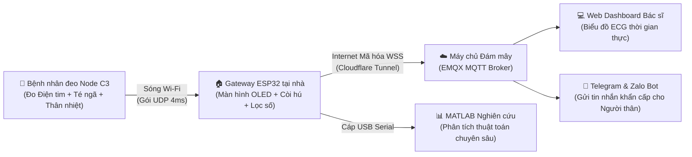
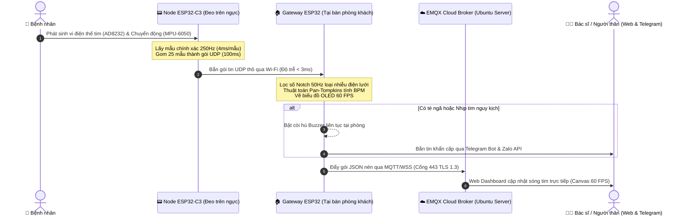
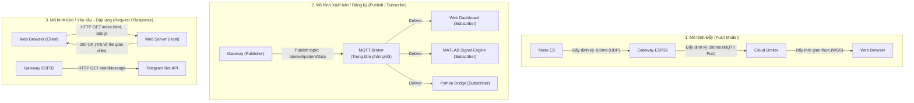
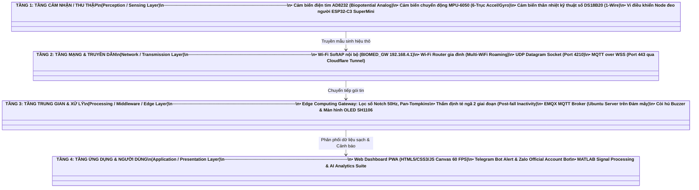

# 📖 KIẾN TRÚC & NGUYÊN LÝ HOẠT ĐỘNG HỆ THỐNG IoMT (ECG & FALL DETECTION)
> **Tài liệu trực quan, toàn diện dành cho mọi đối tượng (kể cả người không chuyên lập trình)**  
> **Dự án:** Hệ thống Giám sát Điện tim Thời gian thực & Cảnh báo Té ngã Y sinh Thông minh  
> **Tác giả:** [TsByinChei](https://github.com/tsbyinchei)

---

## 📑 MỤC LỤC
1. [Bức tranh Toàn cảnh: Hệ thống này là gì?](#1-bức-tranh-toàn-cảnh-hệ-thống-này-là-gì)
2. [Thiết bị Phần cứng: Cảm biến, Cơ cấu chấp hành & Vi điều khiển](#2-thiết-bị-phần-cứng-cảm-biến-cơ-cấu-chấp-hành--vi-điều-khiển)
3. [Vòng đời Dữ liệu: Từ Nhịp tim đến Điện thoại Bác sĩ](#3-vòng-đời-dữ-liệu-từ-nhịp-tim-đến-điện-thoại-bác-sĩ)
4. [Các Mô hình Truyền Dữ liệu trong Hệ thống IoT](#4-các-mô-hình-truyền-dữ-liệu-trong-hệ-thống-iot)
5. [Các Giao thức Truyền thông trong Hệ thống IoT](#5-các-giao-thức-truyền-thông-trong-hệ-thống-iot)
6. [Mô hình Kiến trúc Phân lớp Chức năng (IoT Functional Layers)](#6-mô-hình-kiến-trúc-phân-lớp-chức-năng-iot-functional-layers)
7. [Mô hình Truyền thông 4 Lớp của Hệ thống IoT](#7-mô-hình-truyền-thông-4-lớp-của-hệ-thống-iot)
8. [Những Điểm Thiết kế Kỹ thuật Đột phá của Dự án](#8-những-điểm-thiết-kế-kỹ-thuật-đột-phá-của-dự-án)

---

## 1. BỨC TRANH TOÀN CẢNH: HỆ THỐNG NÀY LÀ GÌ?

### 1.1. Bài toán thực tế
Trong y tế gia đình và viện dưỡng lão, hai rủi ro nguy hiểm nhất đối với người cao tuổi và bệnh nhân tim mạch là:
- **Đột quỵ hoặc Nhồi máu cơ tim:** Xuất hiện những cơn loạn nhịp tim bất thường thoáng qua mà máy đo ngắt quãng tại bệnh viện khó bắt trọn.
- **Tai nạn té ngã (Fall Injury):** Người già bị ngã thường mất ý thức hoặc gãy xương, không thể tự với tới điện thoại để gọi cấp cứu. "Thời gian vàng" cấp cứu bị bỏ lỡ dẫn đến chấn thương nặng hoặc tử vong.

### 1.2. Giải pháp của Hệ thống (IoMT - Internet of Medical Things)
Hệ thống là một mạng lưới y sinh thông minh gồm **2 thiết bị phần cứng nhỏ gọn** kết hợp cùng **Hạ tầng Đám mây (Cloud)** và **Giao diện Web/Ứng dụng Di động**:
- **Thiết bị đeo (Node ESP32-C3):** Bệnh nhân đeo trên ngực, liên tục đo từng xung điện tim, nhiệt độ cơ thể và chuyển động cơ học 250 lần mỗi giây.
- **Trạm trung tâm tại nhà (Gateway ESP32):** Đặt trên bàn phòng khách hoặc đầu giường, có màn hình OLED hiển thị sóng tim 60 FPS, lọc số lọc sạch nhiễu và tích hợp còi hú báo động lớn.
- **Hệ thống cảnh báo từ xa:** Khi người bệnh té ngã hoặc loạn nhịp, còi tại nhà hú vang, đồng thời điện thoại của bác sĩ / người thân ở bất kỳ đâu trên thế giới sẽ rung chuông và nhận ngay tin nhắn khẩn cấp qua **Telegram / Zalo**.



---

## 2. THIẾT BỊ PHẦN CỨNG: CẢM BIẾN, CƠ CẤU CHẤP HÀNH & VI ĐIỀU KHIỂN

Để người không chuyên kỹ thuật dễ hình dung:
> **Ẩn dụ sinh học:**  
> - **Cảm biến (Sensor)** đóng vai trò như **Giác quan** (mắt, tai, da) thu nhận thông tin thế giới thực.  
> - **Vi điều khiển (Microcontroller)** đóng vai trò như **Não bộ & Hệ thần kinh**, thu thập thông tin từ giác quan, suy nghĩ, tính toán và ra lệnh.  
> - **Cơ cấu chấp hành (Actuator)** đóng vai trò như **Tay chân & Giọng nói**, phát ra hành động phản hồi (hú còi, bật đèn, hiển thị hình ảnh).

```
   ┌────────────────────────────────────────────────────────┐
   │             HỆ THỐNG THIẾT BỊ PHẦN CỨNG                │
   ├────────────────────────────────────────────────────────┤
   │                                                        │
   │  [CẢM BIẾN / SENSOR]           (Giác quan thu nhận)    │
   │   ├── AD8232        ─── Điện thế tim microvolt         │
   │   ├── MPU-6050      ─── Gia tốc & Góc nghiêng cơ thể   │
   │   └── DS18B20       ─── Thân nhiệt kỹ thuật số         │
   │            │                                           │
   │            ▼                                           │
   │  [VI ĐIỀU KHIỂN / MCU]         (Bộ não tính toán)      │
   │   ├── ESP32-C3      ─── Thu thập & đóng gói tại biên   │
   │   └── ESP32 Dual-Core ── Lọc số Pan-Tompkins & Định tuyến│
   │            │                                           │
   │            ▼                                           │
   │  [CƠ CẤU CHẤP HÀNH / ACTUATOR] (Hành động phản hồi)    │
   │   ├── Active Buzzer ─── Còi hú báo động decibel cao    │
   │   ├── OLED SH1106   ─── Vẽ đồ thị sóng & trạng thái    │
   │   ├── LED Indicator ─── Nháy báo trạng thái kết nối    │
   │   └── Nút nhấn BOOT ─── Tương tác chuyển màn hình      │
   │                                                        │
   └────────────────────────────────────────────────────────┘
```

---

### 2.1. Các Vi điều khiển (Microcontrollers)

#### A. Vi điều khiển [ESP32-C3 SuperMini](file:///c:/Users/TsByin/Documents/Arduino/IoT/ESP32C3/ESP32C3.ino) (Nút cảm biến đeo trên người)
- **Kiến trúc:** CPU 32-bit lõi đơn nền tảng RISC-V tiên tiến, xung nhịp 160 MHz.
- **Kích thước:** Siêu nhỏ gọn (chỉ bằng ngón tay cái, khoảng 22.5 x 18 mm), cực kỳ lý tưởng để tích hợp thành thiết bị y tế đeo trên cơ thể (Wearable Device).
- **Tính năng mạng:** Hỗ trợ Wi-Fi chuẩn 802.11 b/g/n (2.4 GHz) và Bluetooth 5 (LE).
- **Nhiệm vụ trong hệ thống:** 
  1. Đọc liên tục chân Analog của cảm biến ECG AD8232 với tần số chính xác 250 Hz (chu kỳ 4 miligiây/mẫu).
  2. Giao tiếp I2C với cảm biến gia tốc MPU-6050 ở tốc độ cao (125 Hz).
  3. Chạy thuật toán máy trạng thái (State Machine) đọc thân nhiệt DS18B20 bất đồng bộ không làm khựng CPU.
  4. Gom 25 mẫu ECG thành một "gói hàng" y sinh hoàn chỉnh (100ms dữ liệu) và bắn qua sóng vô tuyến bằng giao thức UDP.

#### B. Vi điều khiển [ESP32 Gateway (Dual-Core Xtensa LX6)](file:///c:/Users/TsByin/Documents/Arduino/IoT/ESP32/ESP32.ino) (Trạm trung tâm)
- **Kiến trúc:** Vi xử lý 2 nhân độc lập (Core 0 và Core 1), xung nhịp tối đa 240 MHz, RAM 520 KB.
- **Khả năng đa nhiệm:** Có thể vừa duy trì kết nối mạng bảo mật vừa xử lý thuật toán phức tạp cùng lúc:
  - **Nhân 0:** Chuyên lo phần cứng mạng, bắt tay bảo mật SSL/TLS 1.3 và gửi gói tin Internet.
  - **Nhân 1:** Chuyên xử lý giải thuật lọc sóng số thời gian thực (Pan-Tompkins) và render đồ thị lên màn hình OLED.
- **Nhiệm vụ trong hệ thống:** 
  1. Phát Wi-Fi riêng (SoftAP `BIOMED_GW`) để Node C3 kết nối trực tiếp không cần qua Router.
  2. Đồng thời kết nối vào Router Wi-Fi gia đình để lấy đường truyền Internet.
  3. Lọc sạch sóng tim, tính nhịp tim BPM, thẩm định tai nạn té ngã.
  4. Hú còi báo động tại chỗ, vẽ màn hình OLED, đồng thời đẩy dữ liệu lên Cloud qua WebSocket mã hóa an toàn.

---

### 2.2. Các Cảm biến (Sensors - Giác quan)

#### A. Cảm biến Điện tim AD8232 (Biopotential Analog Front-End)
- **Đặc điểm:** Tim người mỗi lần co bóp sẽ phát ra các dòng vi điện thế cực nhỏ ở mức microvolt ($\mu V$) truyền ra bề mặt da. Cảm biến AD8232 được thiết kế chuyên biệt để khuếch đại tín hiệu cực nhỏ này lên hàng nghìn lần, đồng thời loại bỏ các nhiễu điện sinh học do co cơ tay/chân.
- **Cách hoạt động:**
  - Sử dụng 3 điện cực dán (Điện cực Đỏ RA: Ngực phải; Điện cực Vàng LA: Ngực trái; Điện cực Xanh lá RL: Hông/chân làm dây nối đất tham chiếu).
  - Xuất tín hiệu điện áp tương tự (Analog Voltage từ 0V đến 3.3V) đưa vào chân ADC1_CH1 (GPIO 1) của ESP32-C3.
  - Tích hợp 2 chân logic **`LO+` (Leads-Off Plus)** và **`LO-` (Leads-Off Minus)**: Tự động nhận diện khi người bệnh vô tình làm tuột miếng dán điện cực khỏi ngực, giúp hệ thống không tính toán sai nhịp tim.

#### B. Cảm biến Gia tốc & Con quay hồi chuyển MPU-6050 (6-DOF IMU)
- **Đặc điểm:** Tích hợp 3 trục gia tốc kế (Gia tốc thẳng $A_x, A_y, A_z$) và 3 trục con quay hồi chuyển (Vận tốc góc xoay $G_x, G_y, G_z$).
- **Cấu hình tối ưu trong dự án:**
  - Dải đo gia tốc: $\pm 8g$ (với độ nhạy 4096 LSB/g) để bắt trọn được cả cú va chạm mạnh xuống sàn bê tông mà không bị bão hòa trần (chạm ngưỡng đo).
  - Bộ lọc số phần cứng DLPF 260Hz để thu nhận trọn vẹn xung phản chấn tức thời.
- **Cách hoạt động trong nhận diện ngã:**
  - Tính toán độ lớn gia tốc tổng hợp vector SMV: $\text{SMV} = \sqrt{A_x^2 + A_y^2 + A_z^2}$.
  - Người đứng yên bình thường: $\text{SMV} \approx 1.0g$ (do lực hấp dẫn Trái Đất).
  - Khi bắt đầu ngã: Giai đoạn rơi tự do làm $\text{SMV}$ tụt xuống $0.5g - 0.7g$.
  - Khi va đập sàn nhà: $\text{SMV}$ vọt tăng đột biến lên $\ge 2.8g$.
  - Con quay Gyroscope đo độ xoay của cơ thể và góc nghiêng (Tilt Angle) để biết người bệnh có đang nằm bất động dưới đất hay không.

#### C. Cảm biến Nhiệt độ Kỹ thuật số DS18B20 (Digital Temperature Sensor)
- **Đặc điểm:** Đo nhiệt độ trực tiếp bằng cảm biến bán dẫn silicon với độ phân giải cao 12-bit (bước nhảy $0.0625^\circ C$), dải đo từ $-55^\circ C$ đến $+125^\circ C$, sai số chỉ $\pm 0.5^\circ C$.
- **Giao tiếp:** Sử dụng chuẩn **1-Wire** độc quyền của Maxim/Dallas – chỉ cần đúng **1 chân dữ liệu duy nhất** (GPIO 4) để giao tiếp.
- **Cơ chế xử lý thông minh trong code:**
  - Thông thường lệnh đọc nhiệt độ DS18B20 sẽ làm CPU bị "đóng băng" (delay 750ms) chờ chip tính toán.
  - Dự án thiết kế **Máy trạng thái bất đồng bộ (Non-blocking State Machine)**: Phát lệnh đo ở giây thứ nhất $\rightarrow$ tiếp tục đọc ECG 250Hz bình thường $\rightarrow$ quay lại lấy kết quả ở giây tiếp theo kèm kiểm tra mã sửa sai **CRC-8**, đảm bảo dữ liệu nhịp tim không bị giật lag một microgiây nào!

---

### 2.3. Các Cơ cấu Chấp hành & Thiết bị Hiển thị (Actuators & Output)

#### A. Còi chíp chủ động (Active Buzzer - Chân GPIO 23 trên Gateway)
- **Đặc điểm:** Loại còi tích hợp sẵn mạch dao động nội bên trong. Khi vi điều khiển cấp mức điện áp HIGH (3.3V), còi sẽ phát ra âm thanh tần số cao (~2.3 kHz) với âm lượng lớn $\ge 85\text{ dB}$.
- **Cơ chế hoạt động:**
  - Được cấu hình hoạt động theo cơ chế **Chốt giữ khẩn cấp (Latching Siren)**: Khi phát hiện ngã hoặc nhịp tim nguy hiểm, còi hú liên tục không ngừng cho đến khi có người nhà bấm nút xác nhận can thiệp, bảo đảm không bị bỏ sót cấp cứu.
  - Hỗ trợ tính năng bật/tắt còi từ xa qua giao diện Web hoặc ứng dụng MQTT.

#### B. Màn hình đồ họa OLED SH1106 1.3 inch I2C (128x64 Pixels)
- **Đặc điểm:** Màn hình phát quang hữu cơ tự phát sáng (không cần đèn nền), độ tương phản cực cao, góc nhìn rộng và tiết kiệm điện. Giao tiếp qua 2 chân I2C (SDA chân 21, SCL chân 22).
- **Giao diện hiển thị trực quan (2 trang màn hình):**
  - **Trang 1 (Giám sát Y sinh Sinh hiệu):** Hiển thị nhịp tim tức thời (BPM), thân nhiệt ($^\circ C$), lực gia tốc ($g$), số ca té ngã và vẽ biểu đồ sóng điện tim cuộn mềm mại 60 FPS.
  - **Trang 2 (Thông tin Mạng & Kỹ thuật):** Hiển thị địa chỉ IP cục bộ, cường độ sóng Wi-Fi (dBm), trạng thái kết nối máy chủ MQTT và trạng thái còi.

#### C. Đèn LED trạng thái & Nút bấm vật lý BOOT (GPIO 0)
- **Đèn LED trên ESP32-C3 (GPIO 8):** Nhấp nháy liên tục khi đang mất kết nối hoặc đang chuyển vùng tìm mạng; sáng ổn định khi truyền dữ liệu bình thường.
- **Nút nhấn BOOT trên Gateway (GPIO 0):**
  - Nhấn nhanh ($< 1$ giây): Chuyển đổi qua lại giữa Trang 1 (Đồ thị tim) và Trang 2 (Thông tin mạng) trên màn hình OLED.
  - Nhấn khi đang có báo động: Tắt còi khẩn cấp (Mute Alarm) khi người nhà đã có mặt ứng cứu.

---

## 3. VÒNG ĐỜI DỮ LIỆU: TỪ NHỊP TIM ĐẾN ĐIỆN THOẠI BÁC SĨ

Một mẫu tín hiệu tim từ cơ thể người trải qua một hành trình 5 bước cực kỳ chặt chẽ trước khi hiển thị lên màn hình điện thoại:



### Chi tiết 5 Bước Vòng đời Dữ liệu:

1. **Bước 1: Thu thập tín hiệu tại biên (Data Acquisition at Edge):**
   - Vi điều khiển C3 lấy mẫu cảm biến AD8232 đều đặn 4ms/lần ($250\text{ mẫu/giây}$).
   - Lấy mẫu MPU-6050 8ms/lần ($125\text{ mẫu/giây}$) để phát hiện va đập cơ học.
   - Khi gom đủ 25 mẫu ECG ($25 \times 4\text{ms} = 100\text{ms}$), C3 đóng gói vào một cấu trúc nhị phân nén `struct_message` chỉ nặng đúng **58 bytes**.
2. **Bước 2: Truyền nhận mạng không dây nội bộ (Local Transport):**
   - C3 bắn gói tin 58 bytes sang Gateway qua sóng Wi-Fi bằng giao thức **UDP Socket**.
   - Thời gian truyền gói tin cực nhanh: **$< 3\text{ miligiây}$**, không làm nóng chip và tốn cực ít pin.
3. **Bước 3: Xử lý số học thông minh tại trạm Gateway (Edge Processing):**
   - Gateway nhận gói tin và đưa qua **Bộ lọc khử nhiễu số IIR Notch 50Hz** để triệt tiêu hoàn toàn sóng điện xoay chiều từ quạt trần, ổ cắm điện trong nhà.
   - Tín hiệu sạch được đưa vào **Thuật toán Pan-Tompkins**: Đạo hàm, bình phương, tích phân cửa sổ trượt để phát hiện đỉnh nhọn R-wave của tim và tính ra nhịp tim chính xác (BPM).
   - Kiểm tra cờ té ngã: Nếu cảm biến báo ngã đã qua thẩm định 2 giai đoạn $\rightarrow$ kích hoạt còi hú liên tục.
4. **Bước 4: Mã hóa và truyền lên Đám mây (Secure Cloud Ingestion):**
   - Gateway đóng gói dữ liệu thành chuỗi JSON tiêu chuẩn và đẩy lên máy chủ Đám mây qua giao thức **MQTT over WebSocket Secure (WSS)** trên cổng 443 thông qua Cloudflare Tunnel.
   - Nhờ đó, dữ liệu được bảo vệ an toàn bằng chuẩn mã hóa TLS 1.3, không ai trên đường truyền có thể đọc trộm thông tin bệnh nhân.
5. **Bước 5: Trực quan hóa & Cảnh báo đa kênh (Visualization & Action):**
   - **Giao diện Web PWA:** Bác sĩ mở trình duyệt xem sóng điện tim chạy mượt mà như máy monitor chuyên dụng trong phòng hồi sức cấp cứu.
   - **Hệ thống Chatbot:** Gửi ảnh chụp hoặc tin nhắn văn bản thông báo ngay lập tức qua Telegram và Zalo đến gia đình.

---

## 4. CÁC MÔ HÌNH TRUYỀN DỮ LIỆU TRONG HỆ THỐNG IOT

Trong hệ thống này, các thiết bị không giao tiếp theo một cách duy nhất mà kết hợp hài hòa **5 mô hình truyền thông dữ liệu chuẩn trong IoT**:



### Bảng So sánh 5 Mô hình Truyền Dữ liệu Được Ứng dụng:

| Mô hình Truyền Dữ liệu | Vị trí Ứng dụng trong Dự án | Cách hoạt động thực tế | Ưu điểm cốt lõi |
| :--- | :--- | :--- | :--- |
| **1. Push (Đẩy dữ liệu)** | - C3 $\rightarrow$ Gateway (UDP)<br>- Gateway $\rightarrow$ Cloud (MQTT)<br>- Cloud $\rightarrow$ Web (WebSocket) | Thiết bị phát chủ động gửi dữ liệu ngay khi vừa có mẫu mới mà không cần phía nhận phải hỏi xin. | Độ trễ cực thấp ($< 10\text{ms}$), dữ liệu tức thời thời gian thực (Real-time). |
| **2. Publish / Subscribe (Pub/Sub)** | - Gateway $\leftrightarrow$ MQTT Broker $\leftrightarrow$ Web / MATLAB / Python | Bên gửi (Gateway) và Bên nhận (Web, MATLAB) **hoàn toàn không biết nhau**. Chúng chỉ trao đổi qua "Chủ đề" (Topic `biomed/patient/data`). | Tách rời hệ thống (Decoupling): Thêm 100 bác sĩ cùng xem một lúc thì Gateway cũng không bị quá tải. |
| **3. Request / Response (Kéo / Hỏi - Đáp)** | - Browser tải file Web từ Server<br>- Gateway gọi API Telegram & Zalo | Bên gửi gửi yêu cầu (Request), bên nhận xử lý rồi trả lại kết quả (Response). | Chuẩn mực, tương thích hoàn hảo với web toàn cầu và các hệ thống bên thứ ba. |
| **4. Client - Server (Khách - Chủ)** | - Trình duyệt Web $\leftrightarrow$ Máy chủ Nginx / Cloudflare | Máy khách kết nối tới một máy chủ trung tâm có địa chỉ IP/Tên miền cố định để nhận tài nguyên. | Dễ quản lý tài nguyên, bảo mật tập trung và xác thực người dùng. |
| **5. Peer-to-Peer / Point-to-Point (Điểm - Điểm)** | - C3 $\rightarrow$ Gateway (Trực tiếp qua SoftAP) | Node C3 kết nối trực tiếp vào mạng nội bộ của Gateway phát ra mà không cần qua bất kỳ Router hay Internet nào. | Hoạt động độc lập tại chỗ ngay cả khi đứt mạng Internet toàn cầu. |

---

## 5. CÁC GIAO THỨC TRUYỀN THÔNG TRONG HỆ THỐNG IOT

Hệ thống sử dụng ma trận các giao thức từ mức vi mạch phần cứng lên đến mạng Đám mây:

```
┌────────────────────────────────────────────────────────────────────────┐
│                        TẦNG ỨNG DỤNG (APPLICATION)                     │
│    MQTT (Gói tin y sinh)  │  HTTP/REST (Telegram, Zalo) │  NTP (Giờ)  │
├────────────────────────────────────────────────────────────────────────┤
│                        TẦNG BẢO MẬT & MÃ HÓA (SECURITY)                │
│             TLS 1.3 / SSL  │  Cloudflare Tunnel (Port 443)             │
├────────────────────────────────────────────────────────────────────────┤
│                        TẦNG VẬN CHUYỂN (TRANSPORT)                     │
│    UDP (Tốc độ cao C3 -> GW)     │     TCP / WebSocket (Tin cậy cao)   │
├────────────────────────────────────────────────────────────────────────┤
│                        TẦNG MẠNG & KHÔNG DÂY (NETWORK / RF)            │
│         Wi-Fi IEEE 802.11 b/g/n (2.4 GHz)  │  IPv4 / DHCP / DNS         │
├────────────────────────────────────────────────────────────────────────┤
│                        TẦNG GIAO TIẾP NGOẠI VI (ON-BOARD BUS)          │
│     I2C (MPU6050, OLED)  │  1-Wire (DS18B20)  │  UART (Cáp Serial)     │
└────────────────────────────────────────────────────────────────────────┘
```

### 5.1. Các giao thức Giao tiếp Phần cứng Vi mạch (On-Board Protocols)
- **I2C (Inter-Integrated Circuit - Tốc độ 400 kHz Fast-Mode):**
  - Giao tiếp giữa ESP32 với MPU-6050 và màn hình OLED SH1106.
  - Chỉ dùng đúng 2 dây: `SDA` (Truyền nhận dữ liệu) và `SCL` (Xung nhịp đồng hồ). Mỗi thiết bị có một mã địa chỉ riêng (MPU-6050: `0x68`, OLED: `0x3C`) giúp nhiều cảm biến dùng chung 2 sợi dây mà không bị chạm dữ liệu.
- **1-Wire (Dallas 1-Wire Protocol):**
  - Giao tiếp giữa ESP32-C3 với cảm biến nhiệt độ DS18B20.
  - Sử dụng đúng 1 dây dữ liệu duy nhất, điều khiển theo các xung vi giây cực kỳ khắt khe để đọc dữ liệu và kiểm tra mã toàn vẹn dữ liệu **CRC-8**.
- **UART / Serial (Universal Asynchronous Receiver-Transmitter - Tốc độ 115200 Baud):**
  - Giao tiếp qua cáp cắm USB Type-C nối máy tính để nạp firmware, xem nhật ký gỡ lỗi (Debugging) và đẩy chuỗi dữ liệu `$DATA,...` trực tiếp vào **MATLAB** để nghiên cứu thuật toán.
- **Tín hiệu Tương tự Analog (ADC 12-bit):**
  - Đọc điện áp cảm biến tim AD8232 và lượng tử hóa thành số nguyên từ `0` đến `4095` tương ứng với điện áp từ `0V` đến `3.3V`.

### 5.2. Các giao thức Mạng & Truyền tải (Network & Transport Protocols)
- **Wi-Fi (IEEE 802.11 b/g/n - Tần số 2.4 GHz):** Cung cấp kết nối không dây tầm xa xuyên tường trong nhà, băng thông cao và phổ biến ở mọi hộ gia đình.
- **UDP (User Datagram Protocol - Cổng 4210):**
  - Dùng để gửi dữ liệu từ Node C3 sang Gateway.
  - **Tại sao chọn UDP thay vì TCP?** TCP bắt buộc phải bắt tay 3 bước và gửi phản hồi xác nhận ACK, nếu mất gói sẽ dừng lại để gửi lại gây nghẽn sóng tim. UDP gửi đi theo dạng "bắn liên thanh" không cần bắt tay, độ trễ chỉ 1–2ms. Trong y tế thời gian thực, mất 1 mẫu tim không nguy hiểm bằng việc dữ liệu bị khựng lại hàng giây!
- **TCP (Transmission Control Protocol):** Dùng cho kết nối từ Gateway lên Cloud qua MQTT và Web Server, bảo đảm dữ liệu cấu hình, lệnh điều khiển và tin nhắn cấp cứu luôn đến đích an toàn 100%.

### 5.3. Các giao thức Tầng Ứng dụng & Bảo mật (Application & Security Protocols)
- **MQTT (Message Queuing Telemetry Transport):**
  - Chuẩn truyền thông công nghiệp dành riêng cho IoT. Cực kỳ gọn nhẹ (tiêu đề gói tin chỉ 2 byte), tiết kiệm pin và tiết kiệm lưu lượng di động 4G/5G.
- **WebSocket Secure (WSS) qua TLS 1.3:**
  - Giúp Web Dashboard trên điện thoại mở một "đường ống hai chiều" trực tiếp với máy chủ đám mây, vẽ biểu đồ sóng mượt mà 60 FPS mà không cần nhấn F5 tải lại trang.
  - Được bảo vệ bằng chứng chỉ mã hóa SSL/TLS hiện đại nhất hiện nay.
- **HTTPS RESTful API:** Dùng để gọi các Webhook gửi tin nhắn khẩn cấp tới dịch vụ mạng xã hội Telegram Bot và Zalo Bot.

---

## 6. MÔ HÌNH KIẾN TRÚC PHÂN LỚP THEO CHỨC NĂNG (IOT FUNCTIONAL LAYERS)

Một hệ thống IoT hoàn chỉnh theo tiêu chuẩn quốc tế được chia thành **4 tầng chức năng chuyên biệt**:



### Chi tiết vai trò từng tầng trong dự án:

1. **Tầng Cảm nhận (Perception Layer):**
   - Đặt trực tiếp trên cơ thể bệnh nhân.
   - Chịu trách nhiệm "cảm nhận" các đại lượng vật lý và sinh học: nhịp đập cơ tim, góc nghiêng cơ thể, va đập trọng trường và nhiệt độ da.
   - Chuyển đổi toàn bộ các hiện tượng thế giới thực thành các con số kỹ thuật số (Digital Data).
2. **Tầng Mạng & Truyền dẫn (Network Layer):**
   - Đóng vai trò là "hệ thống đường cao tốc" vận chuyển dữ liệu.
   - Bao gồm mạng vô tuyến Wi-Fi cục bộ và mạng Internet toàn cầu.
   - Đảm bảo gói dữ liệu đi từ ngực bệnh nhân tới trạm Gateway trong vài miligiây và từ trạm Gateway vượt qua tường lửa lên máy chủ Đám mây an toàn.
3. **Tầng Trung gian & Xử lý (Processing / Middleware Layer):**
   - Đây là "bộ não phân tích" của hệ thống.
   - Thực hiện tính toán tại biên (**Edge Computing**): Không đẩy dữ liệu bừa bãi lên mạng mà tự lọc sạch nhiễu điện tim, tự tính nhịp tim và tự thẩm định ngã trước khi đẩy đi.
   - Quản lý máy chủ trung chuyển EMQX Broker, điều khiển còi hú và hiển thị màn hình OLED.
4. **Tầng Ứng dụng (Application Layer):**
   - Tầng tiếp xúc trực tiếp với con người (Bác sĩ, Y tá, Người nhà bệnh nhân).
   - Biến các con số khô khan thành biểu đồ sóng điện tim trực quan sinh động, âm thanh cảnh báo và tin nhắn tiếng Việt dễ hiểu trên điện thoại thông minh.

---

## 7. MÔ HÌNH TRUYỀN THÔNG 4 LỚP CỦA HỆ THỐNG IOT

So sánh kiến trúc truyền thông của hệ thống này với 2 mô hình kinh điển của thế giới mạng máy tính: **Mô hình OSI (7 tầng)** và **Mô hình TCP/IP (4 tầng)**:

```
┌───────────────────────────────┬───────────────────────────────┬───────────────────────────────────────────────┐
│     MÔ HÌNH OSI (7 TẦNG)      │    MÔ HÌNH TCP/IP (4 TẦNG)    │        MÔ HÌNH TRUYỀN THÔNG IOT DỰ ÁN         │
├───────────────────────────────┼───────────────────────────────┼───────────────────────────────────────────────┤
│ 7. Tầng Ứng dụng (App)        │                               │                                               │
│ 6. Tầng Trình diễn (Pres)     │ 4. Tầng Ứng dụng (App)        │ 4. LỚP ỨNG DỤNG NGHIỆP VỤ (Application)       │
│ 5. Tầng Phiên (Session)       │                               │    • MQTT, HTTP/REST, Web PWA, Telegram Bot   │
├───────────────────────────────┼───────────────────────────────┼───────────────────────────────────────────────┤
│                               │                               │ 3. LỚP NỀN TẢNG DỊCH VỤ (Service / Platform)  │
│ 4. Tầng Vận chuyển (Transport)│ 3. Tầng Giao vận (Transport)  │    • EMQX Broker, TLS 1.3, Cloudflare Tunnel  │
│                               │                               │    • Giao thức UDP (C3->GW) & TCP/WebSocket   │
├───────────────────────────────┼───────────────────────────────┼───────────────────────────────────────────────┤
│ 3. Tầng Mạng (Network)        │ 2. Tầng Mạng (Internet)       │ 2. LỚP MẠNG & LIÊN LẠC (Network/Connectivity) │
│                               │                               │    • IPv4, Định tuyến LAN, Wi-Fi 802.11 b/g/n │
├───────────────────────────────┼───────────────────────────────┼───────────────────────────────────────────────┤
│ 2. Tầng Liên kết dữ liệu (DLL)│ 1. Tầng Truy cập mạng         │ 1. LỚP CẢM BIẾN VẬT LÝ (Physical & Sensor)    │
│ 1. Tầng Vật lý (Physical)     │    (Network Access)           │    • Phần cứng vi mạch: I2C, 1-Wire, ADC, RF  │
└───────────────────────────────┴───────────────────────────────┴───────────────────────────────────────────────┘
```

### Bảng Phân bổ Công nghệ Chi tiết theo 4 Lớp Truyền thông IoT:

| Lớp Truyền thông IoT | Thành phần Phần cứng & Phần mềm tham gia | Giao thức / Chuẩn công nghệ | Chức năng cụ thể trong Dự án |
| :--- | :--- | :--- | :--- |
| **Lớp 1: Cảm biến & Vật lý** *(Physical & Sensor Layer)* | - Kit ESP32-C3 SuperMini<br>- Cảm biến AD8232, MPU-6050, DS18B20<br>- Còi Buzzer, OLED SH1106 | - I2C Fast-mode (400 kHz)<br>- 1-Wire Bus (Timing $\mu s$)<br>- ADC 12-bit (0-4095)<br>- GPIO Switching | Thu thập biến đổi điện áp cơ tim, lực gia tốc và chuyển thành tín hiệu nhị phân. |
| **Lớp 2: Mạng & Kết nối** *(Network & Connectivity Layer)* | - Modem Wi-Fi gia đình<br>- Trạm phát SoftAP ESP32 Gateway<br>- Băng tần RF vô tuyến 2.4 GHz | - Wi-Fi IEEE 802.11 b/g/n<br>- IPv4 Addressing<br>- Subnet Mask & DHCP Client<br>- Smart Multi-WiFi Roaming | Thiết lập cầu nối sóng vô tuyến truyền dữ liệu giữa người bệnh và trạm thu trong nhà. |
| **Lớp 3: Nền tảng Dịch vụ** *(Service Support / Platform)* | - Máy chủ Ubuntu Server (1Panel)<br>- EMQX MQTT Message Broker<br>- Đám mây Cloudflare Edge | - UDP Datagram Socket<br>- TCP Sockets<br>- WebSocket Secure (WSS)<br>- Mã hóa SSL / TLS 1.3 | Quản lý định tuyến gói tin, chứng thực danh tính thiết bị và phân phối dữ liệu thời gian thực an toàn. |
| **Lớp 4: Ứng dụng Nghiệp vụ** *(Application Layer)* | - Web PWA Responsive đa nền tảng<br>- Bot Telegram Cấp cứu<br>- Bot Zalo Thông báo Người thân<br>- Phần mềm Khoa học MATLAB | - MQTT JSON Payload<br>- HTTPS REST API Webhook<br>- HTML5 Canvas Rendering<br>- Web Audio API Siren | Hiển thị đồ thị trực quan, phát chuông báo động trên điện thoại và gửi tin nhắn khẩn cấp cho bác sĩ. |

---

## 8. NHỮNG ĐIỂM THIẾT KẾ KỸ THUẬT ĐỘT PHÁ CỦA DỰ ÁN

Hệ thống sở hữu **4 đặc tính kỹ thuật vượt trội** giải quyết triệt để các bài toán thường gặp trong IoT thực tế:

### 1. Tính toán xử lý tại Biên (Edge Computing) – Không phụ thuộc Internet
- Các giải pháp IoT truyền thống thường đẩy toàn bộ dữ liệu thô lên Cloud rồi máy chủ mới tính toán nhịp tim hay phát hiện ngã. Nếu nhà bị đứt cáp quang hoặc mất Internet, hệ thống sẽ hoàn toàn "tê liệt".
- Trong dự án này, **toàn bộ thuật toán lọc số IIR Notch 50Hz, thuật toán Pan-Tompkins và thuật toán thẩm định ngã đều chạy trực tiếp trên vi điều khiển ESP32 tại nhà**. Kể cả khi mất mạng Internet toàn cầu, còi tại nhà vẫn hú vang và màn hình OLED vẫn vẽ sóng tim bình thường!

### 2. Thuật toán Thẩm định Té ngã 2 Giai đoạn (2-Stage Fall Detection) – Tránh báo động giả
- **Vấn đề thực tế:** Người đeo cảm biến vung tay mạnh, nhấc tay lấy đồ trên cao hoặc ngồi nhanh xuống ghế rất dễ tạo ra xung gia tốc lớn khiến máy báo ngã nhầm (False Alarm).
- **Giải pháp:**
  - **Giai đoạn 1 (Va đập):** Khi gia tốc $\ge 2.8g$, hệ thống **chỉ âm thầm ghi nhận sự kiện khả nghi và TUYỆT ĐỐI CHƯA HÚ CÒI**.
  - **Giai đoạn 2 (Thẩm định bất động 2.5 giây):** Hệ thống theo dõi tiếp hành vi trong 2.5 giây tiếp theo:
    - Nếu người dùng vẫn tiếp tục cử động hoặc góc nghiêng cơ thể vẫn ở tư thế đứng $\rightarrow$ Tự động hủy cảnh báo (nhận diện là sinh hoạt bình thường).
    - Chỉ khi người dùng **nằm ngang sàn (Góc nghiêng $\ge 40^\circ$) ĐỒNG THỜI rơi vào trạng thái bất động (Vận tốc góc xoay Gyro $< 45^\circ/s$)** $\rightarrow$ Hệ thống mới chính thức xác nhận té ngã thật và kích hoạt còi hú khẩn cấp!

### 3. Cơ chế Chuyển vùng Wi-Fi Thông minh (Multi-WiFi Smart Roaming & Fallback)
- Cảm biến đeo C3 ưu tiên bắt thẳng vào mạng Gateway AP `BIOMED_GW` ở gần bàn làm việc để truyền trực tiếp cực nhanh không qua trung gian.
- Nếu bệnh nhân đi bộ ra xa khỏi phòng hoặc ra ban công làm sóng Gateway yếu đi $\rightarrow$ Hệ thống tự động chuyển vùng dự phòng sang bắt sóng **Router Wi-Fi gia đình** và gửi gói tin theo cơ chế Broadcast LAN, giúp bệnh nhân đi bất kỳ đâu trong nhà tín hiệu vẫn thông suốt.

### 4. Vượt tường lửa NAT không cần mở cổng modem (Cloudflare Tunnel & WSS)
- Thông thường để người ở ngoài đường hay bác sĩ ở bệnh viện truy cập được vào máy chủ gia đình, người dùng phải cấu hình mở cổng mạng (Port Forwarding / NAT) trên modem mạng – việc này vừa phức tạp vừa tiềm ẩn rủi ro bị hacker tấn công.
- Dự án ứng dụng **Cloudflare Zero Trust Tunnel**: Thiết lập đường hầm bảo mật mã hóa ngược từ máy chủ ra Đám mây Cloudflare qua cổng 443. Bác sĩ ở bất kỳ quốc gia nào trên thế giới chỉ cần mở liên kết Web là xem được ngay lập tức với độ bảo mật tuyệt đối!

---

> [!TIP]
> **Tài liệu Liên quan trong Mã nguồn:**
> - Mã nguồn Vi điều khiển Node đeo người: [ESP32C3.ino](file:///c:/Users/TsByin/Documents/Arduino/IoT/ESP32C3/ESP32C3.ino)
> - Mã nguồn Vi điều khiển Trạm Gateway tại nhà: [ESP32.ino](file:///c:/Users/TsByin/Documents/Arduino/IoT/ESP32/ESP32.ino)
> - Giao diện Web Bác sĩ: [index.html](file:///c:/Users/TsByin/Documents/Arduino/IoT/web/index.html) & [app.js](file:///c:/Users/TsByin/Documents/Arduino/IoT/web/app.js)
> - Hướng dẫn Kiểm thử & Vận hành Toàn diện: [REPORT_GUIDE.md](file:///c:/Users/TsByin/Documents/Arduino/IoT/REPORT_GUIDE.md)
> - Hướng dẫn Kiểm tra Mã nguồn & Bảo mật: [SECURITY.md](file:///c:/Users/TsByin/Documents/Arduino/IoT/SECURITY.md)
